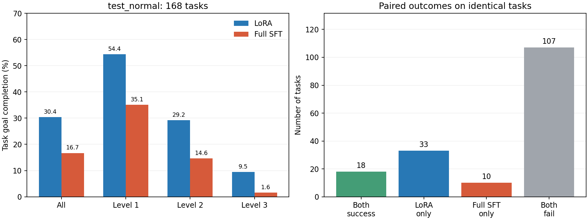
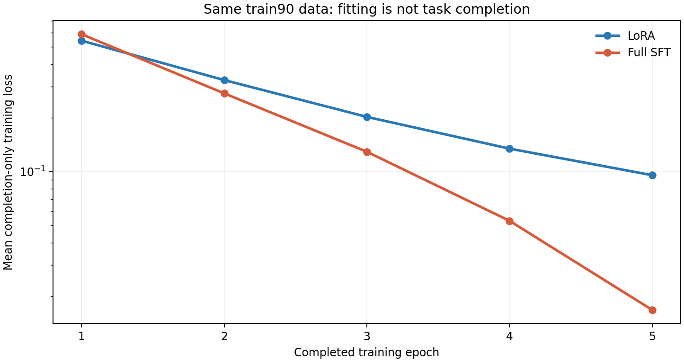

# AppWorld test_normal 168 题：train90 全参数 SFT 与 LoRA 详细对照报告

## 结论

固定第5轮全参数模型完成全部 **168/168** 道 test_normal 题和官方评分：**28/168 成功，TGC=16.7，SGC=5.4**。LoRA 为 **51/168，TGC=30.4，SGC=16.1**。成功任务相差 **-23**，TGC 相差 **-13.7 个百分点**。

本次全参数 SFT 的最终性能低于同数据、同轮数的 LoRA。两组使用相同训练数据与相同评测协议，差异没有被任务清单、提示词、输出解析器或权重损坏解释。

最直接的退化证据是：33道LoRA成功而FFT失败的题中，29道出现提交动作但业务条件仍不满足，2道耗尽步数，2道上下文中断。差距涉及任务约束理解、日期/筛选/聚合、返回结构和状态变更，也涉及错误后的修正；仅扩大窗口不能解释大部分已观察到的差额。

综合判断：当前结果更支持优先检查“小规模轨迹数据上的过度适配、更新范围与优化配置、纠错和状态核验训练不足”。这些是与证据相容的机制假设；已被直接确认的是业务结果与执行轨迹的退化，尚未用消融确定各机制的贡献。

**关于“是不是5轮太多”：目前不能下定论。** 全参数模型训练拟合更强、Dev 表现却更弱，符合过度适配的可能表现；但本次只保留第5轮权重，没有同一训练过程第1/2/3轮的 Dev 曲线，不能证明第2轮更好，更不能把全部差距归因于轮数。下文将已观察到的失败、机制假设和需要的消融分开列出。

## 1. 评测协议与完整性

- 模型固定为本次 train90 全参数 SFT 的 epoch5 / step2925，使用独立 BF16 HF 导出权重；未加载或合并 LoRA，未在测试期间更新参数。
- 官方 test_normal：168题、56个场景；与 train、dev 无任务交集。对照使用 LoRA 原始完整168题结果，不以之后24题扩窗诊断结果替换。
- ReAct agent、任务顺序、temperature=0、seed=100、每题最多50步、单次最多3000输出tokens、总上下文32000、无 reasoning parser；GPU0单进程顺序运行，与 LoRA 一致。
- 168/168 题的首次完整 messages 哈希和服务端输入token数逐题相同；所有请求的固定字段在排除模型名、服务地址、凭据后也一致，模型名另按预定目标核验。生成的 agent 配置逐字一致，实际模型服务参数由启动器覆盖；以日志和脚本快照为准。
- 5个模型权重分片 SHA-256 校验通过，文件大小及修改时间与 Dev 使用版本一致；模型的词表和 chat template 已在前次 Dev 审计中核验一致。
- 官方聚合、逐题记录和CSV覆盖相同168个唯一任务；本次进程退出码0，评分器错误0。运行审计异常：无。

## 2. 官方性能、难度与逐题变化

| 系统 | 成功任务 | TGC | SGC | 完整成功场景 | 通过测试条件 |
|---|---:|---:|---:|---:|---:|
| 原始 Qwen3-8B（历史接口） | 12/168 | 7.1 | 0.0 | 0/56 | 386/1077 (35.8%) |
| train90 LoRA | 51/168 | 30.4 | 16.1 | 9/56 | 598/1077 (55.5%) |
| 本次 train90 全参数 SFT | 28/168 | 16.7 | 5.4 | 3/56 | 498/1077 (46.2%) |

TGC 要求一个任务的全部条件通过；SGC 要求同一场景的三个任务全部成功。测试条件通过率可反映部分完成，不替代 TGC。原始基座行来自历史接口，仅提供背景；严格对齐的主要对照为本次 FFT 与 train90 LoRA。

| 难度 | 题数 | LoRA成功数（TGC） | 全参数成功数（TGC） | 成功数变化 |
|---:|---:|---:|---:|---:|
| 1 | 57 | 31 (54.4%) | 20 (35.1%) | -11 |
| 2 | 48 | 14 (29.2%) | 7 (14.6%) | -7 |
| 3 | 63 | 6 (9.5%) | 1 (1.6%) | -5 |

共同成功 **18** 题，FFT 新增成功 **10** 题，FFT 退化 **33** 题，两者均失败 **107** 题。完整168题见 [CSV](task_comparison.csv)。

FFT新增成功：3d9a636_3、a30375d_3、09b0ee6_1、522e5e5_3、270f1ff_1、90adc3f_1、13547f5_1、1150ed6_3、dac78d9_3、ffe6d5e_3

FFT退化：325d6ec_2、21abae1_1、8749218_1、8749218_3、d6ac34d_2、0d01c76_1、0d01c76_2、0d01c76_3、ff58e36_1、cef9191_2、cef9191_3、afc4005_1、afc4005_2、425a494_1、7847649_1、7847649_2、552869a_2、0de03ea_3、024c982_2、9ef798c_1、b9c5c9a_1、b9c5c9a_3、c77c005_1、c77c005_3、31dc501_2、59fae45_1、59fae45_2、0a9d82a_1、0a9d82a_2、0a9d82a_3、166f4ff_1、166f4ff_2、166f4ff_3

同一场景成功数相差至少2题的情况如下；完整56场景见 `scenario_comparison.csv`。三个变体共享场景结构，因此下方置信区间按场景整体重采样。

| 场景 | LoRA成功 | FFT成功 | 变化 |
|---|---:|---:|---:|
| `0a9d82a` | 3/3 | 0/3 | -3 |
| `0d01c76` | 3/3 | 0/3 | -3 |
| `166f4ff` | 3/3 | 0/3 | -3 |
| `59fae45` | 2/3 | 0/3 | -2 |
| `7847649` | 2/3 | 0/3 | -2 |
| `8749218` | 2/3 | 0/3 | -2 |
| `afc4005` | 3/3 | 1/3 | -2 |
| `b9c5c9a` | 2/3 | 0/3 | -2 |
| `c77c005` | 2/3 | 0/3 | -2 |
| `cef9191` | 3/3 | 1/3 | -2 |

按56个场景为单位做20,000次配对 bootstrap，TGC 差值（FFT−LoRA）的95%百分位区间为 **[-23.2, -4.2] 个百分点**。这只描述场景组成变化下的统计不确定性，不代表训练随机种子方差，也不证明差距的因果来源。随机种子和原始统计见 `summary.json`。

## 3. 性能差异具体发生在哪里

### 3.1 官方未满足条件

下表对两组使用与原 LoRA 报告相同的分类规则，统计未通过某类条件的任务数。一个任务可以属于多个类别，各行不能相加；分类描述业务结果，并非模型内部根因。

| 未通过条件类别 | LoRA | 全参数SFT | 全参数−LoRA |
|---|---:|---:|---:|
| 最终答案不匹配 | 38 | 71 | +33 |
| 笔记状态或内容错误 | 17 | 23 | +6 |
| 其他业务条件未满足 | 26 | 31 | +5 |
| 文件系统路径、目录或内容错误 | 15 | 20 | +5 |
| Spotify 播放、队列或收藏状态错误 | 27 | 31 | +4 |
| 数据库变更不符合要求 | 3 | 6 | +3 |
| 邮件状态或内容错误 | 4 | 7 | +3 |
| Venmo 好友、交易或付款状态错误 | 33 | 35 | +2 |
| 交易或购物状态错误 | 44 | 44 | +0 |
| 待办或项目状态错误 | 6 | 6 | +0 |
| 电话、消息或联系人状态错误 | 10 | 9 | -1 |
| Splitwise 或费用状态错误 | 12 | 11 | -1 |

答案不匹配进一步拆开：LoRA 有 29 题在官方trace中标记 `<<not_given>>`，另有 9 题为其他答案不匹配；FFT 分别为 48 和 23。前者通常伴随未完成提交，不能全解释成数值计算能力；后者仍需逐题看日期、筛选、聚合或回答内容。

### 3.2 轨迹终止与执行信号

为避免重复计数，终止分组按“上下文拒绝→50步上限→代码出现提交调用→其他”优先级统计。代码中出现 `complete_task` 不保证该语句实际运行成功，更不保证业务条件满足。

| 终止分组 | LoRA | 全参数SFT |
|---|---:|---:|
| 成功 | 51 | 28 |
| 上下文请求被拒绝 | 24 | 29 |
| 达到50步上限 | 5 | 19 |
| 出现提交动作但未满足官方条件 | 88 | 92 |
| 无提交动作的其他终止 | 0 | 0 |

| 伴随信号 | LoRA失败题 | 全参数失败题 | LoRA成功题 | 全参数成功题 |
|---|---:|---:|---:|---:|
| 上下文中断 | 24/117 | 29/140 | 0/51 | 0/28 |
| 出现 Python 执行/语法错误 | 93/117 | 99/140 | 25/51 | 10/28 |
| 达到50次LM请求 | 5/117 | 20/140 | 0/51 | 0/28 |
| 代码未出现提交调用 | 29/117 | 48/140 | 0/51 | 0/28 |
| 出现完全相同代码的重复 | 58/117 | 65/140 | 9/51 | 3/28 |

FFT有1题在第50次请求同时发生上下文拒绝，因此终止分组记为上下文中断；这解释了50次请求信号为20题、50步终止组为19题的差别。

Python错误有时会被后续修复，因此不能把“出现错误”直接当作失败原因。完全相同代码重复也可能是合理查询；需要结合反复相同报错、耗尽预算及最终状态判断。

| 环境反馈的异常类型（任务数） | LoRA | 全参数SFT |
|---|---:|---:|
| `Exception` | 82 | 86 |
| `NameError` | 43 | 41 |
| `KeyError` | 22 | 29 |
| `TypeError` | 28 | 16 |
| `AttributeError` | 7 | 11 |
| `StopIteration` | 10 | 5 |
| `ValueError` | 13 | 4 |
| `IndexError` | 6 | 3 |
| `UnboundLocalError` | 3 | 0 |
| `FileNotFoundError` | 1 | 0 |

### 3.3 上下文限制能解释多少差距

全参数模型有 **29** 题遇到上下文拒绝，LoRA 为 **24** 题。全参数请求中，输入自身超32000有 **12** 次，输入加预留3000输出超限有 **17** 次。

在 **33** 道 LoRA 成功、FFT 失败题中，**2** 道伴随 FFT 上下文中断，另外 **31** 道没有该中断。因此应分别讨论窗口问题和未超窗的业务/执行失败。

两组都没有上下文错误的共同子集有 **126** 题：FFT 成功 **27**，LoRA 成功 **49**。这是已观察轨迹的描述性子集，不能当作“修好上下文后”的反事实分数，正式成绩仍使用完整168题。

训练窗口40960而评测32000是与 LoRA 对齐时共同保留的限制，不是本次单独缩短 FFT 的条件。训练转换设置24000字符的 observation 裁剪阈值，记录中有9次裁剪，而评测会遇到很长的原始返回；简单扩大总窗口不保证解决错误调用或一次打印过多数据的问题。两组都存在这个分布差异，只有配对轨迹才能说明其与差距的关联。

### 3.4 输出接口是否失效

FFT 记录 **3,667** 次LM请求，其中 **3,638** 次正常回复、**29** 次错误响应。正常回复中空内容 **0** 次、无Python代码 **0** 次、输出长度截断 **1** 次；No code available observation **0** 次。

上下文被拒绝时，AppWorld 会保存带 error、零token用量和空content的占位记录；这不是模型真实生成空白，也不是 reasoning parser 吞掉代码。正常回复和被拒绝请求已分开统计。

## 4. 代表性配对轨迹证据

以下案例来自固定模型的一次正式运行，按不同失败类型选取，不能用少量案例估算全体原因占比。步号是原始环境交互编号；评分结论由官方 evaluator 给出，解释仅追溯实际执行过程。既列出退化，也列出 FFT 优于 LoRA 的反例。

### A. `8749218_1`：有明确错误反馈，仍重复同一个错误参数

- **要求**：用推荐歌曲重置 Spotify 队列，打乱并播放。LoRA **6/6 条件通过，20步**；FFT **1/6，50步耗尽**，没有上下文错误。
- **FFT过程**：第9步向 `search_songs` 传入不支持的 `access_token`，环境明确列出允许参数；第14、20、26、32、38、44、50步仍执行带同一非法参数的查询，中间反复查文档、取凭据、登录。累计8次相同类型的参数拒绝，播放队列没有发生任务要求的变更。
- **LoRA过程**：使用 `show_recommendations` 获取推荐歌曲；也经历过删除队列时参数名和动态下标错误，但随后继续清空、添加推荐歌曲、打乱和播放，全部条件通过。
- **说明**：关键差异是根据反馈修正行为并推动状态变化的能力。仅统计“有没有 Python 错误”会掩盖 LoRA 的恢复过程；FFT 并非因为生成格式失效或32K窗口而失败。

证据：[FFT交互](/root/autodl-tmp/workspace-tw/experiments/2026-09-23_070617_appworld_qwen3-8b_react_full_sft_codex_rft_train90_test_normal168/experiments/outputs/simplified_react_code_agent/alibaba/qwen3-8b-with-reasoning/test_normal/tasks/8749218_1/logs/environment_io.md:826)、[LoRA交互](/root/autodl-tmp/workspace-tw/experiments/2026-09-21_121920_appworld_qwen3-8b_react_lora_codex_rft_train90_test_normal168/experiments/outputs/simplified_react_code_agent/alibaba/qwen3-8b-with-reasoning/test_normal/tasks/8749218_1/logs/environment_io.md:1176)、[FFT官方评分](/root/autodl-tmp/workspace-tw/experiments/2026-09-23_070617_appworld_qwen3-8b_react_full_sft_codex_rft_train90_test_normal168/experiments/outputs/simplified_react_code_agent/alibaba/qwen3-8b-with-reasoning/test_normal/tasks/8749218_1/evaluation/report.md)、[LoRA官方评分](/root/autodl-tmp/workspace-tw/experiments/2026-09-21_121920_appworld_qwen3-8b_react_lora_codex_rft_train90_test_normal168/experiments/outputs/simplified_react_code_agent/alibaba/qwen3-8b-with-reasoning/test_normal/tasks/8749218_1/evaluation/report.md)。

### B. `0d01c76_2`：返回结构理解错误，最终用空内容替代应复制的正文

- **要求**：把目录里的 Markdown 文件逐个导入笔记，文件名去扩展名、下划线换空格作为标题，保留对应正文。LoRA **6/6，9步**；FFT **3/6，36步**，没有上下文错误。
- **FFT过程**：第17、25、27、32步用 `.content` 访问 API 返回的字典，收到 `AttributeError` 后仍重复；还出现未定义的 `markdown_files`。第33、34步最终改为调用 `create_note(..., content='')`，部分标题也未按要求去掉扩展名，然后提交完成。官方判定新增笔记的标题集合、正文集合及标题到正文映射不符合要求。
- **LoRA过程**：第4步打印不可序列化对象也报过错，但第6步取得文件结构，第7步用 `file['content']` 访问正文，并从文件名生成标题后创建笔记，最终通过。
- **说明**：这是返回结构、变量状态和最终内容核验的复合失败；任务已提交不等于完成。该场景三个变体 `0d01c76_1/_2/_3` 均出现 LoRA 成功而 FFT 失败，提示应在场景层面看稳定性，不能把三个相关任务当作三次独立训练实验证据。

证据：[FFT交互](/root/autodl-tmp/workspace-tw/experiments/2026-09-23_070617_appworld_qwen3-8b_react_full_sft_codex_rft_train90_test_normal168/experiments/outputs/simplified_react_code_agent/alibaba/qwen3-8b-with-reasoning/test_normal/tasks/0d01c76_2/logs/environment_io.md:622)、[LoRA交互](/root/autodl-tmp/workspace-tw/experiments/2026-09-21_121920_appworld_qwen3-8b_react_lora_codex_rft_train90_test_normal168/experiments/outputs/simplified_react_code_agent/alibaba/qwen3-8b-with-reasoning/test_normal/tasks/0d01c76_2/logs/environment_io.md:734)、[FFT官方评分](/root/autodl-tmp/workspace-tw/experiments/2026-09-23_070617_appworld_qwen3-8b_react_full_sft_codex_rft_train90_test_normal168/experiments/outputs/simplified_react_code_agent/alibaba/qwen3-8b-with-reasoning/test_normal/tasks/0d01c76_2/evaluation/report.md)、[LoRA官方评分](/root/autodl-tmp/workspace-tw/experiments/2026-09-21_121920_appworld_qwen3-8b_react_lora_codex_rft_train90_test_normal168/experiments/outputs/simplified_react_code_agent/alibaba/qwen3-8b-with-reasoning/test_normal/tasks/0d01c76_2/evaluation/report.md)。

### C. `325d6ec_2`：把“找到已下载歌曲”变成“下载一首歌曲”

- **要求**：继续切换下一首，直到遇到用户已经下载的歌曲。LoRA **5/5，18步**；FFT **3/5，16步**，没有上下文错误。
- **FFT过程**：查询已下载列表和队列后，发现候选歌曲未下载，却在第12步执行 `download_song`，随后选择一个队列位置播放并提交。官方评分显示额外改变了 `UserDownloadedSong`，且播放光标没有落在任务要求的目标歌曲。
- **LoRA过程**：多次调用 `next_song`，逐次核对该歌曲是否在原有下载集合内，到符合条件的歌曲才停止；没有额外下载，全部通过。
- **说明**：API 可以成功返回，但执行的是被改写的目标。此例主要是任务约束与状态选择错误，单纯延长窗口或增加步数并不会自动消除。

证据：[FFT交互](/root/autodl-tmp/workspace-tw/experiments/2026-09-23_070617_appworld_qwen3-8b_react_full_sft_codex_rft_train90_test_normal168/experiments/outputs/simplified_react_code_agent/alibaba/qwen3-8b-with-reasoning/test_normal/tasks/325d6ec_2/logs/environment_io.md:1798)、[LoRA交互](/root/autodl-tmp/workspace-tw/experiments/2026-09-21_121920_appworld_qwen3-8b_react_lora_codex_rft_train90_test_normal168/experiments/outputs/simplified_react_code_agent/alibaba/qwen3-8b-with-reasoning/test_normal/tasks/325d6ec_2/logs/environment_io.md:823)、[FFT官方评分](/root/autodl-tmp/workspace-tw/experiments/2026-09-23_070617_appworld_qwen3-8b_react_full_sft_codex_rft_train90_test_normal168/experiments/outputs/simplified_react_code_agent/alibaba/qwen3-8b-with-reasoning/test_normal/tasks/325d6ec_2/evaluation/report.md)、[LoRA官方评分](/root/autodl-tmp/workspace-tw/experiments/2026-09-21_121920_appworld_qwen3-8b_react_lora_codex_rft_train90_test_normal168/experiments/outputs/simplified_react_code_agent/alibaba/qwen3-8b-with-reasoning/test_normal/tasks/325d6ec_2/evaluation/report.md)。

### D. `3d9a636_3`：FFT 的新增成功，不能把所有能力都概括为退化

- **要求**：将 Venmo 好友调整为手机中标记为朋友的联系人集合，按需增删。FFT **5/5，18步**；LoRA **1/5，9步**；两者都没有上下文错误。
- **FFT过程**：最初查询不存在的 `contacts` 文档失败，随后改查有效接口；用 `relationship='friend'` 筛选手机联系人，计算两个集合的增删差集，执行加好友和移除好友，并重新查询核对后提交。
- **LoRA过程**：读取全部联系人后，对“待添加”和“待删除”使用了相同的错误集合表达式；又因好友记录不存在 `contact_id` 报错，之后直接提交，未发生要求的好友变更。
- **说明**：FFT 并未整体失去代码/API使用或错误恢复能力。总分差异应表述为这些任务上的总体泛化和执行稳定性差异，不能解释成每一道题都更差或模型权重完全损坏。

证据：[FFT交互](/root/autodl-tmp/workspace-tw/experiments/2026-09-23_070617_appworld_qwen3-8b_react_full_sft_codex_rft_train90_test_normal168/experiments/outputs/simplified_react_code_agent/alibaba/qwen3-8b-with-reasoning/test_normal/tasks/3d9a636_3/logs/environment_io.md:952)、[LoRA交互](/root/autodl-tmp/workspace-tw/experiments/2026-09-21_121920_appworld_qwen3-8b_react_lora_codex_rft_train90_test_normal168/experiments/outputs/simplified_react_code_agent/alibaba/qwen3-8b-with-reasoning/test_normal/tasks/3d9a636_3/logs/environment_io.md:1330)、[FFT官方评分](/root/autodl-tmp/workspace-tw/experiments/2026-09-23_070617_appworld_qwen3-8b_react_full_sft_codex_rft_train90_test_normal168/experiments/outputs/simplified_react_code_agent/alibaba/qwen3-8b-with-reasoning/test_normal/tasks/3d9a636_3/evaluation/report.md)、[LoRA官方评分](/root/autodl-tmp/workspace-tw/experiments/2026-09-21_121920_appworld_qwen3-8b_react_lora_codex_rft_train90_test_normal168/experiments/outputs/simplified_react_code_agent/alibaba/qwen3-8b-with-reasoning/test_normal/tasks/3d9a636_3/evaluation/report.md)。

### E. `21abae1_1`：把“本月累计”错误压缩为一个时间点的查询

- **要求**：计算本月至今向他人转出的 Venmo 金额。LoRA **2/2，11步**；FFT **1/2，10步**，两者都没有上下文错误。
- **FFT过程**：第7步以 `YYYY-MM` 同时作为查询起止边界，收到日期格式错误；第8步改成当前完整时间，但仍把 `min_created_at` 和 `max_created_at` 设为同一个值，得到空列表后直接回答0。
- **LoRA过程**：构建按月的起止边界，分页查询转出交易，对金额求和，最终答案通过官方校验。
- **说明**：把一次异常修到“不再报错”，仍可能留下错误的业务语义。正确答案需要时间范围和聚合逻辑同时正确；该题的差异与输出格式和上下文窗口无关。

证据：[FFT交互](/root/autodl-tmp/workspace-tw/experiments/2026-09-23_070617_appworld_qwen3-8b_react_full_sft_codex_rft_train90_test_normal168/experiments/outputs/simplified_react_code_agent/alibaba/qwen3-8b-with-reasoning/test_normal/tasks/21abae1_1/logs/environment_io.md:499)、[LoRA交互](/root/autodl-tmp/workspace-tw/experiments/2026-09-21_121920_appworld_qwen3-8b_react_lora_codex_rft_train90_test_normal168/experiments/outputs/simplified_react_code_agent/alibaba/qwen3-8b-with-reasoning/test_normal/tasks/21abae1_1/logs/environment_io.md:641)、[FFT官方评分](/root/autodl-tmp/workspace-tw/experiments/2026-09-23_070617_appworld_qwen3-8b_react_full_sft_codex_rft_train90_test_normal168/experiments/outputs/simplified_react_code_agent/alibaba/qwen3-8b-with-reasoning/test_normal/tasks/21abae1_1/evaluation/report.md)、[LoRA官方评分](/root/autodl-tmp/workspace-tw/experiments/2026-09-21_121920_appworld_qwen3-8b_react_lora_codex_rft_train90_test_normal168/experiments/outputs/simplified_react_code_agent/alibaba/qwen3-8b-with-reasoning/test_normal/tasks/21abae1_1/evaluation/report.md)。

### F. `3b8fb7a_2`：双方都因长观察中断，这是共同限制而非单独的FFT退化

- **要求**：依据旅行欠款笔记创建相应付款或收款请求。FFT **2/7 条件通过**，6次正常回复后第7次请求被拒绝；LoRA **2/7**，11次正常回复后第12次请求被拒绝，两者均失败。
- **FFT过程**：第6步遍历并打印好友和全部交易记录，下一次请求输入达到 **40,802 tokens**，超过32,000，尚未开始生成就被拒绝。
- **LoRA过程**：第11步批量查询并打印联系人匹配结果，下一次输入达到 **33,596 tokens**，同样被拒绝。
- **说明**：单次过量打印就能耗尽上下文，并不一定要跑到50步。此例还解释了日志中的空content：它是服务拒绝后的占位记录，不能算作模型真实输出空白。双方都失败的此题不能计入“LoRA成功、FFT失败”的差额；扩大窗口后的潜在分数本次没有测量。

证据：[FFT交互](/root/autodl-tmp/workspace-tw/experiments/2026-09-23_070617_appworld_qwen3-8b_react_full_sft_codex_rft_train90_test_normal168/experiments/outputs/simplified_react_code_agent/alibaba/qwen3-8b-with-reasoning/test_normal/tasks/3b8fb7a_2/logs/environment_io.md:1275)、[LoRA交互](/root/autodl-tmp/workspace-tw/experiments/2026-09-21_121920_appworld_qwen3-8b_react_lora_codex_rft_train90_test_normal168/experiments/outputs/simplified_react_code_agent/alibaba/qwen3-8b-with-reasoning/test_normal/tasks/3b8fb7a_2/logs/environment_io.md:1141)、[FFT官方评分](/root/autodl-tmp/workspace-tw/experiments/2026-09-23_070617_appworld_qwen3-8b_react_full_sft_codex_rft_train90_test_normal168/experiments/outputs/simplified_react_code_agent/alibaba/qwen3-8b-with-reasoning/test_normal/tasks/3b8fb7a_2/evaluation/report.md)、[LoRA官方评分](/root/autodl-tmp/workspace-tw/experiments/2026-09-21_121920_appworld_qwen3-8b_react_lora_codex_rft_train90_test_normal168/experiments/outputs/simplified_react_code_agent/alibaba/qwen3-8b-with-reasoning/test_normal/tasks/3b8fb7a_2/evaluation/report.md)。
错误响应证据：[FFT第7次请求](/root/autodl-tmp/workspace-tw/experiments/2026-09-23_070617_appworld_qwen3-8b_react_full_sft_codex_rft_train90_test_normal168/experiments/outputs/simplified_react_code_agent/alibaba/qwen3-8b-with-reasoning/test_normal/tasks/3b8fb7a_2/logs/lm_calls.jsonl:7)、[LoRA第12次请求](/root/autodl-tmp/workspace-tw/experiments/2026-09-21_121920_appworld_qwen3-8b_react_lora_codex_rft_train90_test_normal168/experiments/outputs/simplified_react_code_agent/alibaba/qwen3-8b-with-reasoning/test_normal/tasks/3b8fb7a_2/logs/lm_calls.jsonl:12)。

### G. `b9c5c9a_1`：发生在退化题中的超窗，但超窗前已经多次偏离正确过程

- **要求**：根据朋友最新的短信回复更新聚会 RSVP CSV。LoRA **7/7，26步**；FFT **1/7，24次正常回复后第25次请求被拒绝**，该次输入 **38,696 tokens**。
- **FFT过程**：第9步对不带分页参数的 `show_directory` 套用“直到空列表才结束”的循环，虽然递增 `page_index` 却没有传入接口，因此不断读取同一列表，触发单次代码1000次API请求上限。之后多次猜测不存在的CSV路径；第20和24步重复批量打印朋友消息，最终超出32K窗口。没有成功更新目标文件或提交。
- **LoRA过程**：先读取目录并定位实际文件，再按 `only_latest_per_contact=True` 检索回复；也经历了不存在接口和环境不允许的CSV函数报错，但后续采用字符串处理完成文件更新，全部通过。
- **说明**：本题确实贡献了“LoRA成功、FFT失败”的差额，且FFT终止于窗口限制；但错误分页、路径选择与重复输出在超窗前就已发生。不能把此题直接计算为“扩大窗口就能挽回的一题”，也不能把分页模板套错直接当作已经证明的训练记忆化。

证据：[FFT错误循环](/root/autodl-tmp/workspace-tw/experiments/2026-09-23_070617_appworld_qwen3-8b_react_full_sft_codex_rft_train90_test_normal168/experiments/outputs/simplified_react_code_agent/alibaba/qwen3-8b-with-reasoning/test_normal/tasks/b9c5c9a_1/logs/environment_io.md:1091)、[FFT重复消息输出](/root/autodl-tmp/workspace-tw/experiments/2026-09-23_070617_appworld_qwen3-8b_react_full_sft_codex_rft_train90_test_normal168/experiments/outputs/simplified_react_code_agent/alibaba/qwen3-8b-with-reasoning/test_normal/tasks/b9c5c9a_1/logs/environment_io.md:2866)、[FFT拒绝记录](/root/autodl-tmp/workspace-tw/experiments/2026-09-23_070617_appworld_qwen3-8b_react_full_sft_codex_rft_train90_test_normal168/experiments/outputs/simplified_react_code_agent/alibaba/qwen3-8b-with-reasoning/test_normal/tasks/b9c5c9a_1/logs/lm_calls.jsonl:25)、[LoRA文件更新与核验](/root/autodl-tmp/workspace-tw/experiments/2026-09-21_121920_appworld_qwen3-8b_react_lora_codex_rft_train90_test_normal168/experiments/outputs/simplified_react_code_agent/alibaba/qwen3-8b-with-reasoning/test_normal/tasks/b9c5c9a_1/logs/environment_io.md:1681)、[FFT官方评分](/root/autodl-tmp/workspace-tw/experiments/2026-09-23_070617_appworld_qwen3-8b_react_full_sft_codex_rft_train90_test_normal168/experiments/outputs/simplified_react_code_agent/alibaba/qwen3-8b-with-reasoning/test_normal/tasks/b9c5c9a_1/evaluation/report.md)、[LoRA官方评分](/root/autodl-tmp/workspace-tw/experiments/2026-09-21_121920_appworld_qwen3-8b_react_lora_codex_rft_train90_test_normal168/experiments/outputs/simplified_react_code_agent/alibaba/qwen3-8b-with-reasoning/test_normal/tasks/b9c5c9a_1/evaluation/report.md)。

## 5. 训练配置差异与“5轮是否太多”

| 配置 | LoRA | 全参数SFT |
|---|---|---|
| 可训练参数 | 21,823,488（LoRA r=8，alpha=16） | 8,190,735,360（约375.3倍） |
| 更新范围 | q/k/v/o、gate/up/down的低秩adapter；基座冻结 | 全部参数，包括embedding与输出层 |
| 数据/监督 | 90条成功轨迹、1170条决策样本；只监督当前completion | 相同数据SHA-256与监督目标 |
| 轮数/步数/全局batch | 5 / 2925 / 2 | 5 / 2925 / 2 |
| 学习率 | 2e-4，固定 | 峰值1e-5；88步warmup；cosine至1e-6 |
| Weight decay / dropout | 0 / LoRA dropout=0 | 0 / 未新增dropout正则 |
| 梯度裁剪 | 记录的训练循环未显式裁剪 | 全局norm=1.0 |
| 参数与计算精度 | 基座BF16、保存adapter为FP32；BF16 autocast | FP32主参数/AdamW状态、BF16计算与导出 |
| 分布式/内存实现 | DDP、标准completion掩码loss | FSDP、仅计算completion位置logits |

| epoch | LoRA平均训练loss | 全参数平均训练loss |
|---:|---:|---:|
| 1 | 0.542399 | 0.589548 |
| 2 | 0.326264 | 0.274838 |
| 3 | 0.202874 | 0.129335 |
| 4 | 0.134637 | 0.053033 |
| 5 | 0.095584 | 0.016795 |

图的纵轴为对数尺度；训练loss只是监督completion的交叉熵，不是任务错误率。两份实际训练快照的 `render_record` 函数AST一致；本次FFT训练前也通过了选定logits与完整loss的数值/逐参数梯度等价测试。详见 `config/training_objective_audit.json`。这些核验降低了明显掩码或标签移位错误的可能性，但不能排除所有训练实现影响。

两组每轮都是585步，训练数据哈希相同。第5轮平均loss分别为 **0.095584** 与 **0.016795**；90个训练内末步诊断的loss分别为 **0.048540** 与 **0.002035**。诊断样本全部参加过训练，不能作为独立验证集。

### 已有证据能支持什么

1. **全参数模型对这批数据拟合更充分，但拟合并不等于闭环泛化。** 90条轨迹产生1170个高度相关的下一步样本，不能当作1170个独立任务；这些轨迹只覆盖30个场景，一轮约94,553个被监督completion tokens；重复5遍没有增加独立任务覆盖。先前同协议Dev已是FFT 12/57、LoRA 23/57，说明低训练loss没有转化为更强的未见任务完成能力。
2. **5轮对两种方法不是等强度的训练。** 可训练参数约375倍、可改变的层和更新约束不同；全参数模型后两轮继续迅速降低训练loss，早停是值得验证的假设。但没有各轮Dev结果，不能说性能恰好从第3轮或第5轮开始下降。
3. **不能用学习率数字直接比较更新强弱。** FFT并没有照搬LoRA的2e-4，而是更低的1e-5加衰减；同时参数化、梯度裁剪、精度与优化路径都不同。现有对照无法分离学习率、轮数与参数更新范围的作用。
4. **示范状态与自主执行后的状态不相同。** 数据有90条成功轨迹，仅9条包含错误恢复；SFT在老师的历史和观察上预测下一步，评测则在学生自己行为产生的状态上继续。小错误、漏查状态或误读返回结构会改变后续输入。报告中的代码错误、重复动作和业务遗漏是可观察信号；这些信号与训练分布偏移相容，但不是单独证明机制的实验。

LoRA 的定义是冻结基座并注入低秩可训练矩阵；这限制了参数变化方式，但不能据此保证任何任务上都优于全参数训练。[LoRA原论文](https://arxiv.org/abs/2106.09685)。序列模仿学习中，后续观察依赖模型先前动作，是经典的训练/执行分布偏移问题；本实验没有额外运行相应算法来证明它能解决差距。[Ross等，2011](https://proceedings.mlr.press/v15/ross11a.html)。

训练任务难度1/2/3的数量为36/36/18，难度3占20%；test_normal难度3为63/168（37.5%）。这提示复杂任务覆盖不足是两组共有的数据限制，不能单独解释FFT相对LoRA的差额，也不能据测试题内容回填训练。

### 目前不能下的结论

- **不能确认“2轮一定比5轮好”。** 本次第2轮权重已滚动清理；旧67轨迹实验第2轮和第5轮Dev都为0/57，但其数据、学习率和数值策略不同，不能替代本次中间轮次消融。
- **不能直接宣称灾难性遗忘。** 当前只有任务域内评测，没有通用能力前后测；低秩约束可能有帮助属于合理假设，仍需对照。
- **不能把所有差距归咎于窗口、BF16或格式。** 窗口对两组一致，本文单列没有超窗的共同任务；FFT训练采用FP32主参数/状态，训练loss和权重核验正常；格式问题要依据正常回复统计而非错误占位记录。
- **不能认为更低loss就是更好的checkpoint。** 验证依据应是未参与训练的任务完成率，而非这90条训练内诊断样本。

## 6. 下一步如何验证原因

| 要验证的问题 | 建议的受控对照 | 固定条件/判据 |
|---|---|---|
| 是否训练过久 | 同一训练过程保存第1/2/3/5轮独立HF模型，在Dev逐轮评分 | 保持本次5轮共2925步的LR计划；早期只导出，不把epochs改为2来缩短cosine，否则同时改变了学习率轨迹 |
| 是否更新空间过大 | 在同数据、预先选定训练预算下对照LoRA、部分层解冻、全参数 | 比较Dev任务/场景成功率与训练loss的分离，不能只看拟合 |
| 学习率或正则是否不合适 | 固定轮次、分别改变LR或weight decay，先在train内留出的独立任务/Dev验证 | 一次控制一个主要因素，使用多种子或报告波动 |
| 错误恢复与状态核验不足 | 只在训练任务上增加学生错误状态下的纠错、分页、提交前状态核验轨迹 | 不复制test轨迹或私有evaluator信息回训练 |
| 长返回导致超窗 | 在train/Dev上比较受控输出、结构化摘要与更长窗口 | 单列窗口拒绝率及剩余业务失败；不把窗口变大等同于能力提升 |

为兼顾存储，后续可逐轮完成Dev评测后只保留最佳轮和最终轮的独立BF16推理模型，完整续训状态继续滚动保留；这样无需长期保存每轮的optimizer大文件，也不会在尚未评测时丢失早期候选。

本次没有执行上述额外训练或调参。这里是固定模型测试后的诊断，后续超参选择使用train/Dev；已经观察过本测试集的详细失败后，应避免把反复针对这些题改动后的复测当成新的未经观察盲测。

## 7. 运行成本与产物

| 项目 | LoRA | 全参数SFT |
|---|---:|---:|
| LM请求（含拒绝） | 3,429 | 3,667 |
| 正常模型回复 | 3,405 | 3,638 |
| AppWorld API调用 | 12,305 | 9,693 |
| API文档查询 | 1,831 | 2,132 |
| 输入tokens | 38,164,179 | 41,490,992 |
| 输出tokens | 335,660 | 285,283 |
| 总tokens | 38,499,839 | 41,776,275 |
| 重复的相同代码动作 | 355 | 934 |

正式评测墙钟时间：FFT **83.1分钟**，LoRA **108.1分钟**。运行时间包含模型启动、官方聚合评分和服务收尾；不同轨迹、加载方式与缓存命中均可能影响墙钟。token数是API记录的逻辑用量，不等于实际计算量；本次未做独立的推理速度基准。

两者共同成功的 18 题上，总token开销：FFT 1,481,978，LoRA 1,645,153。这是同一成功子集的描述性成本；总体API调用少可能只是更早失败，不能自动解释为效率更高。

- `task_comparison.csv`：168题逐题结果、条件通过数、主要终止类型和LoRA差异；`scenario_comparison.csv`：56场景的配对成功数。
- `metrics/full_sft_rollout_analysis.json`、`metrics/lora_rollout_analysis.json`：相同规则生成的逐题执行信号和证据路径。
- `summary.json`：官方指标、配对转移、难度、场景bootstrap与训练对照。
- `CASE_STUDIES.md`：配对轨迹案例；`metrics/*.png`、`metrics/*.pdf`：性能与训练loss图。
- `experiments/outputs/.../evaluations/test_normal.json`：官方结果；`tasks/`保留实际交互、环境和evaluator证据，仅本地保存。
- `manifest.json`、`config/`、`scripts_snapshot/`、`artifacts.sha256`：固定模型来源、协议、代码快照与校验。
- 模型路径：`/root/autodl-tmp/workspace-tw/experiments/2026-09-23_093106_appworld_qwen3-8b_full_sft_codex_rft_train90_epoch5/artifacts/model`。评测目录不复制模型权重。
- 关联记录：[本次训练报告](/root/autodl-tmp/workspace-tw/experiments/2026-09-23_093106_appworld_qwen3-8b_full_sft_codex_rft_train90_epoch5/REPORT.md)、[前次Dev57报告](/root/autodl-tmp/workspace-tw/experiments/2026-09-23_062600_appworld_qwen3-8b_react_full_sft_codex_rft_train90_dev57/REPORT.md)、[LoRA原始test报告](/root/autodl-tmp/workspace-tw/experiments/2026-09-21_121920_appworld_qwen3-8b_react_lora_codex_rft_train90_test_normal168/REPORT.md)。
