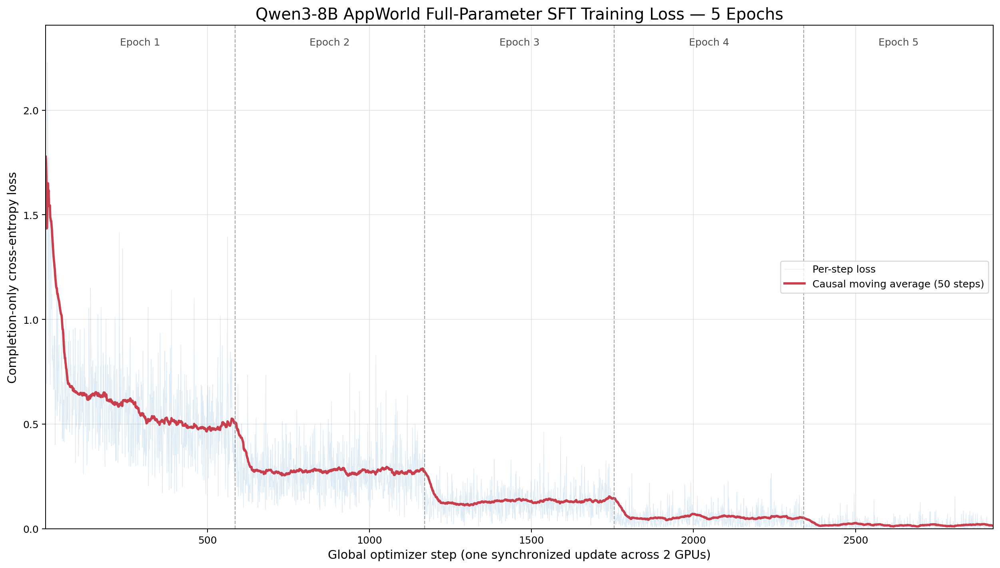
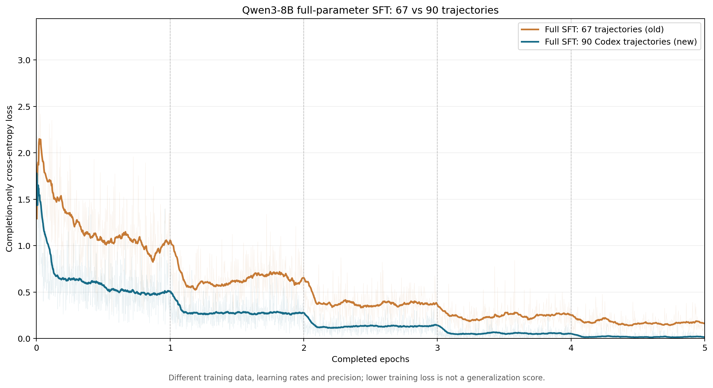

# AppWorld Codex-RFT train90：Qwen3-8B 全参数 SFT 五轮实验报告

## 结论

本次累计完成 **5 个 epoch、2925 个双卡同步 optimizer steps**。训练状态为 **SUCCESS**，包括模型重载检查的综合状态为 **SUCCESS**。

从原始 Qwen3-8B 初始化，**8,190,735,360/8,190,735,360 个参数（100%）均参与优化**，未加载或合并 LoRA。最终完整模型位于 `artifacts/model/`，可供 Transformers 或 vLLM 后续加载。

前 50 步平均 loss 为 **1.018503**，后 50 步为 **0.014466**。这些数值描述训练拟合，不能代替 AppWorld Dev/test 的端到端能力评测。本实验未运行 Dev 或 test_normal。

## 数据与对照边界

- 数据与 2026-09-21 的 train90 LoRA 相同：90 个任务、90 条 Codex 成功轨迹、1170 个决策样本；难度 1/2/3 为 36/36/18。
- train.jsonl SHA-256：`1f5ea51ea22ce7ef6b84d3e16bbb25976179064f7c8d0483ab7dcb0118ed3220`。
- 训练序列 token min/p50/p95/max：3181/7249/16040/37015；最大窗口 40960，训练额外 token 截断 **0 条**。原转换数据已有 observation 脱敏与字符级裁剪，这里没有更改该数据版本。
- 只监督当前 assistant completion；prompt 和 padding 不参与 loss；chat template 使用 `enable_thinking=False`。
- 90 条训练内诊断样本来自每个任务的最后决策，全部与训练集重叠，不是独立验证集。
- 同数据 LoRA 参考：`/root/autodl-tmp/workspace-tw/experiments/2026-09-21_015238_appworld_qwen3-8b_lora_codex_rft_train90_epoch5`。本实验改变了参数更新范围、学习率/调度和数值精度策略，不是只改变一个变量的消融实验。

## 实际训练设置

| 项目 | 实际设置 |
|---|---|
| 基座 | `/root/autodl-tmp/models/Qwen3-8B` |
| GPU | 2 × NVIDIA RTX PRO 6000 Blackwell Server Edition |
| 框架 | PyTorch 2.8.0+cu128；Transformers 4.56.2 |
| 分布式 | 两张 GPU，FSDP FULL_SHARD，按 Qwen3DecoderLayer 包装 |
| 参数 / 梯度归约 / AdamW 状态 | FP32 |
| 前后向计算 / 最终 HF 权重 | BF16 |
| attention / KV cache | SDPA / 训练关闭 cache |
| 每卡 batch / 全局 batch / 梯度累积 | 1 / 2 / 1 |
| epoch / 每轮步数 / 总步数 | 5 / 585 / 2925 |
| optimizer | fused AdamW，betas=(0.9,0.999)，eps=1e-8，weight_decay=0 |
| LR | 峰值 1e-5；88 步 linear warmup；cosine 衰减至 1e-6 |
| 梯度裁剪 | global norm 1.0 |
| seed | 20260921，与同数据 LoRA 对齐 |
| 激活策略 | reentrant gradient checkpointing；未启用 activation CPU offload |
| loss 归约 | 每个样本对 completion token 求均值，再在两个 rank 间平均 |

## 显存优化与预检

旧实现虽然屏蔽了 prompt label，仍对完整长序列构造词表 logits。本次只对预测 completion 的 hidden-state 位置计算 logits，并保持 causal 标签移位正确；全部上下文仍经过 transformer，梯度回传到全部参数。

正式训练每卡 batch=1，不再把序列补齐到 8 的倍数，避免仅为末尾 padding 生成长序列的显式 attention mask，让 SDPA 使用原生 causal/GQA 路径；真实输入和监督 token 不变。CPU 回归测试另外比较了有/无末尾 padding 的 loss 与全部参数梯度。20 步 GPU 压力预检使用此前 padding=8 的较高开销路径，正式训练的实际 padding 设置为 1。

CPU 微型 Qwen3 回归测试覆盖不同 completion 长度、padding、首个目标 token，并逐参数比较 loss/梯度；另验证了恢复后的下一次更新和 scheduler 与连续执行完全一致。记录见 `logs/00_cpu_tests.log`。

正式训练前完成 **20 步真实双卡压力预检**：先用短样本初始化 AdamW 状态，覆盖最长 6 条样本、最长 completion、16K/24K 附近长度和长短交替，并交换 rank。第 10 步保存 FP32 参数与 optimizer 后退出进程，重新加载继续至第 20 步，随后完成诊断 forward。两个进程阶段的峰值 allocated 分别合并为 rank0=76.53 GiB、rank1=76.53 GiB。

首次真实恢复预检曾因两个 rank 的 elapsed_seconds 微小差异被元数据检查误判失败；随后修复为 rank0 广播共享进度，并加入双 CPU 进程恢复回归测试。保留原日志 `logs/03b_stress_resume_initial_failure.log`。重新验证时只对这次经审查的代码修改显式放宽源码哈希一致要求，数据、训练参数、依赖及分片拓扑校验保持不变；正式训练不使用此豁免。

probe 的权重和续训状态已在验证成功后清理；正式训练重新从原始基座初始化，不继承 probe 更新。确定顺序见 `config/probe_schedule.json`。

## 五轮 Loss

| epoch | 步数 | 本次平均 loss | 本次前20步 | 本次后20步 | 旧67轨迹平均 loss |
|---:|---:|---:|---:|---:|---:|
| 1 | 585 | 0.589548 | 1.431749 | 0.484731 | 1.166161 |
| 2 | 585 | 0.274838 | 0.333468 | 0.244486 | 0.629038 |
| 3 | 585 | 0.129335 | 0.108576 | 0.132205 | 0.371676 |
| 4 | 585 | 0.053033 | 0.052603 | 0.051569 | 0.239390 |
| 5 | 585 | 0.016795 | 0.012493 | 0.007360 | 0.166918 |

本图浅蓝线为逐步 loss，红线为向后 50 步移动平均，虚线分隔 epoch。可下载 [PDF](metrics/loss_curve_total_5epochs.pdf) 和 [逐步 CSV](metrics/loss_history_5epochs.csv)。

比较图按完成的 epoch 数对齐，分别用约 0.1 个 epoch 的因果移动平均（旧 32 步、新 58 步）。另有 [PDF](metrics/loss_curve_compare_full_sft_67_vs_90.pdf)、[对比 CSV](metrics/loss_comparison_67_vs_90.csv) 和 [结构化摘要](metrics/loss_comparison_summary.json)。

旧实验为 67 任务/640 样本、最长 25070 tokens、2e-4 固定 LR、BF16 主参数/优化器状态；本次为 90 任务/1170 样本、最长 37015 tokens、1e-5 调度 LR、FP32 主参数/状态。数据来源、规模、学习率和数值实现不同，曲线只能描述各自训练集的拟合过程，不能证明泛化能力谁更好。旧实验 Dev 退化的具体原因也没有通过本次训练被隔离证明。

## 资源、耗时与保存策略

| rank | 正式训练峰值 allocated（GiB） | 恢复后进程峰值 reserved（GiB） |
|---:|---:|---:|
| 0 | 72.18 | 93.97 |
| 1 | 72.28 | 94.09 |

- 从首次正式启动至最终模型导出的实际墙钟时间：**3.36 小时**，包括数据/模型加载、第 100 步保存与恢复切换、各轮保存、诊断和导出；不含此前 probe 与之后重载生成。起始时间见 `config/execution_timing.json`，结束时间见 `metrics/metrics.json`。
- Trainer 累计计时为 **3.21 小时**；恢复沿用保存前的计时值，因此不含第 100 步保存本身、切换间隔和重新加载时间。
- 每 5 秒采样的容器 RAM 使用峰值约 **132.17 GiB**，容器上限 220 GiB；采样可能漏掉更短暂的峰值。
- 采样到的最小磁盘可用量约 **4.98 GiB**。资源原始记录：`logs/resource_usage.jsonl`。
- cgroup memory.events 采样起点：`low 0; high 0; max 3462; oom 0; oom_kill 0`；报告生成前末次：`low 0; high 0; max 3462; oom 0; oom_kill 0`。
- 因初始可用磁盘约 197 GiB，本次采用**滚动完整续训状态 + 最终 HF 模型**，未保留 epoch 1–4 的独立 HF 权重。所有 epoch 的逐步 loss 均保留。
- 训练期间按用户要求每轮结束（每 585 步）保存一次 `artifacts/restart/` 下的完整 FP32 参数分片、AdamW、scheduler、各 rank RNG、步数和采样进度。当时仅保留最新一份完整续训状态；新状态全部写入并落盘后，才移除本实验的旧状态，原子替换期间短暂存在两份。
- 正式训练第 100 步完成一次临时保存，用于将最初的每 100 步保存策略改为每轮保存；随后严格校验训练代码、数据和超参数，从该步恢复 FP32 参数、AdamW、scheduler、RNG 和采样进度，没有重新初始化或重跑训练。切换记录见 `config/checkpoint_cadence_change.json`，恢复命令见 `command_resume.txt`。
- 训练结束后，按用户要求于 2026-09-23T06:14:20.810710+00:00 清理第 2925 步完整续训状态，删除文件共 91.54 GiB。最终 BF16 模型 `artifacts/model/` 已通过 SHA-256 校验并保留，可继续推理、评测或另起微调；无法恢复此次优化器、scheduler 和 RNG 状态。轻量元数据见 `config/final_checkpoint_metadata.json`，清理记录见 `metrics/checkpoint_cleanup.json`。

## 诊断、模型重载与产物核验

- 训练内 token 加权诊断 loss：**0.002035**；perplexity：**1.002037**。
- 最终模型从磁盘重新加载并生成 ReAct Python：**PASS**；非空 Python fenced code block 数为 1。此检查仅验证模型可加载和输出格式，不执行 AppWorld 任务。
- 完整指标：`metrics/metrics.json`；连续 2925 步历史：`metrics/training_history.jsonl`。
- 最终权重 SHA-256：`metrics/final_model_weights.sha256`；代码、配置及轻量产物清单：`artifacts.sha256`。
- 独立产物核验：**PASS**；完整 399 个 BF16 tensor 的名称/形状与基座一致，权重 SHA-256、数据/训练源码哈希、五轮连续日志及检查点保留情况均通过。详见 [核验 JSON](metrics/final_artifact_validation.json)。
- 配置、代码快照及复现命令分别位于 `config/`、`scripts_snapshot/`、`command.txt`；数据和原始基座均未修改。

## 后续评测

建议使用本次最终 epoch 5 模型与同数据 LoRA 对齐 AppWorld Dev 57 题：相同 ReAct prompt、无 reasoning parser 的输出接口、temperature=0、seed=100、最多 50 步、每次最多 3000 输出 tokens、推理 context=32000。训练窗口为 40960 不意味着评测自动扩窗；如比较扩窗效果，应为双方另设同条件实验。

本次没有保留中间独立 HF 模型，不能按原计划在五个 epoch 间选模。先报告固定最终模型的 Dev 结果，再决定独立 test_normal 评测；测试集反馈不用于训练或选择 checkpoint。
