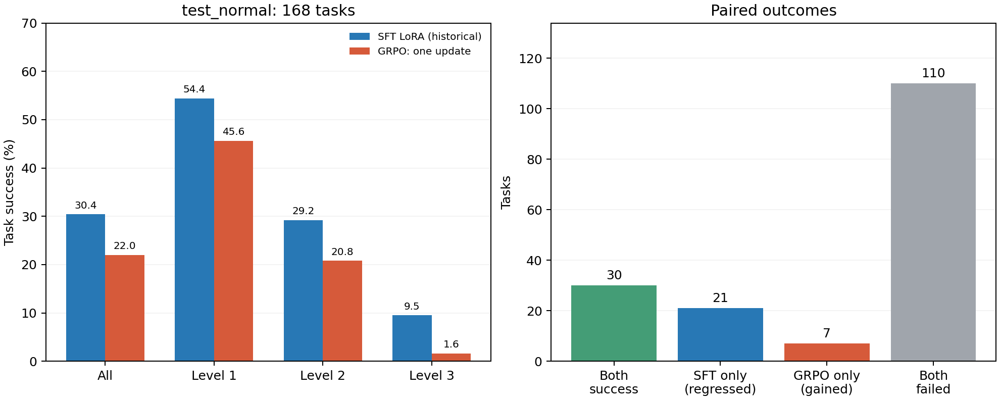

# GRPO 单次更新：test_normal168 评测与诊断

固定更新后的模型完成 **168/168** 题，成功 **37/168**，TGC **22.0%**，SGC **16.1%**。相对更新前 SFT LoRA 历史成绩，成功数变化 **-14**，TGC 变化 **-8.3 个百分点**。

| 模型 | 成功题数 | TGC | SGC | 完整成功场景 | 通过测试条件 |
|---|---:|---:|---:|---:|---:|
| 更新前 SFT LoRA（历史） | 51/168 | 30.4% | 16.1% | 9/56 | 598/1077 |
| GRPO 单次更新 | 37/168 | 22.0% | 16.1% | 9/56 | 594/1077 |
| 参考全参数 SFT（历史） | 28/168 | 16.7% | 5.4% | 3/56 | 498/1077 |

TGC 要求一题的全部官方条件通过；SGC 要求同一场景的三题全部通过。

同一 checkpoint 的 dev57 为 23/57 → 16/57，TGC 40.4% → 28.1%。[Dev 报告](/root/autodl-tmp/workspace-tw/experiments/2026-10-11_appworld_qwen3-8b_react_lora_static_grpo_train90_single_update_dev57/REPORT.md)。Dev 与 test 分开汇报，不合并为一次重复实验。

## 逐题变化与难度

| 难度 | 题数 | 更新前成功 | GRPO 成功 |
|---|---:|---:|---:|
| 1 | 57 | 31 | 26 |
| 2 | 48 | 14 | 10 |
| 3 | 63 | 6 | 1 |

共同成功 30 题，GRPO 新增成功 7 题、退化 21 题，两者均失败 110 题。

退化的 21 题中，16 题只少通过一个条件，就从成功变成失败。所有条件累计通过数仅从 598 变为 594：退化题减少 29 条，新增成功题增加 17 条，两者均失败的题合计增加 8 条。这解释了为什么 TGC 明显下降，而条件通过总数接近；部分进展不能替代一题全部条件通过。

完整成功场景的数量均为 9，但不是同一批场景：共同成功 5 个，新增 4 个、退化 4 个。

新增成功：024c982_1、09b0ee6_1、13547f5_1、325d6ec_1、7847649_3、8749218_2、a30375d_3

退化：09b0ee6_2、0a9d82a_1、0a9d82a_3、0de03ea_3、1150ed6_2、425a494_1、552869a_2、59fae45_1、7847649_1、7847649_2、9ef798c_1、afc4005_1、afc4005_2、b9c5c9a_1、b9c5c9a_3、c77c005_1、c77c005_3、cef9191_1、d6ac34d_2、ff58e36_2、ff58e36_3

56 个场景整体配对 bootstrap（20,000 次，seed=20261011）的 TGC 差值 95% 区间为 [-14.9, -1.8] 个百分点。它只反映场景组成的不确定性，不衡量训练或推理 seed 波动，也不是原因归属的证据。

[逐题对照 CSV](task_comparison.csv) · [场景对照](scenario_comparison.csv) · [全部输入输出](TASKS.md)

## 性能变化出现在哪里

| 终止分组 | SFT LoRA | GRPO |
|---|---:|---:|
| 成功 | 51 | 37 |
| 上下文请求被拒绝 | 24 | 24 |
| 达到50步上限 | 5 | 7 |
| 出现提交动作但未满足官方条件 | 88 | 100 |
| 无提交动作的其他终止 | 0 | 0 |

在 21 道退化题中，终止分组为：{"出现提交动作但未满足官方条件": 21}。其中 0 题发生上下文中断。该分类描述观察到的终止方式，不等同于可由扩窗挽回的题数。

| 未满足条件类别（任务数，可重叠） | SFT LoRA | GRPO |
|---|---:|---:|
| Splitwise 或费用状态错误 | 12 | 12 |
| Spotify 播放、队列或收藏状态错误 | 27 | 27 |
| Venmo 好友、交易或付款状态错误 | 33 | 33 |
| 交易或购物状态错误 | 44 | 44 |
| 其他业务条件未满足 | 26 | 28 |
| 待办或项目状态错误 | 6 | 7 |
| 数据库变更不符合要求 | 3 | 5 |
| 文件系统路径、目录或内容错误 | 15 | 15 |
| 最终答案不匹配 | 38 | 51 |
| 电话、消息或联系人状态错误 | 10 | 10 |
| 笔记状态或内容错误 | 17 | 15 |
| 邮件状态或内容错误 | 4 | 6 |

上表类别可重叠。出现 complete_task 代码或一次 API 调用不保证执行成功；Python 错误可能被后续修复，重复代码也可能是必要查询。具体判断需看成对轨迹和官方失败条件。

[代表性配对轨迹分析](CASE_STUDIES.md)

## 为什么一次 GRPO 不保证提升

本次的“一遍”是全量 540 条轨迹累计后的一次参数更新，并不是论文训练循环的一整段。首先应区分更新方向、更新幅度和训练预算。训练奖励与官方成功整体相关，但二者并非同一目标；一次正确执行的梯度更新仍可能降低 greedy 闭环任务成功率。

- 540 条训练轨迹中，reward 与官方成功的 Pearson 相关约 0.731；混合组内 420 个成功/失败配对有 398 个排序正确、19 个反向、3 个打平。因此不能笼统归因于 judge 乱打分。
- 280 条正优势轨迹包含 122 条官方失败；27 条成功轨迹被赋予负优势。失败的正优势中 67 条来自六条全部失败的组，另外 55 条来自混合组。部分完成的正反馈本身合理，但它不是“只强化成功解”。
- 已确认的训练例子：e7a10f8_3 的 sample=4（第 5 次尝试）把最长歌单误算成所有歌单总时长。judge 指出聚合错误，但其余通用条目通过后 reward=8、advantage≈0.549，错误计算 token 同样得到正向梯度。
- 全轨迹共享 advantage 会把正轨迹中的错误步骤一起强化，也会把负轨迹中的正确步骤一起压制。本次按静态、无 step-credit 基线实现；这是一项方法限制，不能据此认定实现错误。
- 初始 policy=reference，唯一 backward 时 KL 的数值和一阶梯度均为 0。日志中的 KL=0、ratio≈1、clip_fraction≈0.004 是更新前指标，不能说明更新后受到强约束。
- 新建 AdamW 的第一步与保存权重吻合到 3.73e-9；94.28% 参数坐标变化至少为 0.9×学习率。累计更多轨迹可以降低采样方差，却不会自动按轨迹数缩小 AdamW 第一步的每坐标步长。是否学习率过大仍需低学习率对照，现有参数范数不足以证明。

补充只读检查：在固定的 12 道训练题、24 个动作、1701 个 token 上下文上，词表全分布 KL(initial‖updated) 平均 0.002729 nats，greedy 下一 token 改变 0.88%，记录 token 的概率比超出 [0.8,1.2] 的比例为 0.88%。这说明更新后的分布确有变化；该固定历史小样本不是完整 rollout KL，也不能单独证明步长过大。[诊断数据](metrics/post_update_probe.json)。

训练数据、奖励冲突实例、优化器推导、论文差异及验证优先级详见 [训练原因分析](TRAINING_DIAGNOSIS.md)。这些证据提供具体机制和排查顺序，尚未分离各机制对测试差额的因果贡献；本次没有追加训练或根据 test 选参。

## 协议与完整性

- 固定完整 train90 单次更新的 step06 LoRA；评测前后核对 adapter、配置及 optimizer 文件 SHA-256，模型未改变。
- 官方 test_normal168、56 场景、1077 条条件，与 train90/dev57 无交集；每题一条真实轨迹及唯一终态结果。
- 沿用参考实验的 ReAct、temperature=0、seed=100、50 步、3000 输出 tokens、32000 窗口、无 reasoning parser、不覆盖 enable_thinking。
- 两张卡各运行 84 题/28 个完整场景，分片内部保留原顺序；相对历史单卡，这改变了调度。最终在原始完整任务清单上调用官方 evaluator 聚合，而非平均两个分片分数。
- 168/168 首次完整 messages 与两份历史评测一致；首请求 token 数与初始 LoRA 一致；所有实际请求固定字段均一致，模型名按新 checkpoint 单独核验。
- 两个分片、合并逐题记录及全量官方结果一致；无漏题、重复题或评分器故障；模型调用中的上下文拒绝按原协议计入。
- 正常回复空内容 0 次，无 Python 代码 0 次，输出截断 1 次。

## 运行成本与产物

| 项目 | SFT LoRA（历史） | GRPO |
|---|---:|---:|
| 模型请求 | 3,429 | 3,521 |
| AppWorld API 调用 | 12,305 | 14,557 |
| 输入 tokens | 38,164,179 | 39,561,003 |
| 输出 tokens | 335,660 | 340,495 |
| 完全相同代码的重复次数 | 355 | 375 |

两卡并行墙钟 57.2 分钟（含启动、两个分片及全量官方聚合）；这不是单卡速度对照。

最终 adapter：`/root/autodl-tmp/workspace-tw/experiments/2026-10-08_static_rubric_grpo_lora_init/runs/step06_train90_two_gpu_v1/checkpoint`。

- `summary.json`、`task_comparison.csv`、`scenario_comparison.csv`：官方指标与成对变化。
- `TASKS.md`、`trajectory_index.json`：168 题的模型输入输出、环境交互与官方判分入口。
- `metrics/`：前后执行信号、训练奖励诊断、权重更新诊断、图表。
- 报告生成使用已有训练环境中的 NumPy/Matplotlib；首次后处理的依赖缺失和 probe 布尔统计类型问题均已修复，原始失败日志保留，正式 168 条轨迹没有重跑。
- `workers/gpu0`、`workers/gpu1`：两个原始分片的真实轨迹、日志与逐题评分；根输出通过链接汇总。
- `scripts_snapshot/`、`config/`、`artifacts.sha256`：实际代码、冻结配置与校验。
