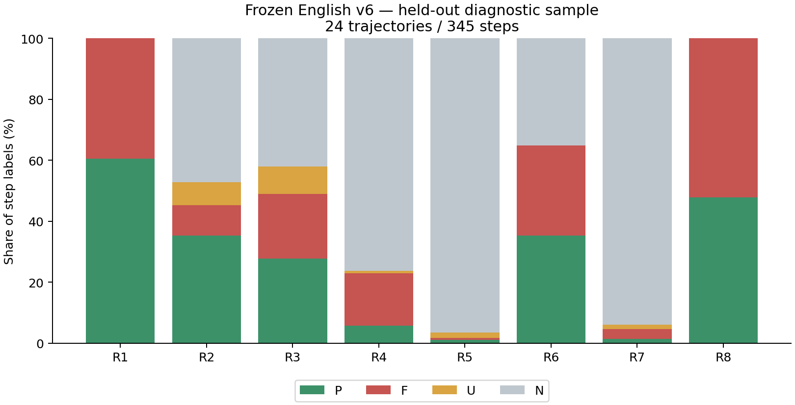

# 英文 v6 小规模验证与优化报告

完成时间：2026-10-13T10:41:04.533048+00:00。最终候选：`assets/prompt_v6_en_format.txt`，SHA256 `df4e8fb406551f2d90e38bbe83838db181bda18e01d947b236ee10a05c633109`。

## 结论

英文 v6 能识别多类明显的执行、实际写入和虚假完成错误；本轮保留原英文 v6 的判定语义，仅优化短理由输出。尝试的两轮语义扩写没有带来稳定的一致性收益，未采用。该候选可继续作为实验性评分提示词，但本次证据不足以认定其优于中文版本，也不足以当作稳定金标直接替换全量训练筛选。

冻结后 24 条留出轨迹的 44 个定向边界检查匹配 42 个；这是同一助手基于证据做的案例核对，不是独立人工金标，也不是总体准确率。留出 4 条重复的标签一致率为 96.1%，但开发集已取得的 4 条困难轨迹的最终候选重复一致率为 81.0%。两者样本难度不同，不能只引用较高值。

## 实验设置与隔离

共 36 条原始 Qwen3-8B AppWorld 轨迹、636 个唯一 step：开发集 12 条/291 步（5 成功、7 失败，8 个家族），留出集 24 条/345 步（8 成功、16 失败，21 个家族）。开发与留出家族不重叠。留出轨迹此前做过 v5 评分，因此不是历史上未见数据。官方成败和旧评分只用于抽样及事后描述，没有发送给 judge。

Judge 为远程 `gpt-5.6-sol`，reasoning effort=high；使用现有 Codex 登录。每次调用只读冻结轨迹，不执行轨迹代码，不调用工具；没有启动本地 GPU 推理或修改 LoRA SFT。模型使用别名，未取得可长期固定的服务端快照 ID。每阶段 2 并发；部分阶段同时运行，实际峰值见下方资源记录。

开发原版、r1、r2 各为 12 次主评分+4 次重复；最终格式版在相同 4 条困难开发轨迹上各评分两次，再评分 24 条留出+4 次重复。最终格式版实际覆盖 28 条唯一轨迹/488 步，不能把早期版本全部 36 条的结果当作最终版本结果。

计划 84 次评分，完成 84 次有效评分、0 次重试耗尽失败；共 90 次实际尝试（含重试）。每条取首个满足 schema 的有效响应，不按标签质量选择输出，不手动截断理由；无效响应全部保留。没有启动全量 540 条评分。

## 提示词迭代

| 版本 | 改动 | 开发边界检查 | 开发重复一致率（实际配对数见下文） |
|---|---|---:|---:|
| development | 原英文 v6 | 27/33 | 87.4% |
| development_r1 | 加强 R5 修改前拒绝/部分写入区别，缩短理由 | 29/33 | 86.0% |
| development_r2 | 再澄清 F/U、局部证据、认证、失败循环、R7 | 30/33 | 84.0% |
| development_format | 恢复原 v6 规则，仅保留短理由要求 | 15/16 | 81.0% |

各版本都有有效重复结果的共同轨迹：`60d0b5b_2__03, b0a8eae_3__03, b7a9ee9_1__05, e7a10f8_1__05`。其配对一致率如下（仍然不是准确率或显著性比较）：

| 版本 | 共同轨迹数 | 配对标签数 | 一致率 |
|---|---:|---:|---:|
| development | 4 | 1144 | 87.4% |
| development_r1 | 4 | 1144 | 86.0% |
| development_r2 | 4 | 1144 | 84.0% |
| development_format | 4 | 1144 | 81.0% |

最终格式版重复取得 4/4 条有效配对。

最后一行只评 4 条开发轨迹，其边界检查分母较小。旧 v5 的 52 项回归检查原版为 52/52、r1 为 49/52、r2 为 50/52；这些历史预期有语义版本依赖，不能当中英文优劣实验。新开发检查 33 项中有 4 项在首轮结果复核后加入，且与旧检查有重叠，不能相加作为独立样本。

最终候选在读取本次留出标签前冻结。冻结时格式复测仍在运行；不再依据后续复测或留出结果修改文字。`DEVELOPMENT_DECISION.json` 保存当时的阶段性数值；本报告使用所有任务完成后的最终数值，两者可能不同。

**保留的改动**：在 Evaluation Evidence 解释 P/F/U/N，输出只用单字母；理由目标不超过 45 个字符、硬上限 60，并要求返回前核对长度。其 `[Output]` 之前的全文与原英文 v6 完全相同。

原版 16 次评分的首次尝试通过 13/16，发生 4 次超长理由失败。最终格式版 36 次有效评分，共 38 次尝试；已完成远程响应 36 次，观察到 0 次 JSON/schema 格式失败。网络/超时失败单独列在资源记录中，不能算作格式改进效果。样本小且存在不同轨迹，不能据此声称统计显著的提升。

## 冻结候选的留出标签分布

| Rubric | P | F | U | N | 适用比例 | P/(P+F) |
|---|---:|---:|---:|---:|---:|---:|
| R1 | 209 | 136 | 0 | 0 | 100.0% | 60.6% |
| R2 | 122 | 34 | 26 | 163 | 52.8% | 78.2% |
| R3 | 96 | 73 | 31 | 145 | 58.0% | 56.8% |
| R4 | 20 | 59 | 3 | 263 | 23.8% | 25.3% |
| R5 | 4 | 2 | 6 | 333 | 3.5% | 66.7% |
| R6 | 122 | 102 | 0 | 121 | 64.9% | 54.5% |
| R7 | 5 | 11 | 5 | 324 | 6.1% | 31.2% |
| R8 | 165 | 180 | 0 | 0 | 100.0% | 47.8% |

适用比例 = (P+F+U)/全部 step；确定判断中的通过比例 = P/(P+F)。N 不应作为失败，也不应当作通过计入；U 应保留为证据不足。以上比例描述当前抽样，不代表全量数据总体。R5/R7 的适用性与轨迹所处阶段相关，稀少不能直接推出 rubric 无用。

## 重复稳定性：不能让 N 掩盖稀有维度的不稳定

| 集合 | Rubric | 全标签一致 | 至少一次非 N 的配对数 | 其中一致 | Cohen κ |
|---|---|---:|---:|---:|---:|
| development | R1 | 143/143 | 143 | 143 | 1.000 |
| development | R2 | 91/143 | 109 | 57 | 0.509 |
| development | R3 | 86/143 | 125 | 68 | 0.496 |
| development | R4 | 91/143 | 87 | 35 | 0.378 |
| development | R5 | 142/143 | 2 | 1 | 0.747 |
| development | R6 | 133/143 | 117 | 107 | 0.889 |
| development | R7 | 101/143 | 59 | 17 | 0.333 |
| development | R8 | 140/143 | 143 | 140 | 0.956 |
| holdout | R1 | 51/51 | 51 | 51 | 1.000 |
| holdout | R2 | 49/51 | 30 | 28 | 0.933 |
| holdout | R3 | 44/51 | 36 | 29 | 0.789 |
| holdout | R4 | 47/51 | 18 | 14 | 0.837 |
| holdout | R5 | 51/51 | 3 | 3 | 1.000 |
| holdout | R6 | 49/51 | 32 | 30 | 0.939 |
| holdout | R7 | 51/51 | 3 | 3 | 1.000 |
| holdout | R8 | 50/51 | 51 | 50 | 0.960 |

κ = (pₒ − pₑ)/(1 − pₑ)，pₒ 为观察一致率，pₑ = Σₗ p₁(l)p₂(l)，l ∈ {P,F,U,N}。它校正边际分布产生的机会一致，但仍不等于正确率；单一标签使分母为 0 时记为未定义。每组仅 4 条重复轨迹，step 高度相关，不把所有标签格当成独立样本计算窄置信区间。

最明显的不稳定来自 `e7a10f8_1__05`：后半段反复输出“最长歌单时长是：”并执行同一个变量表达式，实际 observation 没有数值。两次评分对这属于持续作答还是中间重复、是否应重新评 R2/R3/R4/R7 的理解不同，一次产生大段 U/F，另一次产生大段 N。因此少量长轨迹会显著影响 step 加权一致率。每轨迹宏平均、完整转移矩阵和标签筛选变化都已保存。

## 边界复核与已知局限

留出检查来自原始输入，在查看当前留出评分前写入并复核，共 44 项、匹配 42 项。初稿 46 项，移除两项仅凭缺少完成接口便断言 R3 错误的过强预期；另修正一个 rollout 编号笔误。修改记录保留在检查文件中。

- 能检查到明确越界写入：`ccb4494_1__05` 已显示当前播放位置为 5，执行却给队列全部 10 首歌点赞，包含未来 4 首，R4/R5 应为 F。
- 能区分代码与 commentary：`3c13f5a_1__02` 第 25 步实际只登录，支付代码没有执行；第 26 步却宣称请求已发出。这时 R5=N，虚假完成应由 R3/R7 指出。
- 开发集中仍存在 R5 部分成功漏判：`b7a9ee9_1__05` 第 20 步先成功关注数位歌手再遇到重复错误；`7d7fbf6_1__00` 第 12 步先按错误路径压缩/删除一个目录，再遇到后续冲突。末尾异常不等于整个循环未写入。后续状态及额外 API 调用日志交叉核实了这些情况。额外日志仅用于本地复核，没有提供给 judge，证据范围记录在 `review/execution_log_crosscheck.json`。
- R2 局部读数与全局覆盖、R7 反复作答与中间动作的界线仍有随机波动；r1/r2 扩写并未稳定解决。留出 `22cc237_1__02` 最后一步只是展示所谓凭据、没有可执行代码，也没有提交答案或声称完成，R7 却被判为 F；按当前适用性应为 N，缺少代码由 R1=F 表达。
- R8 的很多 F 有真实协议依据：输入明确要求使用前读完整 API 文档、每步仅一个代码块。额外非空 commentary 代码块、缺少 complete_task 文档均能触发 F；任务最后成功不取消这些局部违规。不能仅因 F 多就删掉 R8。

留出未匹配项（保留原始预期；R7 对越界副作用是否影响交付评价存在边界争议，见 `review/holdout_evidence_audit.json`）：

- `ccb4494_1__05` step 8 R7：预期 F，实际 P。Claims completion after visibly liking four out-of-scope future queue songs.
- `22cc237_1__02` step 10 R7：预期 N，实际 F。Empty code fails; narrated credential text is not a business write or task completion claim.

## 与 SFT 选步的关系

以下只模拟标签条件：R1=P、R2–R6∈{P,N}、R7=N，不限制 R8。没有复现训练的 token/code 等机械过滤，因此不等于实际可训练条数。

| 最终候选集合 | 通过标签条件的 step | 其中 R5=P | 其中 R7=P | 其中 R8=F |
|---|---:|---:|---:|---:|
| development_format | 28 | 0 | 0 | 11 |
| holdout_format | 118 | 1 | 0 | 44 |

R7=P 为 0 是筛选规则 R7=N 的直接结果，不能解释成没有高质量完成行为。若希望 SFT 学会写入和正确结束，应另行设计包含可核验 R5/R7 正例的样本层，并保留协议违规标记。当前训练保持不变。

## 资源与完整性

总远程尝试 90 次；首个请求至最后尝试结束约 66.9 分钟；由尝试区间计算的全局峰值并发为 8。总用量（仅服务返回 turn.completed 的调用，包括无效完成响应）为：`{'input_tokens': 2142508, 'cached_input_tokens': 607360, 'cache_write_input_tokens': 0, 'output_tokens': 551178, 'reasoning_output_tokens': 514249}`。超时/中断若无用量回执，其消耗未知，不推算价格。

远程请求在 900 秒超时后，客户端包装进程结束而原生子进程遗留；已核实并终止该失败尝试的孤儿进程，重试独立保留，未触及训练。详见 `review/TIMEOUT_CLEANUP.json`。区间并发统计按 runner 记录，遗留进程等待清理期间不在其计时内。

失败尝试：

- development/b0a8eae_3__03 attempt 1：ValidationError: 'Used an undocumented nonexistent API on an unverified choice.' is too long
- development/e7a10f8_1__05 attempt 1：ValidationError: 'Supervisor API was called without checking its specification.' is too long
- development/e7a10f8_1__05 attempt 2：ValidationError: 'Supervisor API was called without checking its specification.' is too long
- development_repeat/b7a9ee9_1__05 attempt 1：ValidationError: 'The ID mismatch claim is false and the read API is unchecked.' is too long
- development_format_repeat/b7a9ee9_1__05 attempt 1：900 秒无有效响应，按技术失败重试；完整客户端错误见 failure.json。
- development_format_repeat/b7a9ee9_1__05 attempt 2：900 秒无有效响应，按技术失败重试；完整客户端错误见 failure.json。

最终审计检查了每个有效输出的 schema、逐步覆盖、标签/理由约束、输入/原始轨迹/请求/提示词哈希、首个有效结果规则、工具禁用及开发/留出家族隔离。所有原始事件、响应和失败信息均保存在 `runs/`；`FINAL_VALIDATION.json` 是检查记录。

## 后续建议

保留当前格式版为英文基线，暂不把本轮结果解释为“英文优于中文”或“可以无审核替换全量标签”。如果继续优化，应单独建立少量人工核验的困难金标，重点涵盖部分写入、长重复轨迹和 R2/R7 适用性；必要时改进输入的逐 API 执行证据。应重新保留验证集，不能用本轮已检视留出集继续改提示词后再当独立测试。

## 文件

- `assets/prompt_v6_en_format.txt`：冻结候选；其他版本和 diff 保留。
- `analysis/summary.json`、`analysis/diagnostics.json`：数值、重复转移、筛选稳定性。
- `analysis/rubric_distributions.png`：各版本标签分布（不同集合不可当成配对性能比较）。
- `review/SCORED_TRAJECTORIES.md`：主评分逐步结果；重复结果见 CSV 和 runs。
- `review/*checks.json`、`review/DEVELOPMENT_DECISION.json`：检查和冻结依据。
- `REMOTE_AUTHORIZATION.json`、`FINAL_VALIDATION.json`：授权范围及完整性记录。
