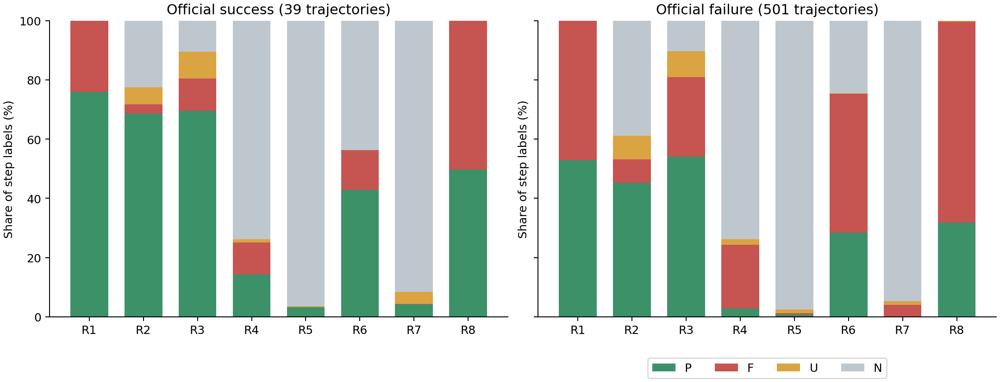
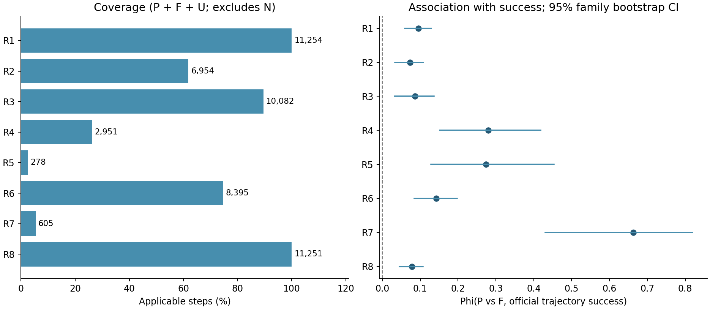

# AppWorld 全量轨迹评分：英文 v6 / GPT-6.1 sol

这轮结果支持把英文 v6 / GPT-6.1 sol 作为后续评分的基础配置：已知的局部/全局混淆、失败调用与实际写入混淆、额外代码块漏判都有明显改善。但不能据此宣称英文单独更好，或给出总体准确率；仍发现8处只读/鉴权/提交步骤的R5适用性错误，以及R6恢复漏评和R7边界不一致。540条全部有效，原始评分、技术失败和复核结论分开保留。

## 实验配置与边界

同一批 Qwen3-8B 原始轨迹，共 540 条、11,254 步、90,032 个 rubric 标签；90 个任务、30 个任务族，每任务 6 次运行。官方成功 39 条、失败 501 条。540 份预处理输入与中文全量实验逐字节相同；不向裁判提供官方成功标记或旧评分。每条轨迹重新调用裁判，没有复用 pilot 评分。

本轮使用冻结的英文 v6 format prompt、GPT-6.1 sol、high reasoning，初始/最大并行均为 8。标签仍为 P（满足）、F（明确违反）、U（适用但证据不足）、N（不适用）。输出每步八字符标签与一条最多 60 字符的简短依据。接收首次通过 schema 的结果；仅对技术/格式失败重试，不根据标签优劣挑选结果。

与旧中文 v5 / GPT-5.6 sol 相比，语言、规则版本、裁判模型同时变化。因此以下是以质量为目标的配置比较，不能将差异单独归因于英文或新模型，也不是严格的语言消融。相同英文 prompt 的 pilot 对照也只提供跨模型一致性，不能替代准确率。

评分经远程 Codex 执行，没有加载本地 GPU 模型，也未修改正在训练的 LoRA、原始轨迹或旧结果。输入沿用已有预处理：有凭据等值替换，但不声称已完整匿名化。

## 时间、调用与完整性

| 指标 | 本轮英文 v6 / 6.1 | 旧中文 v5 / 5.6 |
| --- | --- | --- |
| 评分开始 | 2026-10-13T19:08:04.745994+08:00 | 2026-10-13T00:20:33.110106+08:00 |
| 评分结束 | 2026-10-13T21:40:45.393914+08:00 | 2026-10-13T02:13:24.134800+08:00 |
| 评分墙钟时间 | 2小时32分40.6秒 | 1小时52分51.0秒 |
| 实际调用次数 | 547 | 542 |
| 首次调用有效 | 533/540 | 538/540 |
| 无效尝试 | 7 | 2 |
| 有效调用平均延迟（秒） | 129.055 | 91.477 |
| 有效调用中位延迟（秒） | 123.581 | 84.220 |
| 未报告 token 的尝试 | 2 | 0 |

7次无效尝试包括5次输出格式问题和2次服务容量不足。实际并发调整如下；稳定后恢复到8，模型始终相同。

| 时间（+08:00） | 并发上限 | 原因 |
| --- | --- | --- |
| 2026-10-13T21:20:31.021156+08:00 | 4 | capacity_or_rate_limit |
| 2026-10-13T21:25:19.611834+08:00 | 8 | stable_completed_calls |
| 2026-10-13T21:25:26.451783+08:00 | 4 | capacity_or_rate_limit |
| 2026-10-13T21:31:10.806960+08:00 | 8 | stable_completed_calls |

墙钟时间从首次正式评分子进程启动到 540 条全部有效，包含重试、等待、校验和落盘；不含启动前的模型可用性探测、准备及评分后的分析。原始证据预读与评分并行，不另加一段串行耗时。旧实验先以 2→4→8 并行递增，本轮从 8 开始，因此耗时也不是纯模型速度比较。详细计时见 TIMING.json 与 EVALUATION_TIMING.json。

本轮调用报告的 token 使用：`{"input_tokens": 12661916, "cached_input_tokens": 3892864, "cache_write_input_tokens": 0, "output_tokens": 1687750, "reasoning_output_tokens": 1498024}`。包含已上报的失败尝试；cached/reasoning 通常是对应 token 项的子集，不应再相加。没有完整价格/未上报用量时不估算费用。

已核查源文件与输入哈希、冻结 prompt/config/schema、完整 step 顺序、原始响应未改写、首次有效结果接收及裁判无工具调用。机器核验见 [validation.json](analysis/validation.json)。

## 标签分布

R1执行有效性；R2证据与覆盖；R3状态与数据保真；R4决策逻辑与计算；R5动作与实际效果；R6反馈与恢复；R7终止与交付；R8权限与交互协议。

下图沿用旧图口径：分别在官方成功/失败轨迹的全部步骤内归一化 P/F/U/N；成功组 501 步，失败组 10,753 步。N 不等于失败，图中的全部步骤 P 占比也不等于适用步骤通过率。

| 规则 | P | F | U | N | 适用率 PFU/全部 |
| --- | --- | --- | --- | --- | --- |
| R1 | 6069 | 5185 | 0 | 0 | 100.00% |
| R2 | 5197 | 882 | 875 | 4300 | 61.79% |
| R3 | 6166 | 2944 | 972 | 1172 | 89.59% |
| R4 | 371 | 2363 | 217 | 8303 | 26.22% |
| R5 | 91 | 56 | 131 | 10976 | 2.47% |
| R6 | 3270 | 5110 | 15 | 2859 | 74.60% |
| R7 | 43 | 413 | 149 | 10649 | 5.38% |
| R8 | 3671 | 7544 | 36 | 3 | 99.97% |

至少一项 F 的步骤 9539；仅 R8 为 F 的步骤 1498；八项均无 F/U 的步骤 1664。这些计数不是训练数据质量的独立验证。

## 与中文历史评分的对应变化

逐一对齐相同的 90,032 个单元，变化 10131 个。下表一致率仅表示配置间稳定性，N/N 较多时会抬高全单元一致率；另列至少一方适用的单元。

| 规则 | 全部一致率 | 至少一方适用时一致率 | 跨 F/非F 边界变化 |
| --- | --- | --- | --- |
| R1 | 99.98% | 99.98% | 2 |
| R2 | 74.43% | 61.86% | 1521 |
| R3 | 69.98% | 66.99% | 1086 |
| R4 | 88.58% | 64.24% | 840 |
| R5 | 95.00% | 30.15% | 447 |
| R6 | 92.49% | 90.20% | 590 |
| R7 | 98.29% | 68.88% | 177 |
| R8 | 91.22% | 91.22% | 696 |

完整 PFUN 转移矩阵与目标案例逐项结果见 [configuration_comparison.json](analysis/configuration_comparison.json)，变化单元见 [CSV](analysis/label_changes_vs_chinese.csv)。

同一英文 format prompt 的跨模型比较：

| pilot 集合 | 对齐单元 | 一致率 |
| --- | --- | --- |
| development_format | 1144 | 90.30% |
| holdout_format | 2760 | 89.93% |

## 评分质量核验

先冻结 prompt，再按预先固定的同一组 12 条、176 步阅读原始证据；本轮用于语义复核的有效标签在全量评分结束后才检查。复核者是本对话助手，已知历史案例，不是独立人工金标。全轨迹逐维复核与有选择的边界检查分开报告，不把命中率解释为总体准确率。

| 机械检查 | 本轮匹配 | 旧中文匹配 |
| --- | --- | --- |
| additional_nonempty_python_block | 1209/1209 | 961/1209 |
| conservative_read_only_ast | 8818/8826 | 8826/8826 |
| explicit_execution_failure | 5184/5184 | 5184/5184 |
| normal_execution_observation | 6069/6070 | 6069/6070 |

机械检查覆盖可直接核验的执行异常、正常执行、只读无业务修改和额外非空代码块，不是八项语义的完整金标。

| 预先记录的案例集 | 本轮匹配 | 旧中文匹配 |
| --- | --- | --- |
| legacy_v5_regression_checks | 51/52 | 49/52 |
| development_boundary_checks | 32/33 | 23/33 |
| holdout_boundary_checks | 43/44 | 41/44 |
| legacy_full_boundary_checks | 39/48 | 0/48 |
| current_raw_boundary_checks | 36/36 | 35/36 |

legacy_full_boundary_checks的48项专门取自旧版错误/争议，旧版0/48是选样构造结果，不是旧版总体表现。以上案例集有重叠，且包含争议边界，不汇总成一个准确率。旧 v5 与 v6 规则语义也有差异，最终以逐案证据复核为准。

固定12条、176步、1408单元中，本次逐案复核发现1处明确恢复漏评（3c13f5a_2__04 step48 R6=N，应P）和9处边界争议。旧报告27处明确问题中25处达到旧建议，另1处仍漏评，另1处关于“API不可用”的待验证猜测在v6下改列争议；因此不能把27→1直接当作准确率提升。机械检查的8处R5非N已经逐一确认是误判；它们均不在原common_pool中，对本次2846步筛选计数没有影响。R1唯一机械不匹配来自被try/except捕获的实际API异常，F可辩护，不算已确认错误。补充已知案例还确认22cc237_1__02末步R7把无完成声明的凭据文本记F；这些有偏补充检查不并入固定样本分母。部分写入/随后异常及状态刷新恢复的关键案例均获得有证据支持的标签，详见supplemental_review.json。

| 规则 | 本轮明确错误 | 本轮争议项 | 旧中文明确错误 | 旧中文争议项 |
| --- | --- | --- | --- | --- |
| R1 | 0 | 0 | 0 | 0 |
| R2 | 0 | 0 | 4 | 5 |
| R3 | 0 | 2 | 6 | 2 |
| R4 | 0 | 1 | 1 | 2 |
| R5 | 0 | 0 | 2 | 7 |
| R6 | 1 | 1 | 3 | 2 |
| R7 | 0 | 1 | 4 | 0 |
| R8 | 0 | 4 | 7 | 3 |

[逐案复核记录](review/MANUAL_REVIEW.md) · [固定 12 条原始标签](review/SEMANTIC_SAMPLE_RESULTS.md) · [查看本轮标签前的原始证据笔记](review/raw_evidence_notes.json)

## R5、R7 的样本量与 R8 的解释

R5适用278/11254=2.47%，覆盖219条轨迹、63个任务、25个任务族；成功轨迹中仅18个适用步骤、17条轨迹，同任务成败可匹配仅9个任务。因此保留R5的实际效果语义，但不要要求每一步都R5=P，也不要根据这点样本单独拟合复杂权重。相比旧版794个适用步骤，本轮大量前置拒绝改为N，与规则的实际写入要求一致；原始278里仍含已确认的8处误用，不能把剩余270自动当金标。R7适用605步，覆盖430条轨迹、89个任务、30个任务族，主要负责交付/终止；N多是正常的事件稀疏性。R8的F为7544/11254=67.03%，旧版为7330/11254=65.13%；额外代码块检查从961/1209提升到1209/1209，说明至少一部分F增加是修复漏判。R8还受明确的API规格查询和分页协议约束，不能等同于任务答案错误。仅R8为F仍有1498步，若将R8=P设为硬筛选条件，会明显减少可用数据。 原筛选门槛下加入R8=P会从2846步减至1656步（减少41.8%），是否值得这样筛选需要训练效果验证。

## 相关性与适用覆盖

令 a=成功轨迹中的 P 步数，b=失败轨迹中的 P 步数，c=成功轨迹中的 F 步数，d=失败轨迹中的 F 步数，则：

$$\phi=\frac{ad-bc}{\sqrt{(a+b)(c+d)(a+c)(b+d)}}.$$

这里只在 P/F 上计算，排除 U/N。适用率单独用 (P+F+U)/全部计算；通过率另列 P/(P+F)。步级观察相关，不能把 11,254 步当作独立样本；区间按 30 个任务族聚类 bootstrap 5,000 次，固定 seed=20261013。部分稀疏重采样可能分母为零，区间只使用有限值，并在 statistics.json 记录有效重采样次数。区间是探索性区间，没有多重检验校正。

| 规则 | 适用步骤 | 适用轨迹 | 成功P/(P+F) | 失败P/(P+F) | φ | 95%任务族区间 |
| --- | --- | --- | --- | --- | --- | --- |
| R1 | 11254 | 540 | 75.85% | 52.91% | 0.095 | [0.059, 0.129] |
| R2 | 6954 | 535 | 95.82% | 84.84% | 0.073 | [0.034, 0.108] |
| R3 | 10082 | 538 | 86.35% | 66.82% | 0.086 | [0.033, 0.137] |
| R4 | 2951 | 485 | 57.14% | 11.46% | 0.280 | [0.151, 0.419] |
| R5 | 278 | 219 | 100.00% | 57.25% | 0.274 | [0.129, 0.453] |
| R6 | 8395 | 500 | 76.24% | 37.73% | 0.142 | [0.084, 0.198] |
| R7 | 605 | 430 | 95.45% | 5.07% | 0.663 | [0.430, 0.819] |
| R8 | 11251 | 540 | 49.70% | 31.94% | 0.078 | [0.045, 0.108] |

另按每条轨迹 P/(P+F+U) 计算，在同一任务内比较成功/失败轨迹，再对有两类结果且规则适用的任务等权平均：

| 规则 | 匹配任务数 | 成功减失败 | 95%任务族区间 |
| --- | --- | --- | --- |
| R1 | 20 | 0.078 | [0.022, 0.127] |
| R2 | 20 | 0.156 | [0.053, 0.252] |
| R3 | 20 | 0.171 | [0.062, 0.260] |
| R4 | 20 | 0.446 | [0.264, 0.629] |
| R5 | 9 | 0.393 | [0.057, 0.656] |
| R6 | 20 | 0.176 | [0.054, 0.281] |
| R7 | 20 | 0.403 | [0.150, 0.695] |
| R8 | 20 | 0.099 | [0.057, 0.146] |

相关性不验证标签本身正确，也不证明用来筛选 SFT 会提升模型。全轨迹裁判可受到后续信息影响；U 的出现可能与成败相关；成功只有 39/540 条。R5/R7 低覆盖主要与规则适用事件稀少有关，应同时看适用轨迹/任务族数和区间宽度。规则间 P/F 相关性见 statistics.json 的 pairwise。

## 终止与官方成败

| 末步 R7 | 官方成功 | 官方失败 |
| --- | --- | --- |
| P | 19 | 22 |
| F | 0 | 241 |
| U | 20 | 123 |
| N | 0 | 115 |

末步 P/F 子集与官方成败的表面一致率为 92.20%，该子集有 282 条；U/N 未折算为失败。全数据一律预测失败已有 501/540=92.78%，且分母不同，不能据此宣称裁判准确率。

R7 衡量交付/终止是否如实且有依据，诚实报告失败也可为 P，不能把全部 R7=P 当作任务成功预测。按末步实际 complete_task 参数分类后，声明成功且 R7=P 的 21 条中，官方成功 19 条（90.48%）。官方失败但 R7=P 的具体案例、诚实失败报告和未知动态参数分类见 [终止分析](analysis/terminal_submission_analysis.json)。官方只提供汇总结果，不能据此臆造隐藏断言失败的原因。

旧版声明成功且R7=P为26/35（74.29%）官方成功，本轮为19/21（90.48%）；但39条官方成功中获P的覆盖由26/39降为19/39，另外20条为U。较高的条件精确率伴随更多弃权，不能单独解释成总体准确率提升。20/22条官方失败但末步R7=P是明确status=fail的诚实终止；其余2条是多点赞未来歌曲却仍判交付P的边界案例，见补充复核。

## 候选步骤与对筛选的影响

沿用旧分析规则提取的候选记录共 6099 条，覆盖 5860 个不同步骤；分类计数为 `{"business_or_factual_failure_candidate": 4119, "execution_recovery_candidate": 1980}`。候选可能重叠，尚未赋训练权重。执行恢复并不抹去业务错误：恢复候选中仍有业务维度 F 的记录为 239 条。完整候选保存在 analysis/step_candidates.jsonl。

仅作诊断：在原 SFT 实验冻结的同一 5,234 步 common_pool 中，用新标签应用原门槛 R1=P、R2–R6∈{P,N}、R7=N，暂不约束 R8。未改动训练数据或启动新训练。

| 门槛 | 旧标签通过步骤数 | 新标签通过步骤数 |
| --- | --- | --- |
| 原门槛 | 2580 | 2846 |
| 原门槛 + R8=P | 1497 | 1656 |
| 原门槛 + R5=P | 22 | 27 |
| 原门槛 + R5=P + R8=P | 3 | 3 |

逐个取消 R2–R6 门槛后的规模：`{"R2": 2910, "R3": 2938, "R4": 2905, "R5": 2846, "R6": 3794}`。不能仅因某项删除后样本变多或相关性弱就认定它无用；R5 的实际写入质量与 R7 的交付真实性仍有独立语义价值。

## 结论与下一步

建议继续采用本轮英文v6/GPT-6.1 sol做后续评分基础，并增加确定性的适用性检查：纯读取、登录和complete_task单独出现时，R5必须为N；不满足时回到技术/适用性复核，而非静默改写输出。对R6明确跨步修复的识别、R7对额外副作用的归责时点，以及R8分页的跨步责任，下一版应先用独立样本验证。当前8字符格式出现了少量长度错误及疑似维度错位，未来可比较带R1–R8字段名的PFUN输出，但本次没有混入新的格式或二次语义挑选。所有8项与官方成败的P/F φ及同任务差异均为正，仍只能说明描述性关联；R5小样本、R7接近终止目标、R8强协议约束都要求分别解释。当前结果不自动替换正在训练的LoRA数据，也不能代替后续相同预算的训练效果验证。

## 产物

- [冻结英文 prompt](assets/prompt_v6_en.txt) 与 [配置](judge_config.json)
- [全量评分 JSONL](analysis/scored_trajectories.jsonl) 与 [逐步标签 CSV](analysis/step_labels.csv)
- [汇总](analysis/summary.json)、[相关性统计](analysis/rubric_validity/statistics.json)、[逐调用记录](analysis/attempts.json)
- [评分计时](TIMING.json)、[评估计时](EVALUATION_TIMING.json)
- runs/scoring/<trajectory_id>/ 保存原始输入、请求、每次尝试和首次有效响应。
