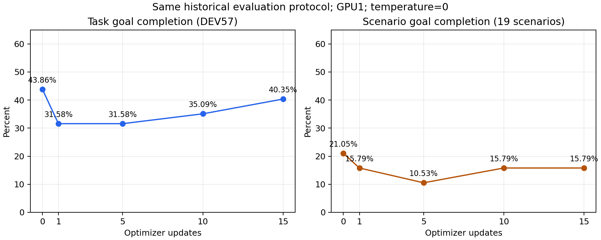

# 同历史协议的训练过程性能对照

更新时间：2026-10-16T12:29:59.779149+08:00；完成 5/5 个模型。

每个点均为同一DEV57、原始AppWorld agent和历史Chat Completions配置；仅替换LoRA权重。step 0为本次在GPU1复测的初始模型。

| 更新次数 | TGC | SGC | evaluator通过/总数 | evaluator失败数 | evaluator通过率 | 新增成功题 | 丢失成功题 |
| ---: | ---: | ---: | ---: | ---: | ---: | ---: | ---: |
| 0 | 25/57 = 43.86% | 4/19 = 21.05% | 204/291 | 87 | 70.10% | 0 | 0 |
| 1 | 18/57 = 31.58% | 3/19 = 15.79% | 189/291 | 102 | 64.95% | 4 | 11 |
| 5 | 18/57 = 31.58% | 2/19 = 10.53% | 198/291 | 93 | 68.04% | 3 | 10 |
| 10 | 20/57 = 35.09% | 3/19 = 15.79% | 201/291 | 90 | 69.07% | 4 | 9 |
| 15 | 23/57 = 40.35% | 3/19 = 15.79% | 188/291 | 103 | 64.60% | 8 | 10 |

## 本次观测结论

最终step 15相对step 0：成功题数-2，TGC -3.51个百分点；全对场景数-1，SGC -5.26个百分点；evaluator通过条件数-16。

TGC随更新次数存在上升和下降。观测到的最高TGC为25/57，出现在step 0；最高SGC为4/19，出现在step 0。

这是每个checkpoint各一次完整DEV57的观测曲线。它能显示本次更新过程的表现变化；没有重复运行或消融，不能单独确定RL、SFT或KL的因果贡献，也不据此声称统计显著。

[57题配对结果](paired_task_results.csv) · [19场景结果](scenario_results.csv) · [指标CSV](trend.csv) · [JSON](COMPARISON.json)

[完整评测协议与运行记录](../../HISTORICAL_DEV57_RUN.md) · [模型/数据/代码哈希](INPUT_MANIFEST.json) · [检查点更新次数及SFT消耗](TRAINING_CHECKPOINTS.json) · [独立最终验收](FINAL_AUDIT.json)（五点完成后生成）

[逐条evaluator测试及完整失败trace CSV](evaluator_test_results.csv) · [同内容JSONL](evaluator_test_results.jsonl) · [按难度统计](difficulty_results.csv)

TGC要求某题全部测试通过；SGC要求一个场景的三题全部成功。evaluator通过率为全部测试条件中通过的比例（微平均），不是TGC或SGC。另在CSV/JSON中给出先对每题测试通过率计算、再对57题平均的宏平均，避免混淆口径。新增/丢失均相对本次step 0。

历史23/57仅作复现参照；本次各checkpoint的收益与损失均相对同环境重测的step 0计算。此前另一入口的20/57不进入此图。

同一A0模型的历史/本次实测：TGC 23/57→25/57；SGC 4/19→4/19；evaluator 206/291→204/291。逐题新增成功9题、丢失成功7题，详见 [历史A0与本次A0对照](HISTORICAL_BASELINE_COMPARISON.json)。这部分差异不计作训练收益。

本次和历史请求均使用seed=100、temperature=0，不能将差异直接归因于换了随机种子。协议校验与历史逐题差异记录见 [step 0复现审计](BASELINE_REPRODUCTION.json)；用户已接受输出差异。推理复现的限制参见 [vLLM官方文档](https://docs.vllm.ai/en/v0.10.2/usage/reproducibility.html)。

该曲线描述这一次联合训练沿途的表现，不区分RL/SFT/KL的独立贡献。

## evaluator条件变化与部分完成情况

| 更新次数 | 新增通过条件 | 丢失通过条件 | 全部通过题 | 部分通过题 | 零通过题 | 每题通过率宏平均 |
| ---: | ---: | ---: | ---: | ---: | ---: | ---: |
| 0 | 0 | 0 | 25 | 32 | 0 | 72.69% |
| 1 | 22 | 37 | 18 | 37 | 2 | 65.71% |
| 5 | 28 | 34 | 18 | 39 | 0 | 67.92% |
| 10 | 32 | 35 | 20 | 36 | 1 | 68.90% |
| 15 | 24 | 40 | 23 | 30 | 4 | 65.10% |

## 按任务难度统计

| 更新次数 | 难度 | 成功题/总题 | TGC | evaluator通过/总数 | evaluator通过率 |
| ---: | ---: | ---: | ---: | ---: | ---: |
| 0 | 1 | 15/30 | 50.00% | 102/129 | 79.07% |
| 0 | 2 | 10/24 | 41.67% | 89/132 | 67.42% |
| 0 | 3 | 0/3 | 0.00% | 13/30 | 43.33% |
| 1 | 1 | 11/30 | 36.67% | 100/129 | 77.52% |
| 1 | 2 | 7/24 | 29.17% | 81/132 | 61.36% |
| 1 | 3 | 0/3 | 0.00% | 8/30 | 26.67% |
| 5 | 1 | 13/30 | 43.33% | 100/129 | 77.52% |
| 5 | 2 | 5/24 | 20.83% | 79/132 | 59.85% |
| 5 | 3 | 0/3 | 0.00% | 19/30 | 63.33% |
| 10 | 1 | 12/30 | 40.00% | 94/129 | 72.87% |
| 10 | 2 | 7/24 | 29.17% | 89/132 | 67.42% |
| 10 | 3 | 1/3 | 33.33% | 18/30 | 60.00% |
| 15 | 1 | 14/30 | 46.67% | 99/129 | 76.74% |
| 15 | 2 | 9/24 | 37.50% | 80/132 | 60.61% |
| 15 | 3 | 0/3 | 0.00% | 9/30 | 30.00% |

## 57题逐题evaluator通过数

表中为通过条件数/总条件数；全部通过才计入该题成功。

| 题目 | step 0 | step 1 | step 5 | step 10 | step 15 |
| --- | ---: | ---: | ---: | ---: | ---: |
| 0d8a4ee_1 | 4/5 | 4/5 | 4/5 | 4/5 | 4/5 |
| 0d8a4ee_2 | 4/5 | 4/5 | 4/5 | 4/5 | 4/5 |
| 0d8a4ee_3 | 4/5 | 4/5 | 4/5 | 4/5 | 2/5 |
| 23cf851_1 | 2/2 | 0/2 | 1/2 | 2/2 | 0/2 |
| 23cf851_2 | 2/2 | 2/2 | 2/2 | 2/2 | 2/2 |
| 23cf851_3 | 2/2 | 2/2 | 2/2 | 2/2 | 0/2 |
| 37a8675_1 | 1/6 | 0/6 | 1/6 | 0/6 | 0/6 |
| 37a8675_2 | 6/6 | 1/6 | 1/6 | 6/6 | 1/6 |
| 37a8675_3 | 1/6 | 1/6 | 1/6 | 6/6 | 6/6 |
| 383cbac_1 | 1/2 | 1/2 | 1/2 | 1/2 | 1/2 |
| 383cbac_2 | 1/2 | 1/2 | 1/2 | 1/2 | 0/2 |
| 383cbac_3 | 1/2 | 1/2 | 1/2 | 1/2 | 1/2 |
| 396c5a2_1 | 6/6 | 6/6 | 6/6 | 6/6 | 6/6 |
| 396c5a2_2 | 6/6 | 6/6 | 6/6 | 6/6 | 6/6 |
| 396c5a2_3 | 6/6 | 6/6 | 6/6 | 6/6 | 6/6 |
| 3ab5b8b_1 | 4/6 | 3/6 | 3/6 | 3/6 | 3/6 |
| 3ab5b8b_2 | 4/6 | 4/6 | 4/6 | 5/6 | 5/6 |
| 3ab5b8b_3 | 6/6 | 4/6 | 6/6 | 6/6 | 6/6 |
| 4ec8de5_1 | 1/2 | 1/2 | 1/2 | 1/2 | 2/2 |
| 4ec8de5_2 | 2/2 | 1/2 | 2/2 | 1/2 | 2/2 |
| 4ec8de5_3 | 1/2 | 1/2 | 1/2 | 1/2 | 1/2 |
| 4fab96f_1 | 2/8 | 1/8 | 2/8 | 2/8 | 1/8 |
| 4fab96f_2 | 1/8 | 2/8 | 2/8 | 2/8 | 2/8 |
| 4fab96f_3 | 2/8 | 2/8 | 2/8 | 2/8 | 2/8 |
| 50e1ac9_1 | 1/2 | 1/2 | 1/2 | 1/2 | 2/2 |
| 50e1ac9_2 | 2/2 | 1/2 | 1/2 | 1/2 | 1/2 |
| 50e1ac9_3 | 1/2 | 1/2 | 1/2 | 1/2 | 2/2 |
| 530b157_1 | 9/10 | 1/10 | 1/10 | 1/10 | 1/10 |
| 530b157_2 | 3/10 | 2/10 | 9/10 | 10/10 | 7/10 |
| 530b157_3 | 1/10 | 5/10 | 9/10 | 7/10 | 1/10 |
| 57c3486_1 | 5/5 | 5/5 | 5/5 | 5/5 | 5/5 |
| 57c3486_2 | 5/5 | 5/5 | 5/5 | 2/5 | 5/5 |
| 57c3486_3 | 5/5 | 4/5 | 4/5 | 5/5 | 4/5 |
| 6171bbc_1 | 4/7 | 7/7 | 7/7 | 6/7 | 4/7 |
| 6171bbc_2 | 7/7 | 3/7 | 4/7 | 7/7 | 4/7 |
| 6171bbc_3 | 4/7 | 6/7 | 6/7 | 4/7 | 4/7 |
| 68ee2c9_1 | 3/5 | 3/5 | 2/5 | 2/5 | 2/5 |
| 68ee2c9_2 | 2/5 | 2/5 | 2/5 | 2/5 | 3/5 |
| 68ee2c9_3 | 4/5 | 3/5 | 2/5 | 3/5 | 2/5 |
| 6bdbc26_1 | 1/2 | 1/2 | 2/2 | 1/2 | 1/2 |
| 6bdbc26_2 | 2/2 | 1/2 | 1/2 | 1/2 | 1/2 |
| 6bdbc26_3 | 2/2 | 1/2 | 2/2 | 1/2 | 1/2 |
| 6c2c621_1 | 8/8 | 7/8 | 8/8 | 7/8 | 8/8 |
| 6c2c621_2 | 8/8 | 8/8 | 8/8 | 5/8 | 8/8 |
| 6c2c621_3 | 8/8 | 8/8 | 8/8 | 8/8 | 8/8 |
| b119b1f_1 | 6/6 | 4/6 | 4/6 | 6/6 | 1/6 |
| b119b1f_2 | 4/6 | 4/6 | 5/6 | 4/6 | 5/6 |
| b119b1f_3 | 6/6 | 6/6 | 1/6 | 4/6 | 6/6 |
| d4e9306_1 | 6/6 | 6/6 | 6/6 | 6/6 | 6/6 |
| d4e9306_2 | 6/6 | 6/6 | 6/6 | 6/6 | 6/6 |
| d4e9306_3 | 2/6 | 6/6 | 2/6 | 6/6 | 1/6 |
| df61dc5_1 | 6/7 | 7/7 | 6/7 | 2/7 | 7/7 |
| df61dc5_2 | 3/7 | 6/7 | 6/7 | 6/7 | 7/7 |
| df61dc5_3 | 5/7 | 5/7 | 6/7 | 2/7 | 7/7 |
| fac291d_1 | 2/2 | 2/2 | 1/2 | 2/2 | 2/2 |
| fac291d_2 | 2/2 | 2/2 | 1/2 | 1/2 | 1/2 |
| fac291d_3 | 1/2 | 2/2 | 2/2 | 2/2 | 2/2 |

## 19个场景的三题完成情况

| 场景 | step 0 | step 1 | step 5 | step 10 | step 15 |
| --- | ---: | ---: | ---: | ---: | ---: |
| 0d8a4ee | 0/3 | 0/3 | 0/3 | 0/3 | 0/3 |
| 23cf851 | 3/3 | 2/3 | 2/3 | 3/3 | 1/3 |
| 37a8675 | 1/3 | 0/3 | 0/3 | 2/3 | 1/3 |
| 383cbac | 0/3 | 0/3 | 0/3 | 0/3 | 0/3 |
| 396c5a2 | 3/3 | 3/3 | 3/3 | 3/3 | 3/3 |
| 3ab5b8b | 1/3 | 0/3 | 1/3 | 1/3 | 1/3 |
| 4ec8de5 | 1/3 | 0/3 | 1/3 | 0/3 | 2/3 |
| 4fab96f | 0/3 | 0/3 | 0/3 | 0/3 | 0/3 |
| 50e1ac9 | 1/3 | 0/3 | 0/3 | 0/3 | 2/3 |
| 530b157 | 0/3 | 0/3 | 0/3 | 1/3 | 0/3 |
| 57c3486 | 3/3 | 2/3 | 2/3 | 2/3 | 2/3 |
| 6171bbc | 1/3 | 1/3 | 1/3 | 1/3 | 0/3 |
| 68ee2c9 | 0/3 | 0/3 | 0/3 | 0/3 | 0/3 |
| 6bdbc26 | 2/3 | 0/3 | 2/3 | 0/3 | 0/3 |
| 6c2c621 | 3/3 | 2/3 | 3/3 | 1/3 | 3/3 |
| b119b1f | 2/3 | 1/3 | 0/3 | 1/3 | 1/3 |
| d4e9306 | 2/3 | 3/3 | 2/3 | 3/3 | 2/3 |
| df61dc5 | 0/3 | 1/3 | 0/3 | 0/3 | 3/3 |
| fac291d | 2/3 | 3/3 | 1/3 | 2/3 | 2/3 |

## step 1 相对 step 0

新增成功：6171bbc_1、d4e9306_3、df61dc5_1、fac291d_3。
丢失成功：23cf851_1、37a8675_2、3ab5b8b_3、4ec8de5_2、50e1ac9_2、57c3486_3、6171bbc_2、6bdbc26_2、6bdbc26_3、6c2c621_1、b119b1f_1。

新增通过的evaluator条件：

- `4fab96f_2`：assert answers match.（no_op_fail）
- `530b157_3`：assert answers match.（no_op_fail）
- `530b157_3`：obtain added, updated, deleted phone.GlobalTextMessage using models.changed_records
assert 1 is added, 0 is updated, and 0 is deleted.（no_op_fail）
- `530b157_3`：assert the added global_text_message's receiver_id is to private_data.friend_phone_user_id.（no_op_fail）
- `530b157_3`：assert the added global_text_message has message, public_data.message_text (ignore case).（no_op_fail）
- `6171bbc_1`：assert model changes match spotify.Playlist, spotify.PlaylistSong.（no_op_fail）
- `6171bbc_1`：assert all song_ids of added playlist_songs match private_data.playlist_song_ids (ignore_order)（no_op_fail）
- `6171bbc_1`：assert the playlist_id of all added playlist_songs match added_playlist.id.（no_op_fail）
- `6171bbc_3`：assert model changes match spotify.Playlist, spotify.PlaylistSong.（no_op_fail）
- `6171bbc_3`：assert the playlist_id of all added playlist_songs match added_playlist.id.（no_op_fail）
- `68ee2c9_2`：assert answers match.（no_op_fail）
- `b119b1f_2`：assert this music player record has updated only in the cursor_position
using models.changed_field_names（no_op_fail）
- `d4e9306_3`：assert model changes match spotify.UserArtistFollowing.（no_op_fail）
- `d4e9306_3`：assert private_data.to_be_followed_artist_ids_by_songs artists have been newly followed.（no_op_fail）
- `d4e9306_3`：assert private_data.to_be_followed_artist_ids_by_albums artists have been newly followed.（no_op_fail）
- `d4e9306_3`：assert artist_ids from added artists match union of
private_data.to_be_followed_artist_ids_by_songs and private_data.to_be_followed_artist_ids_by_albums.（no_op_fail）
- `df61dc5_1`：assert set of updated transaction ids match exactly to
private_data.to_like_transaction_ids (ignore order).（no_op_fail）
- `df61dc5_2`：assert model changes match venmo.Transaction, venmo.TransactionLike（no_op_fail）
- `df61dc5_2`：assert updated transactions have only changed in like_count field using models.changed_field_names.（no_op_fail）
- `df61dc5_2`：assert all updated transactions were created after private_data.min_transaction_datetime（no_op_fail）
- `df61dc5_3`：assert answers match.（no_op_fail）
- `fac291d_3`：assert answers match.（no_op_fail）

丢失通过的evaluator条件：

- `23cf851_1`：assert answers match.（no_op_fail）
- `23cf851_1`：assert no model changes.（no_op_pass）
- `37a8675_1`：assert answers match.（no_op_fail）
- `37a8675_2`：assert model changes match venmo.Notification, venmo.Transaction ignoring venmo.User.（no_op_fail）
- `37a8675_2`：obtain added, updated, removed venmo.Transaction records using models.changed_records,
and assert 1 is added, 0 is updated, and 0 is deleted.（no_op_fail）
- `37a8675_2`：assert the added transaction's receiver_id is private_data.person_venmo_user_id.（no_op_fail）
- `37a8675_2`：assert the added transaction has amount public_data.payment_amount.（no_op_fail）
- `37a8675_2`：assert the added transaction is private/public as per public_data.privacy.（no_op_fail）
- `3ab5b8b_1`：assert all added downloaded song_ids are in private_data.liked_song_ids（no_op_fail）
- `3ab5b8b_3`：assert added downloaded song_ids match private_data.to_download_song_ids (ignore_order=True)（no_op_fail）
- `3ab5b8b_3`：assert all added downloaded song_ids are in private_data.liked_song_ids（no_op_fail）
- `4ec8de5_2`：assert answers match.（no_op_fail）
- `4fab96f_1`：assert answers match.（no_op_fail）
- `50e1ac9_2`：assert answers match.（no_op_fail）
- `530b157_1`：assert answers match.（no_op_fail）
- `530b157_1`：assert model changes match venmo.Transaction, phone.GlobalTextMessage, phone.UserTextMessage,
ignoring venmo.User and venmo.Notification（no_op_fail）
- `530b157_1`：obtain added, updated, deleted venmo.Transactions using models.changed_records
assert 1 is added, 0 is updated, and 0 is deleted.（no_op_fail）
- `530b157_1`：assert the added transaction receiver_id is private_data.friend_venmo_user_id.（no_op_fail）
- `530b157_1`：assert the added transaction has description public_data.note.（no_op_fail）
- `530b157_1`：obtain added, updated, deleted phone.GlobalTextMessage using models.changed_records
assert 1 is added, 0 is updated, and 0 is deleted.（no_op_fail）
- `530b157_1`：assert the added global_text_message's receiver_id is to private_data.friend_phone_user_id.（no_op_fail）
- `530b157_1`：assert the added global_text_message has message, public_data.message_text (ignore case).（no_op_fail）
- `530b157_2`：assert the added transaction has description public_data.note.（no_op_fail）
- `57c3486_3`：assert all songs from artists main_user follows are liked now by using
private_data.followed_artist_song_ids.（no_op_fail）
- `6171bbc_2`：assert answers match.（no_op_fail）
- `6171bbc_2`：assert model changes match spotify.Playlist, spotify.PlaylistSong.（no_op_fail）
- `6171bbc_2`：assert all song_ids of added playlist_songs match private_data.playlist_song_ids (ignore_order)（no_op_fail）
- `6171bbc_2`：assert the playlist_id of all added playlist_songs match added_playlist.id.（no_op_fail）
- `68ee2c9_2`：assert model changes match file_system.File, file_system.Directory.（no_op_fail）
- `68ee2c9_3`：prepare start_file_path_to_content and end_file_path_to_content from start and end state of user.files,
then assert the files have been renamed (with proper content) as per private_data.before_this_year_start_to_end_file_path.（no_op_fail）
- `6bdbc26_2`：assert answers match.（no_op_fail）
- `6bdbc26_3`：assert answers match.（no_op_fail）
- `6c2c621_1`：assert answers match.（no_op_fail）
- `b119b1f_1`：assert the currently playing song has ID private_data.song_id in the end state.（no_op_fail）
- `b119b1f_1`：assert music player's cursor is on the song by private_data.artist_id in the end state.（no_op_fail）
- `b119b1f_2`：assert music player's cursor is on the song by private_data.artist_id in the end state.（no_op_fail）
- `df61dc5_3`：assert model changes match venmo.Transaction, venmo.TransactionLike（no_op_fail）

## step 5 相对 step 0

新增成功：6171bbc_1、6bdbc26_1、fac291d_3。
丢失成功：23cf851_1、37a8675_2、50e1ac9_2、57c3486_3、6171bbc_2、6bdbc26_2、b119b1f_1、b119b1f_3、fac291d_1、fac291d_2。

新增通过的evaluator条件：

- `4fab96f_2`：assert answers match.（no_op_fail）
- `530b157_2`：assert model changes match venmo.Transaction, phone.GlobalTextMessage, phone.UserTextMessage,
ignoring venmo.User and venmo.Notification（no_op_fail）
- `530b157_2`：obtain added, updated, deleted venmo.Transactions using models.changed_records
assert 1 is added, 0 is updated, and 0 is deleted.（no_op_fail）
- `530b157_2`：assert the added transaction receiver_id is private_data.friend_venmo_user_id.（no_op_fail）
- `530b157_2`：obtain added, updated, deleted phone.GlobalTextMessage using models.changed_records
assert 1 is added, 0 is updated, and 0 is deleted.（no_op_fail）
- `530b157_2`：assert the added global_text_message's receiver_id is to private_data.friend_phone_user_id.（no_op_fail）
- `530b157_2`：assert the added global_text_message has message, public_data.message_text (ignore case).（no_op_fail）
- `530b157_3`：assert answers match.（no_op_fail）
- `530b157_3`：assert model changes match venmo.Transaction, phone.GlobalTextMessage, phone.UserTextMessage,
ignoring venmo.User and venmo.Notification（no_op_fail）
- `530b157_3`：obtain added, updated, deleted venmo.Transactions using models.changed_records
assert 1 is added, 0 is updated, and 0 is deleted.（no_op_fail）
- `530b157_3`：assert the added transaction receiver_id is private_data.friend_venmo_user_id.（no_op_fail）
- `530b157_3`：assert the added transaction has description public_data.note.（no_op_fail）
- `530b157_3`：obtain added, updated, deleted phone.GlobalTextMessage using models.changed_records
assert 1 is added, 0 is updated, and 0 is deleted.（no_op_fail）
- `530b157_3`：assert the added global_text_message's receiver_id is to private_data.friend_phone_user_id.（no_op_fail）
- `530b157_3`：assert the added global_text_message has message, public_data.message_text (ignore case).（no_op_fail）
- `6171bbc_1`：assert model changes match spotify.Playlist, spotify.PlaylistSong.（no_op_fail）
- `6171bbc_1`：assert all song_ids of added playlist_songs match private_data.playlist_song_ids (ignore_order)（no_op_fail）
- `6171bbc_1`：assert the playlist_id of all added playlist_songs match added_playlist.id.（no_op_fail）
- `6171bbc_3`：assert model changes match spotify.Playlist, spotify.PlaylistSong.（no_op_fail）
- `6171bbc_3`：assert the playlist_id of all added playlist_songs match added_playlist.id.（no_op_fail）
- `68ee2c9_2`：assert answers match.（no_op_fail）
- `6bdbc26_1`：assert answers match.（no_op_fail）
- `b119b1f_2`：assert this music player record has updated only in the cursor_position
using models.changed_field_names（no_op_fail）
- `df61dc5_2`：assert model changes match venmo.Transaction, venmo.TransactionLike（no_op_fail）
- `df61dc5_2`：assert updated transactions have only changed in like_count field using models.changed_field_names.（no_op_fail）
- `df61dc5_2`：assert all updated transactions were created after private_data.min_transaction_datetime（no_op_fail）
- `df61dc5_3`：assert answers match.（no_op_fail）
- `fac291d_3`：assert answers match.（no_op_fail）

丢失通过的evaluator条件：

- `23cf851_1`：assert answers match.（no_op_fail）
- `37a8675_2`：assert model changes match venmo.Notification, venmo.Transaction ignoring venmo.User.（no_op_fail）
- `37a8675_2`：obtain added, updated, removed venmo.Transaction records using models.changed_records,
and assert 1 is added, 0 is updated, and 0 is deleted.（no_op_fail）
- `37a8675_2`：assert the added transaction's receiver_id is private_data.person_venmo_user_id.（no_op_fail）
- `37a8675_2`：assert the added transaction has amount public_data.payment_amount.（no_op_fail）
- `37a8675_2`：assert the added transaction is private/public as per public_data.privacy.（no_op_fail）
- `3ab5b8b_1`：assert all added downloaded song_ids are in private_data.liked_song_ids（no_op_fail）
- `50e1ac9_2`：assert answers match.（no_op_fail）
- `530b157_1`：assert answers match.（no_op_fail）
- `530b157_1`：assert model changes match venmo.Transaction, phone.GlobalTextMessage, phone.UserTextMessage,
ignoring venmo.User and venmo.Notification（no_op_fail）
- `530b157_1`：obtain added, updated, deleted venmo.Transactions using models.changed_records
assert 1 is added, 0 is updated, and 0 is deleted.（no_op_fail）
- `530b157_1`：assert the added transaction receiver_id is private_data.friend_venmo_user_id.（no_op_fail）
- `530b157_1`：assert the added transaction has description public_data.note.（no_op_fail）
- `530b157_1`：obtain added, updated, deleted phone.GlobalTextMessage using models.changed_records
assert 1 is added, 0 is updated, and 0 is deleted.（no_op_fail）
- `530b157_1`：assert the added global_text_message's receiver_id is to private_data.friend_phone_user_id.（no_op_fail）
- `530b157_1`：assert the added global_text_message has message, public_data.message_text (ignore case).（no_op_fail）
- `57c3486_3`：assert answers match.（no_op_fail）
- `6171bbc_2`：assert model changes match spotify.Playlist, spotify.PlaylistSong.（no_op_fail）
- `6171bbc_2`：assert all song_ids of added playlist_songs match private_data.playlist_song_ids (ignore_order)（no_op_fail）
- `6171bbc_2`：assert the playlist_id of all added playlist_songs match added_playlist.id.（no_op_fail）
- `68ee2c9_1`：assert answers match.（no_op_fail）
- `68ee2c9_2`：assert model changes match file_system.File, file_system.Directory.（no_op_fail）
- `68ee2c9_3`：assert answers match.（no_op_fail）
- `68ee2c9_3`：prepare start_file_path_to_content and end_file_path_to_content from start and end state of user.files,
then assert the files have been renamed (with proper content) as per private_data.before_this_year_start_to_end_file_path.（no_op_fail）
- `6bdbc26_2`：assert answers match.（no_op_fail）
- `b119b1f_1`：assert the currently playing song has ID private_data.song_id in the end state.（no_op_fail）
- `b119b1f_1`：assert music player's cursor is on the song by private_data.artist_id in the end state.（no_op_fail）
- `b119b1f_3`：assert model changes match spotify.MusicPlayer.（no_op_fail）
- `b119b1f_3`：assert spotify.MusicPlayer has 1 updated using models.changed_records（no_op_fail）
- `b119b1f_3`：assert this music player record has updated only in the cursor_position
using models.changed_field_names（no_op_fail）
- `b119b1f_3`：assert the currently playing song has ID private_data.song_id in the end state.（no_op_fail）
- `b119b1f_3`：assert music player's cursor is on the song by private_data.artist_id in the end state.（no_op_fail）
- `fac291d_1`：assert answers match.（no_op_fail）
- `fac291d_2`：assert answers match.（no_op_fail）

## step 10 相对 step 0

新增成功：37a8675_3、530b157_2、d4e9306_3、fac291d_3。
丢失成功：4ec8de5_2、50e1ac9_2、57c3486_2、6bdbc26_2、6bdbc26_3、6c2c621_1、6c2c621_2、b119b1f_3、fac291d_2。

新增通过的evaluator条件：

- `37a8675_3`：assert model changes match venmo.Notification, venmo.Transaction ignoring venmo.User.（no_op_fail）
- `37a8675_3`：obtain added, updated, removed venmo.Transaction records using models.changed_records,
and assert 1 is added, 0 is updated, and 0 is deleted.（no_op_fail）
- `37a8675_3`：assert the added transaction's receiver_id is private_data.person_venmo_user_id.（no_op_fail）
- `37a8675_3`：assert the added transaction has amount public_data.payment_amount.（no_op_fail）
- `37a8675_3`：assert the added transaction is private/public as per public_data.privacy.（no_op_fail）
- `3ab5b8b_2`：assert added downloaded song_ids match private_data.to_download_song_ids (ignore_order=True)（no_op_fail）
- `3ab5b8b_2`：assert all added downloaded song_ids are in private_data.library_song_ids（no_op_fail）
- `4fab96f_2`：assert answers match.（no_op_fail）
- `530b157_2`：assert model changes match venmo.Transaction, phone.GlobalTextMessage, phone.UserTextMessage,
ignoring venmo.User and venmo.Notification（no_op_fail）
- `530b157_2`：obtain added, updated, deleted venmo.Transactions using models.changed_records
assert 1 is added, 0 is updated, and 0 is deleted.（no_op_fail）
- `530b157_2`：assert the added transaction receiver_id is private_data.friend_venmo_user_id.（no_op_fail）
- `530b157_2`：assert the added transaction has amount private_data.grocery_cost.（no_op_fail）
- `530b157_2`：obtain added, updated, deleted phone.GlobalTextMessage using models.changed_records
assert 1 is added, 0 is updated, and 0 is deleted.（no_op_fail）
- `530b157_2`：assert the added global_text_message's receiver_id is to private_data.friend_phone_user_id.（no_op_fail）
- `530b157_2`：assert the added global_text_message has message, public_data.message_text (ignore case).（no_op_fail）
- `530b157_3`：assert answers match.（no_op_fail）
- `530b157_3`：assert model changes match venmo.Transaction, phone.GlobalTextMessage, phone.UserTextMessage,
ignoring venmo.User and venmo.Notification（no_op_fail）
- `530b157_3`：obtain added, updated, deleted venmo.Transactions using models.changed_records
assert 1 is added, 0 is updated, and 0 is deleted.（no_op_fail）
- `530b157_3`：assert the added transaction receiver_id is private_data.friend_venmo_user_id.（no_op_fail）
- `530b157_3`：assert the added transaction has description public_data.note.（no_op_fail）
- `530b157_3`：assert the added global_text_message's receiver_id is to private_data.friend_phone_user_id.（no_op_fail）
- `6171bbc_1`：assert model changes match spotify.Playlist, spotify.PlaylistSong.（no_op_fail）
- `6171bbc_1`：assert the playlist_id of all added playlist_songs match added_playlist.id.（no_op_fail）
- `b119b1f_2`：assert this music player record has updated only in the cursor_position
using models.changed_field_names（no_op_fail）
- `d4e9306_3`：assert model changes match spotify.UserArtistFollowing.（no_op_fail）
- `d4e9306_3`：assert private_data.to_be_followed_artist_ids_by_songs artists have been newly followed.（no_op_fail）
- `d4e9306_3`：assert private_data.to_be_followed_artist_ids_by_albums artists have been newly followed.（no_op_fail）
- `d4e9306_3`：assert artist_ids from added artists match union of
private_data.to_be_followed_artist_ids_by_songs and private_data.to_be_followed_artist_ids_by_albums.（no_op_fail）
- `df61dc5_2`：assert model changes match venmo.Transaction, venmo.TransactionLike（no_op_fail）
- `df61dc5_2`：assert updated transactions have only changed in like_count field using models.changed_field_names.（no_op_fail）
- `df61dc5_2`：assert all updated transactions were created after private_data.min_transaction_datetime（no_op_fail）
- `fac291d_3`：assert answers match.（no_op_fail）

丢失通过的evaluator条件：

- `37a8675_1`：assert answers match.（no_op_fail）
- `3ab5b8b_1`：assert all added downloaded song_ids are in private_data.liked_song_ids（no_op_fail）
- `3ab5b8b_2`：assert answers match.（no_op_fail）
- `4ec8de5_2`：assert answers match.（no_op_fail）
- `50e1ac9_2`：assert answers match.（no_op_fail）
- `530b157_1`：assert answers match.（no_op_fail）
- `530b157_1`：assert model changes match venmo.Transaction, phone.GlobalTextMessage, phone.UserTextMessage,
ignoring venmo.User and venmo.Notification（no_op_fail）
- `530b157_1`：obtain added, updated, deleted venmo.Transactions using models.changed_records
assert 1 is added, 0 is updated, and 0 is deleted.（no_op_fail）
- `530b157_1`：assert the added transaction receiver_id is private_data.friend_venmo_user_id.（no_op_fail）
- `530b157_1`：assert the added transaction has description public_data.note.（no_op_fail）
- `530b157_1`：obtain added, updated, deleted phone.GlobalTextMessage using models.changed_records
assert 1 is added, 0 is updated, and 0 is deleted.（no_op_fail）
- `530b157_1`：assert the added global_text_message's receiver_id is to private_data.friend_phone_user_id.（no_op_fail）
- `530b157_1`：assert the added global_text_message has message, public_data.message_text (ignore case).（no_op_fail）
- `57c3486_2`：assert model changes match spotify.Song, spotify.SongLike.（no_op_fail）
- `57c3486_2`：assert all newly song likes are from artists that main_user follows via models.changed_records（no_op_fail）
- `57c3486_2`：assert all songs from artists main_user follows are liked now by using
private_data.followed_artist_song_ids.（no_op_fail）
- `68ee2c9_1`：assert answers match.（no_op_fail）
- `68ee2c9_3`：prepare start_file_path_to_content and end_file_path_to_content from start and end state of user.files,
then assert the files have been renamed (with proper content) as per private_data.before_this_year_start_to_end_file_path.（no_op_fail）
- `6bdbc26_2`：assert answers match.（no_op_fail）
- `6bdbc26_3`：assert answers match.（no_op_fail）
- `6c2c621_1`：assert answers match.（no_op_fail）
- `6c2c621_2`：assert all added files have tilde_path starting with public_data.backup_directory_path.（no_op_fail）
- `6c2c621_2`：assert all added file_system.File records' paths match keys of
private_data.file_path_to_content. (ignore_case)（no_op_fail）
- `6c2c621_2`：assert all added file_system.File records' path to content
mapping match that of private_data.file_path_to_content
(strip and ignore case).（no_op_fail）
- `b119b1f_2`：assert music player's cursor is on the song by private_data.artist_id in the end state.（no_op_fail）
- `b119b1f_3`：assert the currently playing song has ID private_data.song_id in the end state.（no_op_fail）
- `b119b1f_3`：assert music player's cursor is on the song by private_data.artist_id in the end state.（no_op_fail）
- `df61dc5_1`：assert answers match.（no_op_fail）
- `df61dc5_1`：assert model changes match venmo.Transaction, venmo.TransactionLike（no_op_fail）
- `df61dc5_1`：assert updated transactions have only changed in like_count field using models.changed_field_names.（no_op_fail）
- `df61dc5_1`：assert all updated transactions were created after private_data.min_transaction_datetime（no_op_fail）
- `df61dc5_3`：assert model changes match venmo.Transaction, venmo.TransactionLike（no_op_fail）
- `df61dc5_3`：assert updated transactions have only changed in like_count field using models.changed_field_names.（no_op_fail）
- `df61dc5_3`：assert all updated transactions were created after private_data.min_transaction_datetime（no_op_fail）
- `fac291d_2`：assert answers match.（no_op_fail）

## step 15 相对 step 0

新增成功：37a8675_3、4ec8de5_1、50e1ac9_1、50e1ac9_3、df61dc5_1、df61dc5_2、df61dc5_3、fac291d_3。
丢失成功：23cf851_1、23cf851_3、37a8675_2、50e1ac9_2、57c3486_3、6171bbc_2、6bdbc26_2、6bdbc26_3、b119b1f_1、fac291d_2。

新增通过的evaluator条件：

- `37a8675_3`：assert model changes match venmo.Notification, venmo.Transaction ignoring venmo.User.（no_op_fail）
- `37a8675_3`：obtain added, updated, removed venmo.Transaction records using models.changed_records,
and assert 1 is added, 0 is updated, and 0 is deleted.（no_op_fail）
- `37a8675_3`：assert the added transaction's receiver_id is private_data.person_venmo_user_id.（no_op_fail）
- `37a8675_3`：assert the added transaction has amount public_data.payment_amount.（no_op_fail）
- `37a8675_3`：assert the added transaction is private/public as per public_data.privacy.（no_op_fail）
- `3ab5b8b_2`：assert all added downloaded song_ids are in private_data.library_song_ids（no_op_fail）
- `4ec8de5_1`：assert answers match.（no_op_fail）
- `4fab96f_2`：assert answers match.（no_op_fail）
- `50e1ac9_1`：assert answers match.（no_op_fail）
- `50e1ac9_3`：assert answers match.（no_op_fail）
- `530b157_2`：assert model changes match venmo.Transaction, phone.GlobalTextMessage, phone.UserTextMessage,
ignoring venmo.User and venmo.Notification（no_op_fail）
- `530b157_2`：assert the added transaction receiver_id is private_data.friend_venmo_user_id.（no_op_fail）
- `530b157_2`：obtain added, updated, deleted phone.GlobalTextMessage using models.changed_records
assert 1 is added, 0 is updated, and 0 is deleted.（no_op_fail）
- `530b157_2`：assert the added global_text_message has message, public_data.message_text (ignore case).（no_op_fail）
- `68ee2c9_2`：assert answers match.（no_op_fail）
- `b119b1f_2`：assert this music player record has updated only in the cursor_position
using models.changed_field_names（no_op_fail）
- `df61dc5_1`：assert set of updated transaction ids match exactly to
private_data.to_like_transaction_ids (ignore order).（no_op_fail）
- `df61dc5_2`：assert model changes match venmo.Transaction, venmo.TransactionLike（no_op_fail）
- `df61dc5_2`：assert updated transactions have only changed in like_count field using models.changed_field_names.（no_op_fail）
- `df61dc5_2`：assert set of updated transaction ids match exactly to
private_data.to_like_transaction_ids (ignore order).（no_op_fail）
- `df61dc5_2`：assert all updated transactions were created after private_data.min_transaction_datetime（no_op_fail）
- `df61dc5_3`：assert answers match.（no_op_fail）
- `df61dc5_3`：assert set of updated transaction ids match exactly to
private_data.to_like_transaction_ids (ignore order).（no_op_fail）
- `fac291d_3`：assert answers match.（no_op_fail）

丢失通过的evaluator条件：

- `0d8a4ee_3`：assert model changes match phone.GlobalTextMessage, phone.UserTextMessage（no_op_fail）
- `0d8a4ee_3`：assert all added global text messages have message public_data.message_text (normalize_text=True).（no_op_fail）
- `23cf851_1`：assert answers match.（no_op_fail）
- `23cf851_1`：assert no model changes.（no_op_pass）
- `23cf851_3`：assert answers match.（no_op_fail）
- `23cf851_3`：assert no model changes.（no_op_pass）
- `37a8675_1`：assert answers match.（no_op_fail）
- `37a8675_2`：assert model changes match venmo.Notification, venmo.Transaction ignoring venmo.User.（no_op_fail）
- `37a8675_2`：obtain added, updated, removed venmo.Transaction records using models.changed_records,
and assert 1 is added, 0 is updated, and 0 is deleted.（no_op_fail）
- `37a8675_2`：assert the added transaction's receiver_id is private_data.person_venmo_user_id.（no_op_fail）
- `37a8675_2`：assert the added transaction has amount public_data.payment_amount.（no_op_fail）
- `37a8675_2`：assert the added transaction is private/public as per public_data.privacy.（no_op_fail）
- `383cbac_2`：assert no model changes.（no_op_pass）
- `3ab5b8b_1`：assert all added downloaded song_ids are in private_data.liked_song_ids（no_op_fail）
- `4fab96f_1`：assert answers match.（no_op_fail）
- `50e1ac9_2`：assert answers match.（no_op_fail）
- `530b157_1`：assert answers match.（no_op_fail）
- `530b157_1`：assert model changes match venmo.Transaction, phone.GlobalTextMessage, phone.UserTextMessage,
ignoring venmo.User and venmo.Notification（no_op_fail）
- `530b157_1`：obtain added, updated, deleted venmo.Transactions using models.changed_records
assert 1 is added, 0 is updated, and 0 is deleted.（no_op_fail）
- `530b157_1`：assert the added transaction receiver_id is private_data.friend_venmo_user_id.（no_op_fail）
- `530b157_1`：assert the added transaction has description public_data.note.（no_op_fail）
- `530b157_1`：obtain added, updated, deleted phone.GlobalTextMessage using models.changed_records
assert 1 is added, 0 is updated, and 0 is deleted.（no_op_fail）
- `530b157_1`：assert the added global_text_message's receiver_id is to private_data.friend_phone_user_id.（no_op_fail）
- `530b157_1`：assert the added global_text_message has message, public_data.message_text (ignore case).（no_op_fail）
- `57c3486_3`：assert all songs from artists main_user follows are liked now by using
private_data.followed_artist_song_ids.（no_op_fail）
- `6171bbc_2`：assert model changes match spotify.Playlist, spotify.PlaylistSong.（no_op_fail）
- `6171bbc_2`：assert all song_ids of added playlist_songs match private_data.playlist_song_ids (ignore_order)（no_op_fail）
- `6171bbc_2`：assert the playlist_id of all added playlist_songs match added_playlist.id.（no_op_fail）
- `68ee2c9_1`：assert answers match.（no_op_fail）
- `68ee2c9_3`：assert answers match.（no_op_fail）
- `68ee2c9_3`：prepare start_file_path_to_content and end_file_path_to_content from start and end state of user.files,
then assert the files have been renamed (with proper content) as per private_data.before_this_year_start_to_end_file_path.（no_op_fail）
- `6bdbc26_2`：assert answers match.（no_op_fail）
- `6bdbc26_3`：assert answers match.（no_op_fail）
- `b119b1f_1`：assert model changes match spotify.MusicPlayer.（no_op_fail）
- `b119b1f_1`：assert spotify.MusicPlayer has 1 updated using models.changed_records（no_op_fail）
- `b119b1f_1`：assert this music player record has updated only in the cursor_position
using models.changed_field_names（no_op_fail）
- `b119b1f_1`：assert the currently playing song has ID private_data.song_id in the end state.（no_op_fail）
- `b119b1f_1`：assert music player's cursor is on the song by private_data.artist_id in the end state.（no_op_fail）
- `d4e9306_3`：assert answers match.（no_op_fail）
- `fac291d_2`：assert answers match.（no_op_fail）
