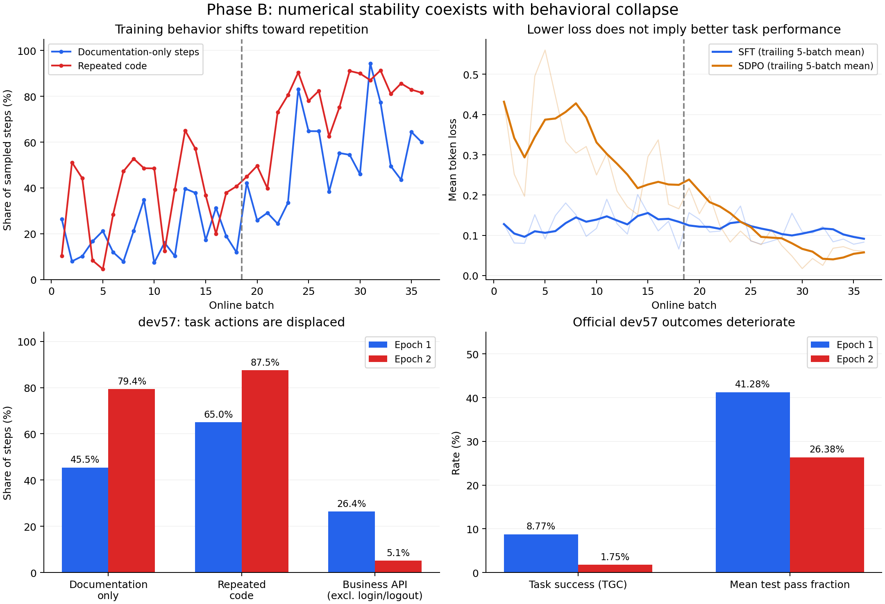

# B 阶段失败诊断与下一步判断

2026-10-24（北京时间）。本次只做 CPU 事后分析、代码审查和原论文/官方代码核对，没有启动新训练、GPU 推理或重新评分。原训练、反馈、checkpoint 和评估结果均保持原样。

## 结论

**停止原配置的后续扩大训练，不进入阶段 C。保留 rubric 选样与反馈修复方向，但需要改变或先验证 FAIL 信号转成训练目标的方式。**

本次最明确的失败是：学生越来越偏向重复的文档查询，越来越少执行任务相关操作及结束任务。数值正常与能力退化同时发生。没有 SFT-only / SDPO-only 对照，不能将责任单独归给一个分支；但目前证据足以否定“按现配置继续加轮次就能改善”的建议。

此前把首批 loss、梯度和 checkpoint 正常作为无人值守续跑的主要检查，条件不够充分。后续应同时检查重复行为、业务推进、教师在固定状态上的纠错质量。数值验收通过不是方法有效的验收通过。

## 1. 已确认的结果与行为变化

两轮均为同一 dev57、temperature=0、seed=100、不带反馈的学生，使用预先指定的 batch 18 / 36 checkpoint。

| dev57 指标 | 第 1 轮 | 第 2 轮 |
|---|---:|---:|
| 整题成功数 / TGC | 5/57，8.77% | 1/57，1.75% |
| 每题官方检查通过比例的平均值 | 41.28% | 26.38% |
| 平均步骤 | 26.86 | 38.30 |
| 只查文档的步骤 | 696/1531，45.46% | 1733/2183，79.39% |
| 重复查询已有同一文档的步骤 | 516/1531，33.70% | 1546/2183，70.82% |
| 轨迹内已出现过的代码步骤 | 995/1531，64.99% | 1911/2183，87.54% |
| 含业务 API 调用的步骤，排除登录/登出 | 404/1531，26.39% | 112/2183，5.13% |
| 出现至少连续 5 次相同代码的任务 | 36/57 | 56/57 |
| 没有业务 API 调用的任务，排除登录/登出 | 24/57 | 49/57 |
| 由 complete_task 结束的任务 | 14/57 | 1/57 |
| 触及步数或上下文上限 | 38/57 | 56/57 |

这里的“业务 API”是排除 api_docs、supervisor 和 login/logout 后的静态 API 调用，包含读取与写入，不等同于已取得有效进展。“重复代码”按 AST 去掉格式/注释后的完全相同代码识别；合法分页或切歌也可能复用代码，不能据此单独判违规。“重复文档”只统计文档 API 及其全部字面量参数均与历史相同的调用；无法静态解析的参数不计入该重复指标。官方检查通过比例不等于任务完成百分比。

第二轮没有新增成功题，丢失 4 题。查看这些题的完整动作序列：

- `6c2c621_1`：第一轮在 27 步内读取笔记、创建目录与文件并完成，8/8 检查通过；第二轮 45 步，登录后持续查询文档，没有进入实际笔记搜索与文件创建，1/8 通过，最终上下文耗尽。
- `6c2c621_2`：第一轮 23 步、8/8 通过；第二轮 44 步、1/8 通过，也在登录后的文档查询中耗尽上下文。
- `b119b1f_2`：第一轮实际查询当前歌曲、切歌并提交，6/6 通过；第二轮 50 步全部是文档 API，没有实际播放业务调用，0/6 通过。
- `d4e9306_2`：第一轮读取喜欢的歌曲/专辑、执行关注并提交，6/6 通过；第二轮重复同一 Spotify API 列表 13 次后上下文耗尽，1/6 通过。

这些是事后选取的退化案例，用于解释具体行为，不用于估计独立效果。全量统计覆盖两轮所有 114 条 dev 轨迹。



## 2. 训练过程已经出现相同变化

| train90 统计 | 第 1 轮 | 第 2 轮 |
|---|---:|---:|
| 轨迹数 / 步骤数 | 90 / 2048 | 90 / 3166 |
| 只查文档的步骤占比 | 19.78% | 53.41% |
| 已出现过的代码占比 | 40.48% | 77.54% |
| 含业务调用步骤，排除登录/登出 | 46.73% | 15.95% |
| SFT 步骤数 | 404 | 508 |
| SFT 中只查文档 | 217/404，53.71% | 347/508，68.31% |
| SFT 中含业务调用，排除登录/登出 | 84/404，20.79% | 33/508，6.50% |
| SFT 中包含 complete_task | 0 | 0 |
| SDPO 步骤数 | 1644 | 2656 |
| SDPO 中已出现过的代码 | 813/1644，49.45% | 2444/2656，92.02% |
| 含 R6=F 的步骤数 | 905 | 2481 |
| 含 R8=F 的步骤数 | 1114 | 383 |
| 含 R1=F 的步骤数 | 750 | 196 |
| 按 batch 等权平均的 SFT loss | 0.12859 | 0.11074 |
| 按 batch 等权平均的 SDPO loss | 0.30005 | 0.09080 |

全程 64 个包含 complete_task 的动作全部有 R8=F，均未进入 SFT。它们并非全部只有 R8 问题，也不能由此说全部实际完成任务；该事实表示当前正向训练中没有提交动作的示范。底座本来具有提交能力，缺少正向示范本身不等于必然遗忘，但这里缺少保留、强化正确结束行为的直接信号。

R1/R8 违规减少的同时，R6 重复/恢复违规和整体停滞增加。“更少执行报错”没有转换成更好的任务结果。第二轮多采了 1118 个步骤，主要不能解释为获得更多独立、有效的学习样本。

第 1–6 批与第 31–36 批相比：SDPO loss 的 batch 均值从 0.39709 降到 0.05503，文档步骤比例从 14.26% 升到 64.08%。注意数据分布同时变化，因此这不是固定测试集上的 KL 改善。

## 3. 为什么会出现这种效果

### 3.1 A 验证的是重新生成的局部纠错；B 学的是原错误前缀上的教师分布

A 中 C2 的局部修复率为 75.15%，但 149 个成功动作中有 131 个（87.9%）只查询文档。许多是在当前状态必要且有用的前置动作；A 当时没有证明模型下一步会应用规范、执行目标操作、最终完成任务。

B 的老师不是 Codex。Codex 提供诊断文本，真正提供 logits 的仍是 Qwen3-8B 的 EMA 教师。实际目标为：

```text
student: p(next_token | 原动作前历史 h, 原错误回答前缀 a_<t)
teacher: q(next_token | h, C2反馈, 同一个原错误回答前缀 a_<t)
loss:    KL(student || stopgrad(teacher))
```

含 FAIL 的动作没有被转成一个显式负标签，也没有先生成并验证修复答案再蒸馏。“判 F”只是选择进入该分支；到底降低还是提高某个原错误续写的概率，由教师分布决定。若反馈后的教师在已固定的错误代码前缀上仍倾向原续写，KL 不会自动代表“不要再这样做”。

A 已保存过 C2 在某些错误 API token 上提高原错误概率的反例。B 的后期重复步骤占比很高、对应蒸馏 loss 较低，与该风险相容；**当前尚未对 B 的初始/中期/最终教师在同一状态重新测分布，不能将这个机制写成已被直接证实的唯一根因。**

这一原前缀构造本身符合 [SDPO 原文的目标](https://arxiv.org/html/2601.20802v1#S2)，并非发现了一个简单的实现拼写错误。问题是它迁移到此任务时，教师能否在这些前缀上提供有益监督没有得到足够验证。

### 3.2 局部正确性筛选不保证任务推进，在线数据又由当前模型自己产生

当前 SFT 条件 F=0、P≥3 可以选出合法而有依据的文档查询，并不要求该动作本身执行业务写入、完成子目标或最终任务。第一轮开始模型获得更强的前置查询倾向后，第二轮采样分布已经改变；SFT 中业务调用从 84 步下降到 33 步，SDPO 中则大量是循环里的旧动作。

最可信的整体机制假设是：局部准备动作得到较多正向监督，加上未能有效打断循环的蒸馏，逐渐造成任务操作减少；新的在线轨迹进一步集中在准备和重复状态上，使后续更新缺乏多样、可信的任务推进示范。这里存在反馈循环，需通过分支对照分离贡献。

**不能把原因简化成“文档占比高”。** 你之前成功的 ZeroFail3 数据有 62.2% 的步骤包含文档查询，本次全部 SFT 中 61.8% 是只查文档；两个统计定义不同，但至少足以说明文档偏多并不必然导致失败。旧实验使用固定离线数据、不同评分版本与训练预算；本次使用不断变化的在线数据并新增 SDPO。旧实验不能充当本轮严格的 SFT 对照。见 [原消融报告](../../2026-10-16_appworld_rubric_selection_ablation/REPORT.md)。

### 3.3 不是裁判没有发现重复；发现错误与产生有效梯度之间存在断点

在 1522 个“重复查询已有同一文档、且进入 SDPO”的步骤中，1521 个有 R6=F。重复文档被直接收入 SFT 的只有 14 个步骤。后期反馈也明确指出继续重复无益。例如 batch 36、`b036_692c77d_3` step 16：反馈指出 login 规范已在 step 5 得到，要求使用已有规范、已取到的密码和核实的 email 登录并保留 token。

因此，“再强调一次不要重复”未必能解决核心问题。反馈文本本身正确，不代表 EMA 教师在原回答前缀上产生了正确的梯度。当前反馈不是全量人工语义审查；这里的高 R6 覆盖只证明相关违规大多已被识别，不能证明每份 correction 都足够好。

### 3.4 长循环占据大量训练位置；低 KL 可以与坏策略共存

两分支分别取均值，λ=1，所以 **4300 个 SDPO 步骤并不意味着蒸馏权重自动是 912 个 SFT 步骤的 4.7 倍**。第二轮平均 SFT 梯度 norm 0.4923，反而高于 SDPO 的 0.3213，不能简单归因为 SDPO 数量压过 SFT。

但在 SDPO 分支内部，重复状态会占据越来越多位置。第二轮 92.0% 的 SDPO 步骤代码已在其轨迹出现过；这些重复步骤的平均 loss 0.05942，非重复步骤为 0.34159。全程重复文档 SDPO 的平均 loss 为 0.07871。老师与学生对某种错误续写都很确定时，KL 可以很小；固定状态的概率/梯度诊断仍需补上，才可确认具体发生在哪些 token。

原实现逐步骤、逐回答 token 平均；一个短的重复查询与一个复杂业务步骤可具有相同的 step 权重，而真正决定动作类型的少数 token 又被整段回答平均。这些是需要消融的目标设计因素，不是已证明的单一元凶。调整时必须保留完整历史，只改变重复训练位置的权重，不能删掉实际发生过的环境状态。

EMA 跟随学生，并非固定正确标准；本次没有完整任务回报或独立的可信业务行为保持约束。不能由此断言 SDPO 必须有终局奖励，但在这个实现中，没有额外信号保证“局部修正规范”最终成为“完成任务”。

## 4. 哪些解释目前证据不足

- **NaN、梯度爆炸、没更新、checkpoint 加载错：** 未发现。36 次更新完成，只 2 批裁剪，依赖摘要匹配；CPU 读取 epoch 1/2 checkpoint，优化器计数分别 18/36，参数有限、师生 adapter 不相同。尚未对完整运行重新做数值复现，因此这是排除明显异常，不是证明不存在任何软件问题。
- **学习率一定太高：** 未证实。历史成功的 LoRA SFT 使用 2e-4，比本次 5e-5 更高；目标、数据和更新预算不同，无法直接比较，也不能仅凭一个 LR 数字解释失败。
- **应该换成 C3：** 没有支持。A 中 C3 比 C2 差，且带完整原回答加重某些错误锚定；不建议以 C3 替换作为默认补救。
- **用了 reverse KL 就是抄错原论文：** 不成立。原文 §2.3 讨论 JSD 稳定性，但已核对的官方 rich-feedback 脚本也使用 reverse KL（alpha=1）、top-k=20、teacher update rate=0.01；本实验为 top-k=100、EMA 新学生权重 0.05。它们是可消融的差异，不能从失败后直接指定某个值为根因。[官方固定版本脚本](https://github.com/lasgroup/SDPO/blob/7c457fc1b1f636ae794eb0362ba37d4743b06fbc/experiments/rich_feedback/run_sdpo.sh)
- **SDPO 本身或所有 rubric 方向已经被否定：** 一次单 seed、无分支对照的 AppWorld 迁移实验不足以支持。原 SDPO 的反馈环境、有效教师条件与本次逐 agent step 的构造不同；其 [限制与后续方向](https://arxiv.org/html/2601.20802v1#S7) 也讨论自教师能力、反馈质量与长程 agent 场景。
- **已经退化到低于匹配底座：** 本轮没有同管线的底座 dev57。历史底座 1/57、ZeroFail3 平均 17.54% 只能作为背景，不能作为本轮匹配的因果基线。可以确定的是第二轮比第一轮明显减少任务执行，丢失 4 个成功题。

## 5. 建议的下一步：先验证信号，限制新增成本

### 第一步：固定状态诊断，暂不再跑完整训练

从本次 train90 保存状态中预先固定 32 个，避免从 dev57 失败题中挑训练例：8 个 R6 重复状态、8 个 R8 前提/协议缺失状态、8 个 R1 执行错误状态、8 个无 FAIL 的业务步骤。允许分项重叠时规定唯一优先分层，并固定每题上限，避免同一循环占满样本。复用现有 Codex 反馈。

只对 24 个 FAIL 状态，在同一动作前状态分别检查初始冻结 Qwen+C2 和第二轮 EMA 教师+C2：一是自由生成能否摆脱重复并采取相关动作；二是在原错误回答前缀上，错误/重复动作关键 token 的概率与梯度方向；同时保留无反馈学生对照。文档查询是否有效，要看它是否提供此前缺少的信息、随后 3–5 步是否实际应用它推进任务，而非要求每一步必须写数据库。8 个干净业务状态不加中性或负反馈，只在原输入下比较初始与训练后学生，用于检测间接退化。

这一小样本用于机制诊断，不声称能估计全 dev57 或证明总体收益。

| 诊断结果 | 下一步 |
|---|---|
| 初始 C2 教师能修复，后期 EMA 教师不能 | 优先检验固定可靠教师，暂不随坏学生更新；保留教师能力检查 |
| 自由生成能修复，但原错误前缀上的分布/梯度不可靠 | 放弃当前原错误前缀 SDPO 作为主方案，转向生成并验证后的修复动作监督 |
| 两种教师自由生成都只会准备或循环 | 先改反馈/教师能力或采用更可靠教师，不靠调整 KL 权重期待解决 |
| 教师分布可靠，但学生一次更新方向不对或业务行为受损 | 检查分支梯度、关键 token 平均方式、状态权重和参数漂移 |

### 第二步：用同一缓存首批做最小分支对照

从相同初始化、同一已保存首批轨迹/反馈，比较仅 SFT、仅 SDPO、混合的一次更新；已有 batch 1 混合 checkpoint 可复用。新增两次单 batch 更新即可先检查分支即时影响，避免立即再跑两个完整在线轮次。使用与首批训练任务隔离的固定状态探针，查看业务动作保留、重复倾向、正确修复倾向以及梯度方向。

这只能定位一步更新的局部作用，不能替代完整在线 SFT 对照对长期效果的判断。若两分支短程都正常而混合后闭环才退化，再设计少量在线 batch 的序贯实验，每批检查行为，达到事先约定的退化条件则停止。

### 第三步：若保留 FAIL 利用，优先考虑可验证的修复监督

候选分支为：FAIL 状态 → Codex 反馈 → 可靠 C2 教师从动作前状态生成新的修复动作 → 执行并验证，必要时短续跑 → 学生在不带反馈的原状态学习已验证修复。对齐的是新修复动作路径，不能把它仍称为原样 SDPO；硬标签版本是修复 SFT/离策略蒸馏，软标签版本也要明确使用的行为分布。

同时需要保留可信业务读取、决策、写入及正确终止的示范，而不是只保留前置准备。可考虑从已验证的 ZeroFail3 SFT 模型出发，或混入固定可信正例作为保留能力的样本；不得以放宽标准为理由直接正向模仿已知违规动作。

对同一任务、状态、未变化的观测和相同根因导致的重复错误，考虑去重或限权；原完整历史照常保留。先验证再采用，不能把合法分页、状态变化后的重新读取和必要核验一概删掉。

如果仍保留 KL 分支，固定教师、降低蒸馏权重、缩小更新、JSD/正则等应逐项消融。它们是稳定性工具，不能替代对教师信号是否正确的验证。

## 6. 是否值得继续

**rubric 的研究值得保留，当前全 FAIL→C2 自蒸馏配方不值得继续直接扩大。** 旧 ZeroFail3 有多 seed 的正面证据；A 证明反馈能改善许多局部重新决策；B 则表明这两点不能直接推出当前训练构造有效。

建议只再投入一次有明确退出条件的小诊断：若可靠教师或验证后修复仍不能产生正确业务推进与稳定的学习方向，就停止这条 SDPO 支线，把资源转回已有效的 ZeroFail3 与更明确的任务/子目标监督。若断点定位为错误前缀或 EMA 漂移，再围绕该断点做小规模修复实验，而不是同时改 prompt、teacher、loss、学习率后再跑 25 小时。

## 证据与复现

- [原始训练与两轮评估报告](REPORT.md)
- [诊断总表及口径](analysis/failure_diagnosis/summary.json)
- [逐批行为与 loss](analysis/failure_diagnosis/training_by_batch.csv)
- [每个训练步骤的标签、分支、行为与 loss](analysis/failure_diagnosis/training_step_features.csv)
- [dev57 逐题行为](analysis/failure_diagnosis/dev57_behavior_by_task.csv)
- [四个退化案例、64 个结束动作与后期反馈审计](analysis/failure_diagnosis/case_audit.json)
- [图像](analysis/failure_diagnosis/behavior_and_loss.png)、[PDF](analysis/failure_diagnosis/behavior_and_loss.pdf)
- CPU 分析脚本：[analyze_b_failure.py](../scripts/analyze_b_failure.py)

统计已核对 36 个 batch、180 条训练轨迹、114 条 dev 轨迹、5214 个训练步骤，与原报告的 912 个 SFT、4300 个 SDPO、2 个 mask 完全一致。没有把 `.partial.json` 当成独立样本。图中训练 loss 的实线是向后 5 批滑动均值，细线为逐批值；同批行为比例是步骤加权。
