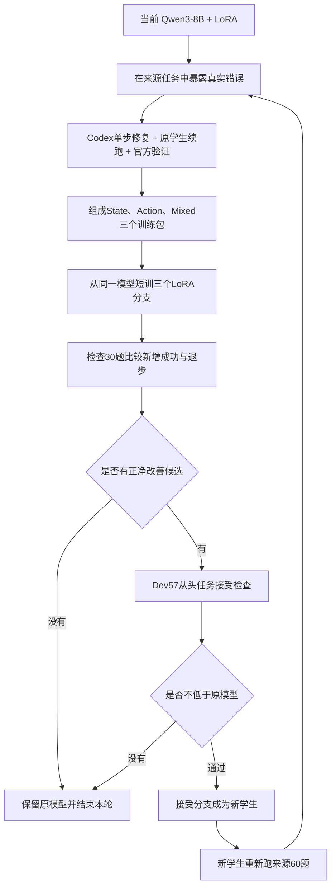

# Dynamic CFST 方法总览：根据实际学习收益，动态决定下一轮练什么

<!-- STATE_DEV57_DIAGNOSTIC_START -->
**2026-09-29四模型Dev57评测已齐：** State-1epoch在Dev57成功25/57（43.9%），evaluator条件通过179/291（61.51%）。相对原epoch5的23/57，新增成功9题、退步7题、净变化+2题；此前Action为31/57、Mixed为21/57。保持既有Action选择及接受记录；本次没有训练、教师答案或来源60题刷新。详见 [第7e步总报告](/root/autodl-tmp/workspace-tw/experiments/2026-09-28_dynamic_cfst/step07e_dev57_state_one_epoch/README.md) · [State的57题evaluator明细](/root/autodl-tmp/workspace-tw/experiments/2026-09-28_dynamic_cfst/step07e_dev57_state_one_epoch/EVALUATOR_DETAILS.md) · [四模型逐题对照](/root/autodl-tmp/workspace-tw/experiments/2026-09-28_dynamic_cfst/step07e_dev57_state_one_epoch/four_model_per_task.csv)。
<!-- STATE_DEV57_DIAGNOSTIC_END -->

<!-- MIXED_DEV57_DIAGNOSTIC_START -->
**2026-09-29补充诊断已完成：** Mixed-1epoch在Dev57成功21/57（36.8%），evaluator条件通过184/291（63.23%）。相对原epoch5的23/57，本次净变化-2题（新增成功10、退步12）；此前Action为31/57。这次完整Dev57评测用于核查Mixed的表现，保留原第7b步选择和第7c步Action接受记录，不训练、不生成教师答案、不刷新来源60题。详见 [第7d步总报告](/root/autodl-tmp/workspace-tw/experiments/2026-09-28_dynamic_cfst/step07d_dev57_mixed_one_epoch/README.md) · [57题evaluator明细](/root/autodl-tmp/workspace-tw/experiments/2026-09-28_dynamic_cfst/step07d_dev57_mixed_one_epoch/EVALUATOR_DETAILS.md)。
<!-- MIXED_DEV57_DIAGNOSTIC_END -->

> 本文说明我们准备提出的完整方法，以及从当前实验走到完整方法的路线。它是一份研究方案，不代表下面的效果已经得到验证。当前最小版本只使用“状态构建”和“动作落地”两个主能力，并设置一个不分类的混合训练包。
>
> [METHOD_PROPOSAL.md](/root/autodl-tmp/workspace-tw/plans/2026-09-28_capability_frontier/METHOD_PROPOSAL.md) 是当前最小闭环的执行计划。本文解释它在整体方法中的位置。[IMPLEMENTATION_NOTES.md](/root/autodl-tmp/workspace-tw/plans/2026-09-28_capability_frontier/IMPLEMENTATION_NOTES.md) 涉及的执行设置以当前第5–7步冻结产物为准；本轮实际只训练State、Action、Mixed三个分支。

**2026-09-29当前进展：** 第6b步三支1epoch训练、第7b步检查30题选择和第7c步Dev57接受检查均已完成。检查30题为State 17/30、Action 19/30、Mixed 15/30，唯一候选为Action；Action-1epoch在Dev57上成功31/57（54.4%），测试条件通过215/291（73.88%）。通过既有接受门槛，可在后续第8步使用该候选；本次未启动来源60题刷新。详见 [第7c步总报告](/root/autodl-tmp/workspace-tw/experiments/2026-09-28_dynamic_cfst/step07c_dev57_action_one_epoch/README.md)。

## 1. 我们最终想做出什么

我们想做一个能反复改善 **Qwen3-8B 工具使用能力的训练流程**。

Qwen3-8B 先自己做 AppWorld 任务。我们找到它做错的步骤，请 Codex 提供一个经过环境验证的修复动作。然后，不立即把所有修复动作混在一起训练，而是先做几次小规模试训，观察：**学哪一类修复步骤，最能帮助 Qwen3-8B 做对其他任务？**

把本轮最有效的试训模型留下，成为下一轮的 Qwen3-8B。让它重新做任务、暴露新的错误，再决定下一轮练什么。

这就是我们拟议的 **Dynamic Capability-Frontier Step Training，简称 Dynamic CFST**。

它的核心研究问题是：**在有限训练预算下，根据当前模型实际能从什么步骤中学到东西，反复调整训练内容，是否比固定选样、随机选样或直接学习完整轨迹更有效？**

最终交付仍然是一个可以独立完成任务的 Qwen3-8B 加 LoRA adapter。Codex 和试训分支用于训练阶段；正式评测时，由这个 Qwen3-8B 自己完成任务。

## 2. “能力边界”和“动态”具体指什么

这里的“能力”先用两种可观察、可训练的行为不足表示：

| 主能力 | Qwen3-8B 可能出现的错误 | 希望它学会什么 |
| --- | --- | --- |
| 状态构建 | 漏查必要信息、选错记录、没有按日期或关系过滤、把大量无关状态塞进上下文 | 取得、筛选、压缩并理解下一步真正需要的环境状态 |
| 动作落地 | 状态已经基本足够，但选错API、对象、方向、路径、参数或数据格式 | 把任务意图转成可以正确执行的工具动作 |

这两个类别用于组成训练包，不声称模型内部只有两个独立能力模块。一个动作可能同时需要状态理解和动作构造；第一版为每条样本指定一个主能力，同时保留次要标签。

原来的“错误恢复”不再作为第三个主能力。它描述的是错误发生后的阶段，可以附着在状态构建或动作落地上。同样，Python异常、上下文过载、日期过滤、API选择和CSV格式都作为次要标签，用来解释结果，不单独训练一个分支。

当前20条官方成功修复按这套规则得到：

- 状态构建12条；
- 动作落地8条，其中包含原来唯一的CSV恢复样本；
- 另建一个包含全部20条的混合训练包，检查“不分类直接训练”是否已经足够。

“能力边界”指同时符合以下条件的训练内容：

1. **当前还做不好：** Qwen3-8B 自己在这里失败了。
2. **得到有限帮助后能接着做：** Codex 只替换一个动作，后面仍由原来的 Qwen3-8B 完成，任务能够成功。
3. **练习之后能用到别处：** 用这些修复步骤短训后，Qwen3-8B 在其他任务上也改善了。

前两项已经在当前20条样本上得到验证。第三项的旧版试训没有正净收益；改为各包1epoch后，检查30题为State 17/30、Action 19/30、Mixed 15/30。唯一候选Action在Dev57进一步达到31/57，相对原epoch5净增8题，通过既有接受门槛。这支持本次Action修复训练在固定设置下带来了任务收益；还不能单独证明两能力划分最优或动态选择机制有效。

“动态”意味着：**模型更新后，上面三件事都重新检查。** 第一轮值得学的内容，到第二轮可能已经学会；原来接不住的修复，到第二轮可能变得可以接住。训练优先级由更新后模型的新失败和实际迁移结果决定。

## 3. 第一版完整算法使用什么

| 角色 | 具体使用什么 | 用途 |
| --- | --- | --- |
| 初始学生 | 已完成 train90 SFT 的 **Qwen3-8B + LoRA epoch5 adapter** | 从现有结果继续训练，不重新选择基座 |
| 修复老师 | **Codex，模型 gpt-5.6-sol，high effort** | 在学生真实出错的位置提出一个替代动作 |
| 执行与裁判 | **AppWorld 环境及官方任务评估器** | 执行动作、恢复状态、判断最终任务成功与否 |
| 修复来源 | train90 中按任务族划出的 **60 个任务** | 收集学生错误，产生训练步骤 |
| 训练过程中的检查任务 | train90 中其余 **30 个任务** | 比较候选训练内容，检查能力是否迁移、是否退步 |
| 阶段评测 | **dev57** | 对已确定的方案，从任务开始评测整体效果 |

60/30 按任务族划分，同一任务族的变体放在同一侧。这与当前第一阶段计划一致。

这里的 30 个检查任务，旧的 LoRA 在最初的 train90 SFT 中已经见过。因此我们检验的是“新一轮修复训练能否迁移到没有为它提供修复样本的任务族”，不能把它们称为模型从未见过的新任务。它们参与选样，属于训练流程的一部分；dev57 不参与每轮选哪一包训练内容。

现有 FFT 结果作为背景基线保存。第一版闭环先使用 LoRA，把方法流程跑通，再考虑验证它能否用于 FFT。

## 4. 一轮训练究竟怎么运行

### 第一步：让当前学生暴露真实错误

用当前Qwen3-8B完成修复来源任务，保存每一步输入、动作、环境返回和最终结果。对失败任务，找到一个有日志证据、能够恢复前缀状态的决策位置。

第一版允许人工确认位置和主能力，不要求先训练自动错误定位器。主能力只在状态构建与动作落地中选择；错误反馈后、Python异常和上下文过载作为次要标签。

**输出：** 错误动作之前的完整历史，以及可以干净恢复的环境状态。

### 第二步：验证“只帮这一步，学生能不能继续成功”

把错误动作之前的原始历史交给Codex，请它生成一个替代动作。恢复当时的AppWorld数据库和Python执行状态，执行该动作，然后立即交还原来的Qwen3-8B继续任务。

只有最终通过官方全部断言的修复才进入候选库。一次assistant决策可以包含一段Python代码和多个自然需要的API调用，但它仍只替换一个决策回合。

**输出：** 学生历史、教师修复动作，以及原学生接着完成任务的验证记录。

### 第三步：组成三个最小训练包

每轮准备三个包：

| 训练包 | 内容 | 作用 |
| --- | --- | --- |
| State | 状态构建修复 | 测试集中训练状态取得、筛选和压缩 |
| Action | 动作落地修复 | 测试集中训练API、对象、参数、路径和格式构造 |
| Mixed | 本轮全部合格修复 | 检查不做能力划分是否已经足够 |

训练样本保留修复动作之前的完整历史，只对教师修复动作计算训练损失。前缀tokens只作条件输入；原错误动作和教师之后的学生续跑步骤不进入训练答案。续跑轨迹仅用于证明修复能够通向官方成功。

当前最小实验改为三个包各训练1轮，每条唯一修复只使用一次。State/Action/Mixed分别监督1,826/1,493/3,319 tokens，在全局batch=2时更新6/4/10步，不补齐相同训练量。分别记录输入计算tokens、实际更新步数和耗时；旧约8,000-token方案保留为历史对照。

**输出：** 三个来源清楚、每条只学一次、规模不同的训练包。

### 第四步：从同一个学生短训三个分支

复制同一个Qwen3-8B + 当前LoRA adapter，分别训练State、Action、Mixed三个分支。它们使用相同学习率、batch、训练轮数和其他超参数，训练总量随包大小自然变化；彼此不串行继承。当前修订保持学习率2e-4，不同时调整其他超参数。

这里没有新训练损失，仍然是只对修复动作进行普通监督微调。方法变化在于：训练内容来自当前学生的真实失败、经过单步修复与官方结果验证，并在之后用其他任务的真实收益进行选择。

**输出：** 三个独立LoRA分支和完整训练记录。

### 第五步：用检查30题比较净改善

让原模型和三个分支从头完成同一份检查30题。检查题不提供Codex答案，也不产生训练数据。

对每个分支统计：

- 原来失败、现在成功的新增成功；
- 原来成功、现在失败的退步；
- 净改善 = 新增成功 − 退步；
- 官方总成功、任务族变化和上下文失败。

只有净改善大于0的分支有资格进入Dev57。检查30题按照预先冻结的规则只选一个候选：先看净改善，再看退步数，仍并列则使用训练前固定的随机顺序。State或Action胜过Mixed，才初步说明集中训练某个能力方向可能有额外价值；Mixed最好则说明修复数据可能有效，但当前二分类没有显示额外价值。

**输出：** 一个已选定候选，或“没有正收益分支”的停止结论。

### 第六步：用Dev57做从头任务接受检查

Dev57不参与训练包生成，也不在多个模型间重新选赢家。比较原模型、检查30题已经选定的唯一候选，以及解释结论所需的Mixed诊断参照。

最小接受规则是：已选候选在检查30题净改善大于0，并且Dev57官方成功数不低于原模型。通过时直接保留已经评测过的那个LoRA分支，不合并adapter，也不追加未经检查的训练。

如果没有候选通过，保留旧模型并结束本轮。一次检查的小幅改善只作为可行性证据，不当作稳定统计结论。

### 第七步：让新学生重新暴露错误

接受的新学生重新完成同一来源60题，产生新的成功、失败、错误位置和两能力分布。旧修复只有在新学生仍然需要、并重新通过“替换后可继续成功”的验证时，才进入下一轮。

最小闭环做到“新学生重新产生下一轮候选清单”即可停止，不要求立刻再训练第二轮。如果本轮没有可接受更新，也记录为一次完整但失败的闭环尝试，不能为了形式强行选模型。

## 5. 用一个例子理解整个过程

下面数字全部是假设，只用于解释选择规则。原模型在检查30题上成功17题：

| 第一轮训练内容 | 新增成功 | 退步 | 净改善 | 检查结论 |
| --- | ---: | ---: | ---: | --- |
| State | 4 | 1 | +3 | 进入Dev57 |
| Action | 2 | 2 | 0 | 不进入 |
| Mixed | 3 | 1 | +2 | 进入Dev57并作为不分类参照 |

假设Dev57上State不低于原模型，而Mixed下降，那么State通过接受检查，成为新的当前学生。接着让State模型重新完成来源60题，可能发现状态构建错误减少，而动作落地错误成为主要剩余问题。下一轮就会重新生成修复库和训练包。

也可能Mixed在检查30题和Dev57都最好。此时可以接受Mixed模型完成自我改进，但结论应是“修复训练有效，当前二分类没有额外价值”，不能把它包装成能力选择成功。

这就是能力边界移动的具体含义：选择依据是更新后模型的真实失败与迁移结果，不是永久固定某个标签。

## 6. 当前 METHOD_PROPOSAL.md 在哪里

它现在定义的是Dynamic CFST的**最小一轮闭环**：先用两个粗能力把流程走通，再决定分类是否值得细化。

| 当前计划步骤 | 完整方法模块 | 当前状态或目标 |
| --- | --- | --- |
| 步骤1–2 | 暴露错误、冻结来源60/检查30 | 已完成 |
| 步骤3–4 | 单步修复、环境续跑与官方验证 | 已完成，冻结20条合格修复 |
| 步骤5 | 组成State、Action、Mixed训练包 | 已完成：12/8/20条，472项核验通过 |
| 步骤6 | 从同一起点短训三个LoRA分支 | 旧版及每包1epoch修订版均完成，三个新adapter已核验 |
| 步骤7 | 检查30题选择 + Dev57接受检查 | 旧版无正净改善；1epoch检查30题完成；Action Dev57 31/57，接受门槛通过 |
| 步骤8 | 接受分支并重新跑来源60题 | 得到更新后模型的新能力边界 |

当前第一轮使用“两个专项包 + 一个全部样本混合包”，共三个分支。它是可行性实验：如果专项分支胜过Mixed，说明分类可能有用；如果Mixed胜出，说明应优先保留修复训练而重新考虑分类；如果全部无收益，则当前数据或训练设置不支持迁移。

**2026-09-29第一轮实测：** 检查30题已完成：原epoch5为17/30（复用），CFST-state 13/30、CFST-Action 14/30、CFST-Mixed 14/30。 三个分支都没有正净改善，按原计划保留原epoch5，本轮不进入Dev57或来源60题刷新。 [逐题证据与报告](/root/autodl-tmp/workspace-tw/experiments/2026-09-28_dynamic_cfst/step07_check30_evaluation/README.md)。本轮没有给检查题生成教师答案，也没有给检查题精细重分类；这些结果用于判断当前更新是否值得继续，不能单独证明分类或完整动态算法有效。

本次1epoch修订是在看过旧结果后提出的一次开发实验，训练前固定规则，已完整报告各支训练结果；现已完整报告各支评测结果，不根据检查30题结果临时加训或挑中间权重。检查30题后续比较不作为全新独立测试；Dev57仍不提供训练答案或选超参数依据。比较解释为“不同数据包各学一遍的效果”，不宣称已经控制总训练量或证明分类有效。

## 7. 假设第一阶段效果不错，后面具体做什么

### 阶段二：实现两轮 Dynamic CFST

先按当前计划重复有希望的结果，确认优势不只来自一个训练种子或一次随机抽样。随后冻结完整算法的设置，从原有 Qwen3-8B LoRA epoch5 重新开始，执行两轮闭环。

需要补上的功能主要是：

| 要补的功能 | 具体做什么 | 完成后的产物 |
| --- | --- | --- |
| 错误现场恢复与修复验证 | 恢复数据库和执行变量，替换一个动作，让学生续跑 | 可重复验证的修复库 |
| 训练包生成与分支短训 | 保留完整历史，只训练修复动作，每包完整训练一轮并记录实际训练量 | 每轮候选数据和 LoRA 分支 |
| 共同检查与收益记录 | 保存新增成功、丢失成功、各任务族变化 | 可核查的选样依据 |
| 主模型更新与轮次管理 | 执行完整任务检查，保留通过的分支，再采样 | 第一轮、第二轮主模型及选择记录 |

具体入口沿用现有的 AppWorld 采样、LoRA 续训和评测脚本，修改点已列在当前计划与实现备注中。它们目前并没有自动组成上述完整闭环，需要新增衔接和验证逻辑。

阶段二要验证：模型更新后，重新计算训练价值是否有用；整个流程是否能连续运行，而不只是在一次试训中找到一个好数据包。

### 阶段三：验证“动态选择”到底带来了多少

从同一个初始模型开始，至少比较下面四条路线：

| 路线 | 每轮怎样决定训练内容 | 用来排除什么解释 |
| --- | --- | --- |
| 随机修复训练 | 从有效修复中随机选择 | 是否只是增加修复数据就够了？ |
| 固定类别训练 | 第一轮选出一个类别，后面保持这个方向 | 是否第一次选对方向后就不必重新测量？ |
| 错误频率训练 | 优先训练当前出现最多的错误类型 | 是否只数错误次数就足够？ |
| Dynamic CFST | 每轮试训，并依据其他任务的净改善选择 | 实测学习收益和动态重新选择是否有额外价值？ |

各路线都从各自当前模型收集错误，使用相同的修复验证规则。模型一旦不同，后续错误和修复库自然会不同，不能声称它们始终使用完全相同的数据。要单独研究选择器本身，可以另做“固定同一修复库”的比较。

既报告相同主模型训练 token 下的效果，也报告相同总资源预算下的效果。**被丢弃的试训分支、Codex 调用、环境续跑和完整任务检查都计入总成本。** 随机方法应有机会把节省的选择成本用于更多训练或采样，才能判断 Dynamic CFST 是否值得它的额外开销。

dev57 用于阶段结果检查，不参与每轮训练包选择。已经多次用于研究决策的 dev 或 test 分数只作为开发证据；正式泛化结论需要在协议冻结后用未参与决策的任务检验。

### 阶段四：补成完整论文证据

前面结果成立后，再做更完整的对照：学习整个成功修复轨迹是否同样有效、取消环境验证会怎样、取消退步惩罚会怎样，以及不同训练预算和随机种子下是否稳定。

同时与最接近的已有方法做适配后的实现对照，清楚记录不能保持一致的训练目标、教师成本和评测预算。若多次试训成本过大，可以在后续研究用预测器估计训练包收益；第一版先保留实际试训，避免在没有真实收益证据时又引入一个未经验证的打分器。

## 8. 和 CSO、DRACO 等方法相比，我们想研究的区别是什么

“能力标签 + 挑选步骤 + self-improvement”本身不足以构成明确的新贡献。步骤选择、教师修复和迭代训练已有相关工作。我们要验证的更具体：**用短程参数更新后的跨任务净改善，决定当前模型下一轮学习哪些经过验证的修复步骤。**

| 工作 | 已有方法的主要机制 | Dynamic CFST 拟研究的区别 |
| --- | --- | --- |
| [CSO](https://arxiv.org/abs/2602.03412) | 在学生失败位置构造专家替代步骤，并结合学生续跑形成步骤偏好、进行优化；包含迭代改进 | 修复和迭代不是我们的独有点。我们重点研究：若干修复训练包中，哪个经过实际短训后最能改善其他任务，并据此选择模型更新 |
| [DRACO](https://arxiv.org/abs/2609.04094) | 随策略能力调整评价准则，并把轨迹层面的评价分配到相关步骤，用于策略优化 | 我们使用 AppWorld 的官方结果验证修复，再用独立试训分支的实际行为变化决定训练内容；第一版仍做监督微调 |
| [ATLaS](https://arxiv.org/abs/2503.02197) | 选择值得学习的步骤，并在保留上下文的情况下进行选择性监督微调 | 保留历史、只训练部分步骤是已有思路。我们拟增加当前学生的真实错误、修复可接续性验证，以及每轮实测迁移收益 |
| [LESS](https://arxiv.org/abs/2402.04333) | 利用与优化器相关的梯度信息，为目标能力选择训练数据 | 我们第一版直接试训并执行任务，测量一个训练包带来的改善和退步。它更直接，也更贵，需要用实验说明成本是否值得 |

这张表用于定位研究问题，不等于完成了新颖性证明。此前列出的 SALT、ProCredit、CANOPY、AgentEvolver、Skill-SD、ProST 等仍需要在最终机制确定后逐项核对。相关工作不能仅凭名称不同就排除重合。

潜在贡献可以写成三件可检验的事：

1. **可接续修复：** 只给当前学生一个经过环境验证的正确动作，构造它有机会学会的训练内容。
2. **实测学习价值：** 根据短训后对其他任务的净改善，选择训练包，并记录造成的退步。
3. **随模型更新重选：** 每轮重新生成和比较候选内容，追踪当前最值得学的方向。

第一件事与已有修复方法有明显重合。完整研究的重点是证明后两件事及其组合确实有用，不能仅把三个已有概念连起来就宣布创新成立。

## 9. 根据结果，下一步如何决定

| 实际看到的结果 | 可以支持的判断 | 下一步 |
| --- | --- | --- |
| State或Action优于Mixed，且dev整体表现改善 | 两能力组织方式值得继续研究 | 重复确认后，实现两轮闭环 |
| Mixed与专项组相近或更好 | 修复数据有价值，当前能力分组价值未证实 | 保留修复流程，重新设计分组或选择器 |
| 续跑变好，从头做任务没有改善 | 局部改善尚未转化为完整任务能力 | 检查更早的错误和状态分布，执行完整任务接受检查 |
| 两轮动态选择优于固定类别和随机选择 | 随模型变化重新分配训练内容有价值 | 扩展重复实验、预算对照和已有方法对照 |
| 动态与固定相近，且选择方向基本不变 | 当前设置不支持动态机制的额外收益 | 如实保留较简单方案，不强行讲动态故事 |
| 相同主模型训练量下有效，但相同总成本下不如随机 | 选择器有信号，但当前实现不够划算 | 减少候选数量或研究更便宜的收益估计 |
| 修复可验证，但反复短训都不迁移 | 单步可修复不等于单步可学习、可迁移 | 检查上下文、训练强度和多步依赖；调整后仍无效则停止这一路线 |

当前的最小任务已经明确：用状态构建、动作落地和混合三个包完成一次“短训—检查—接受—重新采错”闭环。若这个基础成立，再重复随机种子和第二轮动态选择。完整方法的成败，最终看的是 **Qwen3-8B 是否能以合理总成本，独立完成更多任务**。

**Dev57接受检查补充：** Action-1epoch在Dev57上成功31/57（54.4%），测试条件通过215/291（73.88%）。它执行的是既有候选接受规则，不是根据Dev重新选训练包；通过既有接受门槛，可在后续第8步使用该候选；本次未启动来源60题刷新。[57题evaluator明细](/root/autodl-tmp/workspace-tw/experiments/2026-09-28_dynamic_cfst/step07c_dev57_action_one_epoch/EVALUATOR_DETAILS.md)。
