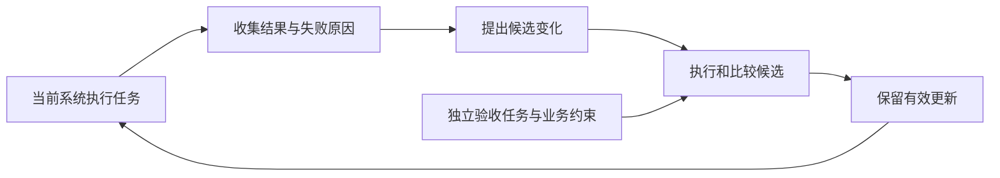

# RSI 十二类方向调研与讨论手册：兼顾时效、影响力与业务稳定性

更新：2026 年 10 月 27 日；面向 10 月 28 日上午会议。目标是决定下一阶段重点研究哪些方向、哪些作为配套能力、哪些暂缓，以及这些决定依赖什么业务条件。业务应用优先，论文贡献作为后续可能产出。

**当前不预设 DATA 是唯一主线，也不预设必须训练模型。** 调研覆盖基础模型、上下文、工具、流程、数据与环境、评价器、训练器、改进机制和研发过程。以下 12 个方向是便于资源决策的议题划分，可交叉组合，不是互斥的学术分类。

**怎么读：** 每类先用四句话定位，再按建议顺序阅读两至三篇代表论文；每篇都解释输入、执行步骤、反馈、保存的更新以及 RSI 的边界，之后再看本方向的技术解释与采用建议。无需先跳到外部原文才能理解基本机制，原文链接供进一步核查。

**本轮只更新当前手册，配套速读与矩阵尚未同步本版优先级；会议选型以本手册为准。**

配套文件：[十二类四句话速读](02_十二类四句话速读.md) · [文献阅读索引](03_文献阅读索引.csv) · [方向决策矩阵](04_方向决策矩阵.csv)。

**十二类跳转：**

- [D1 提示词与上下文策略演进](#d1)
- [D2 记忆与经验演进](#d2)
- [D3 工具与可执行技能演进](#d3)
- [D4 工作流与多 Agent 组织演进](#d4)
- [D5 数据、任务与课程演进](#d5)
- [D6 环境与世界模型协同演进](#d6)
- [D7 基础模型参数自改进](#d7)
- [D8 评价器、奖励与验证能力演进](#d8)
- [D9 算法与程序进化](#d9)
- [D10 训练器与学习规则演进](#d10)
- [D11 自身代码与改进机制演进](#d11)
- [D12 研究与研发流程自动化](#d12)

## 本轮选文标准：2023 年以后，影响力与新贡献两条入口

**本版的折中是：用 2023—2024 年已有引用积累的方法建立主要对照，再用 2025—2026 年有明确新贡献的工作补齐前沿方向；业务稳定性决定采用次序。** 不要求每类机械地各放一篇新旧论文，例如元改进器方向仍主要依靠近期研究，不能因此把它说成已经成熟。

### 年份与引用采用什么口径

- **年份按首次公开计算。** 预印本在 2022 年、会议在 2023 年的文章，不借正式发表年份进入本轮主讲。主讲清单全部首次公开于 2023 年或以后；综述与补充阅读也采用这一时间范围。
- **2023—2024 年文章优先选择至少百次被引者。** 这是本次调研的工作性筛选条件，不是“百次引用便有效”的科学阈值。只有较窄方向、方法直接相关且已有数十次引用的文章，才作为补充机制保留；不靠它单独支撑路线成熟度。
- **2025—2026 年文章不设同样的引用门槛。** 每篇须说清独特贡献，或有可核查的高校／产业研究团队及实质研究内容；本版同时列团队和贡献，再用实验与局限限制结论。
- **选入阅读、优先验证、可以部署，是三件事。** 引用积累支持影响力，独立复现支持可重复性，业务实测才支持本项目采用；三者不能相互替代。知名机构署名也不保证结论正确。

**引用快照日期：2026-10-27。** 本次先查询 OpenAlex，再用 Semantic Scholar 交叉核查；后者单篇接口及后续批次出现限流，因此成功取得 Semantic Scholar 记录的论文用该记录，其余用已取得的 OpenAlex 记录。表中逐项标明来源、可点击记录和计数，不把两库数字混成统一排行榜，也不把未取得的数据写为零。

计数是相应数据库所列记录的 `citationCount`／`cited_by_count`，不是对全网去重后的引用总数，也未去除自引。预印本与正式版可能分开或被合并；表中每项只采用一条记录，**不相加，也不挑多个记录中的数值凑门槛**。例如 MIPRO 的 OpenAlex 会议版记录为 28，Semantic Scholar 对应记录为 377，这说明单个索引的低值不足以认定论文缺乏关注。[OpenAlex 记录](https://openalex.org/W4404782958) · [Semantic Scholar 记录](https://www.semanticscholar.org/paper/8544160c4fb07e78a965a8223cff5c361e9df090)

### 2023—2024 年论文：逐篇给出引用依据

以下 18 篇按首次公开年份进入较早组，不把后续版本年份当成新论文。计数主要用于区分“已有关注积累”和“仍缺传播证据”，**不能比较不同数据库中的数值大小来判断谁更有效**。

| 论文 | 首次公开 | 查询来源与被引次数 | 本版取舍 |
| --- | --- | --- | --- |
| [MIPRO](#d1-paper1) | 2024 | [Semantic Scholar：377](https://www.semanticscholar.org/paper/8544160c4fb07e78a965a8223cff5c361e9df090) | 引用积累支持保留；采用顺序见对应方向 |
| [Promptbreeder](#d1-paper3) | 2023 | [Semantic Scholar：715](https://www.semanticscholar.org/paper/7fe071ea76e49bc3e573beb53f07721630954247) | 引用积累较充分，但业务上仍属探索／辅助参考 |
| [ExpeL](#d2-paper2) | 2023 | [OpenAlex：158](https://openalex.org/W4393160747) | 2023 首发；计数对应 2024 正式版记录 |
| [Voyager](#d3-paper1) | 2023 | [OpenAlex：221](https://openalex.org/W4378505261) | 引用积累支持保留；采用顺序见对应方向 |
| [LATM](#d3-paper2) | 2023 | [Semantic Scholar：385](https://www.semanticscholar.org/paper/32dcd0887537cece54e214f531d2c384470b023f) | 引用积累支持保留；采用顺序见对应方向 |
| [AFlow](#d4-paper1) | 2024 | [Semantic Scholar：496](https://www.semanticscholar.org/paper/53132ea6c107479d4557631299d3ed525109b464) | 引用积累支持保留；采用顺序见对应方向 |
| [ADAS](#d4-paper2) | 2024 | [Semantic Scholar：480](https://www.semanticscholar.org/paper/c9537f656e7d9713fd4108ce7bf512290f48e562) | 引用积累支持保留；采用顺序见对应方向 |
| [WizardLM／Evol-Instruct](#d5-paper1) | 2023 | [OpenAlex：121](https://openalex.org/W4367000491) | 引用积累支持保留；采用顺序见对应方向 |
| [DreamerV3](#d6-paper1) | 2023 | [OpenAlex：124](https://openalex.org/W4315706776) | 计数对应 2023 预印本；方法讲解采用 2025 正式版 |
| [DPO](#d7-paper1) | 2023 | [OpenAlex：671](https://openalex.org/W7133208539) | 引用积累支持保留；采用顺序见对应方向 |
| [ReST-EM](#d7-paper2) | 2023 | [Semantic Scholar：420](https://www.semanticscholar.org/paper/48362b169a235ca650918c489c8cea4c597da645) | 引用积累支持保留；采用顺序见对应方向 |
| [ETO](#d7-paper3) | 2024 | [Semantic Scholar：224](https://www.semanticscholar.org/paper/f95da5b7be2fac2381eb5dfe26dc7dc5bc2d9a90) | 引用积累支持保留；采用顺序见对应方向 |
| [Let’s Verify Step by Step](#d8-paper1) | 2023 | [Semantic Scholar：5,180](https://www.semanticscholar.org/paper/be8db99310602d66bba64bcf41a572c45816fbfc) | 引用积累支持保留；采用顺序见对应方向 |
| [Self-Rewarding LM](#d8-paper2) | 2024 | [Semantic Scholar：788](https://www.semanticscholar.org/paper/04d64be16fb402f28348faffef484bd419c8bd8f) | 引用积累较充分，但业务上仍属探索／辅助参考 |
| [Meta-Rewarding](#d8-paper3) | 2024 | [Semantic Scholar：234](https://www.semanticscholar.org/paper/df90ee11ed6378635f22e6d0061cf67dd0bacd13) | 引用积累较充分，但业务上仍属探索／辅助参考 |
| [FunSearch](#d9-paper1) | 2023 | [OpenAlex：534](https://openalex.org/W4389727268) | 引用积累支持保留；采用顺序见对应方向 |
| [ReEvo](#d9-paper2) | 2024 | [OpenAlex：77](https://openalex.org/W4415797930) | 77 次，作为运筹相关的补充机制；D9 主读 FunSearch 与 AlphaEvolve |
| [The AI Scientist](#d12-paper1) | 2024 | [OpenAlex：116](https://openalex.org/W4402952666) | 引用积累较充分，但业务上仍属探索／辅助参考 |

ReEvo 是本版唯一低于百次快照的较早主文工作。本次取得的是 OpenAlex 的 2024 会议记录，不能据此断定其全网引用少；也不在未补齐其他索引前宣称它是高引论文。保留详细说明是因为它与运筹启发式方向直接相关，但将其降为补充阅读。十二类每类仍至少有两篇主文解释，D9 的主要证据由 FunSearch 与 AlphaEvolve 承担。

### 2025—2026 年论文：不靠年份新，靠具体增量入选

机构信息来自原文署名，以下只列主要或部分合作机构，不代表机构对所有结果作担保。新论文计数未作为本轮门槛，也不凭机构名气免除验证。

| 论文／首发年 | 可核查团队 | 值得保留的独特贡献 | 当前业务角色 |
| --- | --- | --- | --- |
| [GEPA，2025](#d1-paper2) | [UC Berkeley、Stanford、MIT、Databricks 等](https://arxiv.org/html/2507.19457v1) | 将执行轨迹中的自然语言反馈用于提示变化，并保留互补候选；直接对照参数更新与提示搜索。 | 优先验证候选 |
| [ReasoningBank，2025](#d2-paper1) | [Google Cloud AI Research，及 Yale、UIUC 等合作作者](https://arxiv.org/html/2509.25140v1) | 把成功与失败抽象为策略，研究记忆与额外尝试之间的相互作用。 | 有可信经验时验证 |
| [Absolute Zero，2025](#d5-paper2) | [清华大学、北京通用人工智能研究院、Penn State](https://arxiv.org/html/2505.03335v1) | 让同一模型学习出题与解题，以执行器检查任务，将练习分布纳入学习。 | 可执行任务中的条件研究 |
| [WebEvolver，2025](#d6-paper2) | [Tencent AI Lab](https://arxiv.org/html/2504.21024v1) | 把网页世界模型同时用于合成训练轨迹和推理时前瞻，与执行模型共同更新。 | 网页机制参考，迁移待验证 |
| [AlphaEvolve，2025](#d9-paper3) | [Google DeepMind](https://arxiv.org/html/2506.13131v1) | 把程序进化扩展到更大修改范围和多目标评价，并提供作者报告的基础设施部署案例。 | 部署参考及条件候选 |
| [SEAL，2025](#d10-paper1) | [MIT CSAIL](https://arxiv.org/html/2506.10943v1) | 以更新后模型的效果评价自生成学习材料与更新指令，学习怎样准备自己的适应过程。 | 训练平台成熟后研究 |
| [DiscoRL，2025](#d10-paper2) | [Google DeepMind](https://www.nature.com/articles/s41586-025-09761-x) | 由多环境中的学习过程优化更新规则，研究发现规则向未见环境的迁移。 | 高资源条件研究 |
| [DGM，2025](#d11-paper1) | [UBC、Vector Institute、Sakana AI](https://arxiv.org/html/2505.22954v1) | 保留自修改程序档案，在固定外层搜索下探索编码 Agent 的实现变化。 | 自改机制参考 |
| [HyperAgents，2026](#d11-paper2) | [Meta／FAIR、UBC 等合作团队](https://arxiv.org/html/2603.19461v1) | 进一步开放任务程序和元改进程序；需要检验增量是否超出固定改进器。 | 探索参考 |
| [The AI Scientist-v2，2025](#d12-paper2) | [Sakana AI、UBC、Oxford、Vector Institute](https://arxiv.org/html/2504.08066v1) | 用实验管理与分支搜索推进研究，减少人工代码模板依赖。 | 优先借鉴局部实验自动化 |

### 引用之外，再看后续工作究竟怎么用它

有引用不代表做过实验，更不代表认可全部结论。本轮补查以下两条原文可确认的使用关系：

- **Evol-Instruct → WizardCoder：** 后续工作明确把数据演化方法适配到代码任务；说明思想可以被继续使用，但这有重叠作者，不能包装成独立团队复现。[WizardCoder 原文摘要](https://arxiv.org/abs/2306.08568)
- **FunSearch → AlphaEvolve：** 后者明确扩展前者，并对修改范围、模型与评价方式作比较；这是同一研究脉络的扩展和部署线索，不等于独立生产审计。[AlphaEvolve §1、§5](https://arxiv.org/html/2506.13131v1)

因此，本版既不因为“老而经典”保留不合年份的论文，也不因为“新且名校／大厂”就认定值得采用。方向优先级仍以可靠反馈、可限制的修改范围、可复现比较和总成本为依据。

### 与上一版的具体变化

| 上一版内容 | 本版处理 | 保留的讨论问题 |
| --- | --- | --- |
| MBPO（2019） | 移出主讲，D6 主讲 DreamerV3 与 WebEvolver | 环境预测何时可信，误差如何影响策略 |
| DAgger（2011）、STaR（2022） | 移出主讲，D7 改为 DPO、ReST-EM、ETO | 有什么反馈，就采用什么参数更新方式 |
| Self-Instruct（2022 首发／2023 会议） | 以 2023 首发的 Evol-Instruct 替换 | 数据怎样演化，筛选是否可靠 |
| 较早论文的影响力只作定性描述 | 增加 18 篇引用快照与来源；ReEvo 降为补充 | 有无后续关注，是否真正使用／复现 |
| 较新论文仅解释机制 | 增加 10 篇团队、贡献与业务角色 | 新贡献是否值得额外资源和验证 |

本版共 **28 篇详细讲解：18 篇首发于 2023—2024 年，10 篇首发于 2025—2026 年**；这是一份兼顾全景与业务选型的阅读组合，不是论文成熟度排行榜。

## 本版的取舍：先看能否稳定交付，再看自改进程度

本版按“实际业务优先、稳定性与鲁棒性优先”重新选文和安排阅读顺序。**目标是找到值得验证的可控改进方式，而不是选出递归层数最多或发表时间最近的系统。**

现有公开证据不足以给出“在 IP、网络／无线、运筹、商网上普遍最稳定”的论文排名。稳定性依赖任务分布、错误代价、评价标准、工具接口和运行条件。本文提供的是**有依据的选型优先级及验收方法**，不是未经业务实测的稳定性认证。

### 先把“稳定”和“鲁棒”变成可检查的问题

| 维度 | 应该观察什么 | 容易产生的误判 |
| --- | --- | --- |
| 运行稳定性 | 重复运行的失败率、延迟和成本波动 | 只展示一次成功 |
| 更新稳定性 | 多轮修改是否退化、旧任务是否保持能力 | 只展示搜索到的最好版本 |
| 输入鲁棒性 | 缺字段、噪声、边界条件、表述变化下的结果 | 平均分提高就认为各类任务都提高 |
| 分布适应性 | 新时间段、新设备／实例规模、新规则下的表现 | 随机划分同分布数据就声称业务泛化 |
| 反馈可靠性 | 成功标签、奖励和评审是否与业务目标一致 | 把自评分提高当真实收益 |
| 约束满足 | 关键约束是否被满足，错误是否可以检测 | 用收益平均值抵消硬约束违规 |
| 可运维性 | 能否复现、定位版本、恢复服务及回退更新 | “代码开源”就等于容易维护 |
| 资源稳定性 | 最坏情况下的调用、执行、等待与训练成本 | 只核算一次正常任务的成本 |

这些是工程评价维度，不是把所有指标压成一个随意加权的总分。若某项是业务硬约束，应先作为通过条件；收益比较在满足条件的方案之间进行。

### 论文证据怎样影响选择

本文按以下顺序查证，但不把它机械当成等级积分：

1. **实际部署证据：** 是否说明真实运行环境、持续时间、监控和失败处理；作者报告部署收益仍不等于独立审计。
2. **独立复现证据：** 是否由不同团队在可比设置下复现；公开代码、引用多、被后续论文使用都不能代替这一项。
3. **作者实验覆盖：** 是否比较强基线、多次运行、不同任务或规模，是否报告失败和资源成本。
4. **理论与机制依据：** 是否明确处理分布偏移、模型误差或反馈偏差；理论保证依赖其假设，不能直接变成业务保证。
5. **可执行性与维护条件：** 模型、数据、接口和实现能否在本方条件下复现。

**本次没有完成对所有论文的独立复现系统审查，也没有亲自复现其实验。** 未核查到的项按“待补证据”处理，不写成“没有复现”，更不据此给出稳定性五星评分。后文的“基础对照”“优先验证”“条件候选”“探索参考”是工程角色，不是学术质量或已验证成熟度的排名。

可靠比较需要报告重复运行、区间和各任务子集结果，不能只比较单个平均值。这是本手册的工程验收要求，不依赖把某一篇早期论文纳入本轮选文。

### 本版的总体建议

优先考虑 **离线产生候选 → 独立验证 → 版本化发布 → 在线固定执行 → 收集新证据**。达到触发条件后再进行下一轮改进，线上不必持续改变核心逻辑。这里“固定”针对一个发布周期，不意味着永远不更新。

这是一项工程建议：将候选探索的波动与业务运行分开，便于比较和回退；它本身不能保证结果正确。对于必须即时适应的任务，可以保留局部在线更新，但需要单独验证收益、约束和失败恢复。

作者工程经验也支持从简单、可组合的流程起步，再根据需要增加动态 Agent 控制；这属于经验报告，不是受控比较实验。[Anthropic：Building effective agents](https://www.anthropic.com/research/building-effective-agents)

### 本次具体怎样调整选文

| 方向 | 本版优先阅读／验证入口 | 保留的探索内容 | 调整原因 |
| --- | --- | --- | --- |
| D1 提示 | 新增 MIPRO，与 GEPA 对照 | Promptbreeder 的变异提示演进 | 先研究固定流程里的离线配置优化 |
| D2 记忆 | ExpeL、ReasoningBank 的经验提炼机制 | 未经验证自动写入全部经验 | 借鉴记忆方式，不直接接受模型自评为真 |
| D3 工具 | LATM 的制造／使用分离；Voyager 的技能复用 | 在线自由生成并立即执行工具 | 候选工具与已验证工具应分开 |
| D4 工作流 | 固定人工流程作为基线；AFlow、ADAS 作离线设计候选 | 每次任务都重构流程 | 先证明结构变化的增量收益 |
| D5 数据 | Evol-Instruct 的数据演化，加可靠筛选 | Absolute Zero 的自主课程 | 合成数量与可信学习价值分别评价 |
| D6 世界模型 | DreamerV3 的环境学习与真实反馈 | WebEvolver 的网页协同演进 | 先回答何时可以信任模拟 |
| D7 参数 | DPO、ReST-EM 按反馈条件对照 | ETO 等偏好路线按反馈条件进入 | 先用有依据的纠错，避免无锚点自训练 |
| D8 评价 | 新增过程监督论文，先看外部反馈如何进入评价器 | Self-Rewarding、Meta-Rewarding | 把评价可靠性放在自评自动化之前 |
| D9 程序 | FunSearch 主读；ReEvo 作运筹补充机制 | AlphaEvolve 作扩展及部署案例 | 先限定可改区域并执行验证 |
| D10 学习规则 | 固定学习方案作为基线；SEAL、DiscoRL 作条件候选 | 自动改变整个训练机制 | 嵌套学习先证明可重复的增量价值 |
| D11 自改代码 | DGM、HyperAgents 保留为机制参考 | 生产系统直接开放元层修改 | 当前不据递归性优先配置业务资源 |
| D12 自动科研 | 固定实验流程与局部辅助先行 | AI Scientist 两代的端到端自主科研 | 先验收有效实验，再讨论自主选题 |

较早但有引用积累的工作提供对照，新工作提供新的改进对象、反馈方式或部署线索。本轮不再主讲 2023 年以前的方法，同时保留对反馈可靠性、误差传播和回退能力的工程检查。

## 一、会议首先要统一的边界

### 改好一次答案和改好一个系统是不同问题

| 层次 | 判断标准 | 例子 | 会议中的定位 |
|---|---|---|---|
| 单次改进 | 当前任务结果得到修正，未保留跨任务更新 | Self-Refine、运行失败后重试 | 基础能力及对照，不单独当作持续 RSI |
| 持续自改进 | 提示、记忆、工具、代码或参数的更新保留到后续任务 | ReasoningBank、迭代自训练、工作流优化 | 近期业务候选的主要范围 |
| 有界递归自改进 | 改进机制的一部分也能被更新，并影响下一轮改进 | Promptbreeder 的变异提示、STOP、HyperAgents | 单独讨论增量价值和验证成本 |
| 通用开放式 RSI | 在不断变化的领域持续提升，并扩大自身改进能力 | 理论目标 | 不将局部实验视为这一目标已实现 |

这是一套会议工作定义。不同综述对“自我”“持续”“递归”的门槛并不相同。[S1](https://arxiv.org/html/2507.21046v4#S2) 强调经验驱动和持久更新；[S2](https://arxiv.org/html/2607.13104v1#S3) 区分模型参数与运行框架；[S5](https://self-improving-agent.com/) 将可修改的改进机制作为分级的重要依据。不能把某一套等级当作已统一的行业标准。

**递归性、自动化程度、业务收益应分别判断。** 自动搜索固定提示词也可能很有用；递归修改搜索器则不一定更划算。多 Agent 只是组织方式，数据只是反馈载体，RL 只是更新机制，都不能单凭名字判断是否属于 RSI。

### 用五个问题描述任何方法

1. **改什么：** 输出、提示、记忆、工具、流程、数据、模型、评价器，还是改进器？
2. **凭什么改：** 可执行验证、真实业务结果、人类标签、模型评价、内部一致性？
3. **怎样改：** 检索归纳、文本编辑、搜索／进化、监督学习、偏好学习、RL、元学习？
4. **何时改：** 任务内、任务间、周期离线，或部署后在线？更新是否跨任务保留？
5. **谁验收：** 提出方案、训练、选择与最终验收的角色分别是谁？

“可训练／仅 API”“有无交互环境”“反馈是否可信”是选型约束，不是学术优劣排序。

## 二、先读综述 后看代表工作

| 编号 | 综述及采用版本 | 提供的视角 | 建议阅读位置 |
|---|---|---|---|
| S1 | [A Survey of Self-Evolving Agents: What, When, How, and Where to Evolve…](https://arxiv.org/html/2507.21046v4)，v4，2026-01；TMLR 2026 | 以改进对象、时机、机制和应用建立全景 | §2 定义，§3 分类，§4–5 浏览，§7 评价 |
| S2 | [Self-Improvements in Modern Agentic Systems: A Survey](https://arxiv.org/html/2607.13104v1)，v1，2026-07，预印本 | 模型参数和运行框架两条主线；框架包括提示、记忆、工具和控制逻辑 | §3–4 框架，§5–6 分类，§8–9 评价与讨论 |
| S3 | [A Survey on Self-Evolution of Large Language Models](https://arxiv.org/html/2404.14387v2)，v2，2024-06 | 获取经验、加工经验、更新、评价组成循环 | §2 总框架，§4–7 按需阅读 |
| S4 | [Recursive Self-Improvement in AI: From Bounded Self-Refinement to Autonomous Research Loops](https://arxiv.org/html/2607.07663v2)，v2，2026-09，预印本 | 部署、训练、评价、自动科研；关注反馈和循环闭合程度 | §2 边界，§5 评价，§6 自动科研 |
| S5 | [The Path to Recursive Self-Improving Agents: Foundation, Framework, and Future Directions](https://self-improving-agent.com/)，作者项目页及链接 PDF，2026 预印本 | 基础模型、运行框架、数据系统、训练器、改进机制 | 能力分级、框架图和各部分分类表 |

读法：S1 用来防止漏方向，S2 用来理解系统组成，S3 用来理解数据循环，S4 与 S5 用来讨论递归性。不要先读完全部参考文献再形成观点。

S4 对开放式 RSI 的表述较强，不能由此推断“递归改进必须放弃外部验收”。我们的工程问题仍然可以要求独立、固定的最终业务验收。

## 阅读准备：术语与通用改进流程

| 术语 | 在本文中的意思 |
|---|---|
| Agent／智能体 | 不只是回答一句话，还会观察、调用工具、执行多步任务的系统 |
| 骨干模型／基础模型 | 提供理解、推理和生成能力的模型本体 |
| 模型权重／参数 | 通过训练改变的内部数值；修改提示不等于修改权重 |
| 运行框架／Harness／Scaffold | 围绕模型组织输入、工具、流程、记忆和错误处理的程序 |
| 轨迹／Trajectory | 一次执行中的观测、行动和反馈记录，不只包含最后答案 |
| 评价器／Judge | 判断候选答案、行动或系统版本好坏的模块，可能由规则、模型或人承担 |
| 奖励／Reward | 用来指导学习或选择的反馈信号，不天然等于真实业务价值 |
| 元层／Meta-level | 负责决定“怎样改进”的那一层，例如怎样提出、选择和验证修改 |
| 内层／外层 | 内层执行一次任务或学习，外层根据其结果改进任务系统或学习方式 |
| 泛化／迁移 | 改进能否帮助未参与优化的新任务、新输入或新环境 |
| 消融 | 去掉某个部件再比较，用来判断收益是否确实来自该部件 |

### 一轮改进与一次任务执行

一次任务执行是“收到任务→采取行动→产生结果”；一轮改进是“查看一批结果→提出变化→比较效果→保留新版本”。一轮改进可能需要运行很多任务，两者的成本要分开。

上图是便于讨论的通用工程框架，不是要求每篇论文都实现完全相同的模块。“保留”可以是存下一条记忆、一个函数、一份提示、一个模型版本，或一种新的改进规则；它决定下一轮到底发生了什么变化。

### 为什么十二类会重叠

这十二类是会议上的**投入对象**，不是把论文强行装进互斥的盒子。一篇方法同时更新数据和模型很正常；一个工具搜索系统同时积累经验也很正常。

例如：D5 产生练习数据，D7 根据数据更新模型，D8 判断练习与答案是否可靠；D2 保存策略，D3 把策略变成函数，D4 安排何时调用。D10 和 D11 则进一步触及“怎样产生下一次改进”。

讨论时先确定主产物，再标记配套方向。否则同一份采样、评价或训练基础设施可能被重复计算成多笔投入。

## 三、十二个方向：四句话、论文机制与采用判断

每类保留四句话作为入口，并逐篇展开至少两项代表工作；所有“帮助理解的自拟例子”和“假设例子”都是解释性示例，不是论文实验或已经确定的业务需求。

### 本轮逐篇展开的 28 篇代表论文

每类至少两篇，全部首次公开于 2023 年及以后；按引用积累、贡献与业务可验证性共同筛选。下表按正文顺序列出，阅读优先级见各类的“业务稳定性判断”。其中部分是 RSI 的支撑方法，不宣称全部属于严格递归自改进。

| 方向 | 逐篇讲解 | 本版定位 |
| --- | --- | --- |
| [D1](#d1) | [MIPRO](#d1-paper1)、[GEPA](#d1-paper2)、[Promptbreeder](#d1-paper3) | 优先验证受限提示优化 |
| [D2](#d2) | [ReasoningBank](#d2-paper1)、[ExpeL](#d2-paper2) | 有可信重复经验时验证 |
| [D3](#d3) | [Voyager](#d3-paper1)、[LATM](#d3-paper2) | 优先验证已测试工具复用 |
| [D4](#d4) | [AFlow](#d4-paper1)、[ADAS](#d4-paper2) | 有流程瓶颈时离线搜索 |
| [D5](#d5) | [WizardLM／Evol-Instruct](#d5-paper1)、[Absolute Zero](#d5-paper2) | 可信筛选后再扩大合成 |
| [D6](#d6) | [DreamerV3](#d6-paper1)、[WebEvolver](#d6-paper2) | 有真实校准条件才投入 |
| [D7](#d7) | [DPO](#d7-paper1)、[ReST-EM](#d7-paper2)、[ETO](#d7-paper3) | 模型确为瓶颈再训练 |
| [D8](#d8) | [Let’s Verify Step by Step](#d8-paper1)、[Self-Rewarding LM](#d8-paper2)、[Meta-Rewarding](#d8-paper3) | 优先建设外部可校准评价 |
| [D9](#d9) | [FunSearch](#d9-paper1)、[ReEvo](#d9-paper2)、[AlphaEvolve](#d9-paper3) | 可执行验证充分时优先 |
| [D10](#d10) | [SEAL](#d10-paper1)、[DiscoRL](#d10-paper2) | 成熟训练平台上的条件研究 |
| [D11](#d11) | [DGM](#d11-paper1)、[HyperAgents](#d11-paper2) | 保留机制参考，暂缓开放元层 |
| [D12](#d12) | [The AI Scientist](#d12-paper1)、[The AI Scientist-v2](#d12-paper2) | 先局部自动化，后自主科研 |

### D1 提示词与上下文策略演进

**改什么：** 改进跨任务复用的指令、示例和上下文组织方式，让同一个模型更准确地理解和执行任务。

**一轮更新怎样发生：** 运行当前提示并收集失败原因，提出候选修改，在任务集上比较后保留更有效的版本供下轮使用。

**需要什么资源：** 需要模型调用、具有代表性的任务和可靠反馈，以及独立的验收任务集，通常无需更新模型权重。

**什么条件下采用或暂缓：** 当主要瓶颈是提示且有独立验收集时优先小规模验证；缺知识或工具先补基础，不能靠提示搜索代偿。

#### 业务稳定性判断与建议采用方式

**阅读与投入顺序：** 先比较人工提示、简单搜索与 MIPRO，再验证 GEPA 的反馈搜索是否值得额外调用；Promptbreeder 用于理解元层变化，不作为首个落地要求。

**建议的运行方式：** 固定流程、模型版本和工具接口，只离线更新提示与示例；发布时保留配置及对应评价结果。

**最需要验证的失效方式：** 相同请求换一种表述、增加无关上下文、缺少字段时都应检查，尤其要观察原来正确的任务是否被改坏。若只能依靠反复查看同一验证集选提示，不能声称泛化改善。

#### 论文一：MIPRO——在固定程序中优化指令与示例组合

**选文依据与引用核查：** 首次公开 2024 年；Semantic Scholar 所列记录为 [377 次被引](https://www.semanticscholar.org/paper/8544160c4fb07e78a965a8223cff5c361e9df090)（2026-10-27 查询，不跨库／跨版本相加）。这支持其具有一定后续关注，效果与适用范围仍以下述实验为准。

**原文与阅读位置：** [Optimizing Instructions and Demonstrations for Multi-Stage Language Model Programs](https://aclanthology.org/2024.emnlp-main.525.pdf)，EMNLP 2024，§3–4，尤其 §4.3。这里解释论文中的 MIPRO，不把后续库中的 MIPROv2 与原算法视为逐项相同。

**它想解决什么问题？** 多阶段程序中，每个模块的提示看似合理，组合起来却未必有效；单改某一模块也难判断对最终结果的影响。

**一轮具体怎样运行？**

1. 在给定程序中收集通过任务指标筛选的执行示例，形成各模块的候选示例集。
2. 根据程序、任务数据和示例生成候选指令。
3. 使用贝叶斯优化选择指令与示例的组合，在小批数据上评价并更新搜索模型。
4. 对有希望的组合做较充分评价，输出选定配置。

**保存什么、是否训练？** 保存程序的提示与示例配置；骨干权重不因此更新。优化时的搜索与发布后的执行是不同阶段。

**RSI 在哪里？** 它是反馈驱动的提示程序优化，核心方法不要求改写自身优化算法；本版把它作为受限改进的基础对照，不给它贴强递归标签。

**帮助理解的自拟例子：** 信息提取模块需要详细示例，答案组织模块则需要短而明确的格式约束。分别选择局部最优提示未必组合最优，所以评价要看完整任务结果。

**证据与限制：** 作者在多个 LM 程序上比较方法，并提供实现；没有据此核实长期生产或独立复现。贝叶斯搜索能处理部分评价噪声，不保证对业务分布变化鲁棒。

**本版为何增加它？** 它给出了可限定修改对象、可保存配置的对照入口。建议先与人工提示和简单随机搜索比较，再判断是否需要 GEPA 或元层提示演进。

#### 论文二：GEPA——把执行反馈变成更好的提示

**选文依据与团队：** 首次公开 2025 年；[原文署名团队](https://arxiv.org/html/2507.19457v1)包括 UC Berkeley、Stanford、MIT、Databricks 等。独特贡献：将执行轨迹中的自然语言反馈用于提示变化，并保留互补候选；直接对照参数更新与提示搜索。 本版角色：优先验证候选；不以机构名气替代稳定性证据，也不要求短期内达到较早论文的引用门槛。

**原文与阅读位置：** [GEPA: Reflective Prompt Evolution Can Outperform Reinforcement Learning](https://arxiv.org/pdf/2507.19457)，v2，方法 §3。以下讲解针对提示优化主方法。

**它想解决什么问题？** 提示词写得不好，模型可能有能力却用不出来；只看“这次得了多少分”，又不知道应修改哪个指令。GEPA 利用执行过程中的文字信息定位问题，在不训练骨干模型的情况下搜索更有效的提示。

**一轮具体怎样运行？**

1. 从已有候选中选一个提示配置，在一小批任务上运行，记录中间推理、工具调用及反馈。
2. 让模型阅读这些记录，分析哪里出了问题，再提出提示修改。
3. 用相同小批任务比较新旧候选，有改善才进行更大范围评价，并加入候选库。
4. 保留在不同任务上各有所长的候选，后续还可合并互补修改；预算用完后返回综合表现较好的版本。

这里的 Pareto 选择可理解为：不要只留下平均分最高的一份提示，以免丢掉特别擅长某类问题的候选。它不是单纯“让模型多想几次”。

**保存什么、是否训练？** 保存候选提示及其表现、演化关系；主方法冻结执行模型权重。最终任务运行时使用选中的提示，不必重跑整套搜索。

**RSI 在哪里？** 执行经验进入提示，再影响下一轮行为，构成持续系统改进；主方法没有因此让提示优化器自己的程序持续变化，不能直接称为完整元层递归。

**帮助理解的自拟例子：** 一份提示擅长解释原因，却经常忽略格式；另一份严格守格式，却遗漏证据。系统尝试结合二者的有效指令，并重新测试。合并之后可能更好，也可能指令冲突，所以“文字看起来合理”不是接受依据。

**证据与限制：** 作者在多个任务上比较提示优化和参数训练；结论限定于其任务、模型与预算，不能从标题推出所有业务上都优于 RL。对本项目最有用的思想是先检查失败日志能否指导可复用修改。

#### 论文三：Promptbreeder——连“怎样改提示”的提示也一起改

**选文依据与引用核查：** 首次公开 2023 年；Semantic Scholar 所列记录为 [715 次被引](https://www.semanticscholar.org/paper/7fe071ea76e49bc3e573beb53f07721630954247)（2026-10-27 查询，不跨库／跨版本相加）。这支持其具有一定后续关注，效果与适用范围仍以下述实验为准。

**原文与阅读位置：** [Promptbreeder: Self-Referential Self-Improvement via Prompt Evolution](https://arxiv.org/pdf/2309.16797)，v1，方法 §3；另见 [ICML 2024 页面](https://proceedings.mlr.press/v235/fernando24a.html)。

**它想解决什么问题？** 即使提示优化自动化了，负责产生新提示的规则也可能很僵化。作者把两种文本分开：任务提示告诉模型怎样做题，变异提示告诉模型怎样修改任务提示。

**一轮具体怎样运行？**

1. 维护一批候选，每个候选带有任务提示和对应的变异提示。
2. 在有答案的训练题上运行任务提示，得到其任务表现。
3. 选择候选，按变异提示生成新的任务提示，继续比较。
4. 部分变异操作也修改变异提示，使下一轮产生任务提示的方式发生变化。

底层语言模型仍固定，评价题与进化框架也不是无限开放；改变的是被保存的文本策略。

**保存什么、是否训练？** 保存演进中的提示群体，包括任务层与变异层文本；不通过这套方法更新骨干权重。

**RSI 在哪里？** 任务提示改善“怎样做题”，变异提示改善“怎样提出下一次修改”，后者使它具有有界的自指／递归特征；但不能据此推断算力、评价标准和整个搜索算法都在自我演进。

**帮助理解的自拟例子：** 起初变异提示是“把指令写得更清楚”，后来变成“先找出导致失败的隐含假设，再改对应指令”。这类似从泛泛修改转为针对错误修改。是否更有效，要通过它产生的后续任务提示表现判断。

**证据与限制：** 论文测试了推理和分类任务。它提供了提示层元改进的实例，不是通用能力无限加速的证据；变异提示变复杂也可能只适应固定题集。

#### 本方向论文怎样配合阅读

先理解较受限、较容易核查的改进机制，再判断更强自动化是否带来额外价值；高引用或递归层次更深都不能替代这个比较。

GEPA 重点回答“怎样从执行反馈中提取有用修改”；Promptbreeder 进一步问“产生修改的文本策略能否也进化”。会议要决定的不是哪篇标题更先进，而是当前是否需要开放第二层，以及增量收益是否值得额外搜索成本。

#### 用一个例子理解

**假设例子，非论文实验：** 同一个分析助手经常在缺少证据时直接给结论。最初指令只写“分析问题并给建议”，候选指令增加“先列出已知事实、区分未知信息、再给结论及依据”。执行模型没有换，改变的是它接收任务的方式。

只让模型把某一次回答改好，不足以说明提示策略变好了；需要把新提示保存下来，再看它处理其他问题是否也更可靠。

#### 技术上需要看懂的部分

这里通常有三个角色：执行任务的模型、提出提示修改的模型、评价候选的程序或评审者；它们可以由同一模型承担，但职责不能混为一谈。评价信号可以是分数，也可以是“格式错误”“漏掉约束”等文字反馈。文字反馈的价值在于说明应往哪里改，最终是否采用仍需要任务评价。

“上下文优化”还可以包含选哪些示例、以什么顺序放入，以及哪些信息可以压缩；但每次临时整理上下文并不必然构成持续演进，需要有可复用策略被更新。

#### 如何判断值得继续

**建议的小验证：** 固定执行模型、工具和任务分布，对比人工提示、自动优化提示，以及同预算多尝试的基线。把搜索用任务与验收任务分开，观察质量、提示长度和调用成本；如果换一批任务就没有增益，应先检查是否只记住了优化集。

**边界：** 与 D2 的差别是，D1 主要修改通用做事指令，D2 主要积累随经历变化的经验；把经验压缩成提示后，两者会交叉。

**读论文到这里即可：** GEPA 看方法总图、反馈如何变成修改、候选如何选择；Promptbreeder 看任务提示与变异提示的区别，暂不深究搜索超参数。

---

### D2 记忆与经验演进

**改什么：** 改进系统在任务之间保留的经验，以及这些经验的提炼、检索、修订和淘汰方式。

**一轮更新怎样发生：** 完成任务后从成功与失败中归纳经验，检查适用条件后保存，并在后续相似任务中检索使用。

**需要什么资源：** 需要可记录的执行过程、经验存储与检索、提炼调用和效果检查，通常可以冻结骨干模型。

**什么条件下采用或暂缓：** 有可验证的重复任务时验证；难以追溯经验依据或规则变化很快时，先采用可追溯案例检索，暂缓自动归纳并发布策略。

#### 业务稳定性判断与建议采用方式

**阅读与投入顺序：** 先保留无记忆与原始案例检索基线，再比较 ExpeL 的规则和案例、ReasoningBank 的策略提炼；不能默认抽象规则一定更稳。

**建议的运行方式：** 经验带上来源、适用条件和版本，候选经验通过检查后进入可用库；过期、冲突经验可撤回。事实更新与行动策略更新分开管理。

**最需要验证的失效方式：** 最危险的不是检索不到，而是错误经验被频繁检索后放大；应对比无关经验、过期经验和矛盾经验下的行为，并测跨时间收益。原论文的自评组件不能直接成为业务真值。

#### 论文一：ReasoningBank——把成功和失败整理成可复用策略

**选文依据与团队：** 首次公开 2025 年；[原文署名团队](https://arxiv.org/html/2509.25140v1)包括 Google Cloud AI Research，及 Yale、UIUC 等合作作者。独特贡献：把成功与失败抽象为策略，研究记忆与额外尝试之间的相互作用。 本版角色：有可信经验时验证；不以机构名气替代稳定性证据，也不要求短期内达到较早论文的引用门槛。

**原文与阅读位置：** [ReasoningBank: Scaling Agent Self-Evolving with Reasoning Memory](https://arxiv.org/html/2509.25140v1)，v1，§3、§4、附录 A。

**它想解决什么问题？** 同一个 Agent 做了很多任务，但每次都像第一次遇到问题；单纯保存完整日志，又难以把经验用于新任务。作者把经历压缩为可检索的推理策略。

**一轮具体怎样运行？**

1. 新任务到来，先检索相关记忆，并把记忆与任务一起交给执行 Agent。
2. Agent 产生完整执行过程；模型评审依据过程判断成功或失败。
3. 从成功中提炼有效做法，从失败中提炼应避免的误区，形成结构化记忆条目。
4. 新条目加入记忆库，后续任务继续检索和积累。

附加的 MaTTS 利用更多尝试获取可比较的经历，再提炼经验；这与只挑一个最高分答案不同，因为产物还包括供未来使用的记忆。

**保存什么、是否训练？** 保存外部记忆，不更新骨干权重；经验提炼与正确性判断可以使用同一骨干模型，但这些调用承担不同角色。

**RSI 在哪里？** 过去经历改变后续任务的上下文与策略，体现跨任务持续改进；并不意味着记忆管理算法本身已经递归重写。

**帮助理解的自拟例子：** 两次查找文件，一次按文件名猜测而失败，一次先检查目录结构而成功。记忆应概括适用条件和有效顺序，而不是记录“下次永远读取某个路径”。后者会把偶然事实误当策略。

**证据与限制：** 论文在网页与代码任务报告记忆收益；关键局限是模型自评并非真实环境的绝对正确标签。对于业务，应额外检查经验是否因错误归因而被反复传播。

#### 论文二：ExpeL——同时保留成功案例和可修订的经验规则

**选文依据与引用核查：** 首次公开 2023 年；OpenAlex 所列记录为 [158 次被引](https://openalex.org/W4393160747)（2026-10-27 查询，不跨库／跨版本相加）。这支持其具有一定后续关注，效果与适用范围仍以下述实验为准。

**原文与阅读位置：** [ExpeL: LLM Agents Are Experiential Learners](https://arxiv.org/html/2308.10144v3)，v3，§4，特别是 §4.2–4.3。

**它想解决什么问题？** 只靠在同一道题上反思重试，未必能帮助下一道题。ExpeL 将“练习时积累经验”与“面对未见任务使用经验”分开。

**一轮具体怎样运行？**

1. 在练习任务上交互，失败后可反思重试，保存成功和失败轨迹。
2. 比较同一任务的一成一败，找出关键差别；也从多条成功轨迹中归纳共性。
3. 用增加、编辑、赞同、反对等操作修订经验规则，并通过计数淘汰失去支持的规则。
4. 面对新任务，加入这些规则，并检索相似的成功轨迹作为示例。

这形成两种知识：案例告诉模型“别人怎样做过”，规则告诉模型“什么条件下应这样做”。

**保存什么、是否训练？** 保存成功案例库和规则集，骨干权重不变；论文中的经验学习阶段不应被误读成梯度训练。

**RSI 在哪里？** 自身试错产生的经验可跨任务使用；规则还能被后续经验修订。这是外部知识层的持续改进，规则修订程序仍由人设计。

**帮助理解的自拟例子：** 初始规则说“优先选择最便宜方案”，后续案例表明有些便宜方案违反硬约束。规则应改成“先检查可行性，再比较成本”。同时保留成功案例，能解释这条规则怎样落实到操作。

**证据与限制：** 论文用交互和问答任务检验经验学习及迁移；不能把特定练习分布中归纳的规则直接当成稳定业务规律。

#### 这两篇放在一起看

ReasoningBank 更突出持续积累可检索的策略记忆；ExpeL 清楚展示了“成功案例＋可修订规则”两层经验。选型时应先问希望复用哪一种知识，以及谁能判断经验仍然适用。

#### 用一个例子理解

**假设例子，非论文实验：** 系统第一次检查一份结果时，因未先核对输入版本而给出错误结论。任务结束后，不只保存完整日志，还提炼出“比较结果前先核对数据版本；版本不同则不能直接比较”的经验。后续遇到相关问题时检索出这条经验，改变执行顺序。

这里保存的是一条带适用条件的策略。只保存“上次成功了”没有足够的信息帮助下次决策；把一次偶然成功误当普遍规律，也可能让系统越用越差。

#### 技术上需要看懂的部分

建议区分事实记忆、案例记忆和策略记忆：事实回答“现在是什么”，案例记录“那次发生了什么”，策略指导“遇到某种条件应怎样做”。不同类型需要不同的更新与过期规则。

普通检索增强生成（RAG）可以只查阅固定资料；记忆演进还需要根据自身执行结果更新资料或使用规则。两者可以共用检索基础设施，但不能仅因用了向量数据库就认定实现了自改进。

#### 如何判断值得继续

**建议的小验证：** 按时间顺序回放任务，确保只能使用过去产生的经验；比较无记忆、原始案例检索、提炼后的经验三组。重点观察后续未见任务是否受益，以及错误经验会不会持续传播。

每条记忆建议记录来源、适用条件、产生时间和使用后的结果；这属于工程建议，不是对代表论文实现的逐项描述。先判断“经验是否有用”，再讨论更复杂的记忆管理。

**边界：** D2 的主要产物是可检索内容；D3 的主要产物是可执行程序；把记忆蒸馏进模型权重后又与 D7 交叉。

**读论文到这里即可：** ReasoningBank 看记忆提炼、检索使用和成功／失败经验的比较；重点问谁判断成败，不必先研究向量库细节。

---

### D3 工具与可执行技能演进

**改什么：** 改进系统能调用的工具和可复用程序，使反复出现的操作成为经过验证的技能。

**一轮更新怎样发生：** 发现能力缺口后生成或修改程序，在环境中执行并检查结果，保留可用技能供后续组合调用。

**需要什么资源：** 需要稳定的操作接口、可执行测试环境、工具版本管理和生成代码的模型能力。

**什么条件下采用或暂缓：** 重复操作多且结果可测试时优先验证；不能检查副作用或接口持续变化时暂缓自主扩展工具库。

#### 业务稳定性判断与建议采用方式

**阅读与投入顺序：** 优先借鉴 LATM 的工具制造与使用分离，以及 Voyager 的技能复用；业务首版应同时比较人工实现的工具库。

**建议的运行方式：** 生成代码只是候选，经过接口、正确性及副作用检查后才注册为工具；线上复用已发布版本，生成模型升级不自动触发全部工具升级。

**最需要验证的失效方式：** 在异常参数、重复调用、接口超时和依赖变化下测试；一次跑通不代表工具可复用。若技能需要访问真实系统，测试环境必须能反映其关键行为。

#### 论文一：Voyager——把学会的动作保存成程序技能

**选文依据与引用核查：** 首次公开 2023 年；OpenAlex 所列记录为 [221 次被引](https://openalex.org/W4378505261)（2026-10-27 查询，不跨库／跨版本相加）。这支持其具有一定后续关注，效果与适用范围仍以下述实验为准。

**原文与阅读位置：** [Voyager: An Open-Ended Embodied Agent with Large Language Models](https://arxiv.org/html/2305.16291v2)，v2，§2。

**它想解决什么问题？** Agent 在开放环境中如果每次从头规划、写动作，就难以积累复杂能力。Voyager 把完成任务的程序存成技能，让后续任务建立在已有能力之上。

**一轮具体怎样运行？**

1. 根据当前环境状态、已有物品和完成记录提出下一个可尝试的任务。
2. 检索已有技能，让模型生成调用基础接口或旧技能的新代码。
3. 执行代码，将环境变化、程序报错及自我验证反馈用于修改。
4. 确认完成后，把技能代码和描述存入技能库，再选择新任务。

课程、代码改进和技能保存互相配合，因此它不是只有一个“会写代码的模型”。

**保存什么、是否训练？** 保存可执行技能及其检索描述；论文通过模型调用工作，不微调骨干权重。

**RSI 在哪里？** 过去生成的技能成为后续能力的组成部分，体现能力积累与组合；自动课程也影响后续经历，但不代表课程生成器或整个训练方法已递归改写。

**帮助理解的自拟例子：** 先学会“收集材料”，再把它用于“制作工具”，再调用前两者完成更复杂任务。业务中的类似结构可能是从单项检查积累到完整检查流程；这是类比，不是论文对业务接口的验证。

**证据与限制：** 论文检验了 Minecraft 中的探索和技能迁移。游戏里可执行、可复用，不等于企业工具已经满足可靠性、权限和副作用要求。

#### 论文二：LATM——由强模型制造工具，再让较小模型重复使用

**选文依据与引用核查：** 首次公开 2023 年；Semantic Scholar 所列记录为 [385 次被引](https://www.semanticscholar.org/paper/32dcd0887537cece54e214f531d2c384470b023f)（2026-10-27 查询，不跨库／跨版本相加）。这支持其具有一定后续关注，效果与适用范围仍以下述实验为准。

**原文与阅读位置：** [Large Language Models as Tool Makers](https://arxiv.org/pdf/2305.17126)，v2／ICLR 2024，§3。

**它想解决什么问题？** 一类重复问题如果都交给强模型直接推理，成本高；较小模型又可能不擅长关键计算。LATM 将困难集中到一次性的工具制造阶段。

**一轮具体怎样运行？**

1. 工具制造者根据少量任务示例写出通用 Python 函数，运行报错时修复。
2. 用验证样例构造调用并执行检查；论文该阶段的修正针对测试中的函数调用，不是任意改写预期答案。
3. 将函数与调用示例打包。
4. 工具使用者把后续自然语言问题转成参数调用，执行函数得到结果，并缓存工具供复用。

工具制造者和使用者可以采用不同模型；不要求每次请求都重新造工具。

**保存什么、是否训练？** 保存函数及调用示例，通常不训练模型；能力以外部程序的形式转移到使用者系统。

**RSI 在哪里？** 系统能为新的问题类型补充工具，留下持久能力；它主要是工具增强和自动制造，不能把制造／使用两阶段直接当成改进器自我演进。

**帮助理解的自拟例子：** 大模型写好一个约束计算函数，小模型只需从请求中提取参数并调用。若输入越来越多样，函数仍须接受新测试；“能复用”不等于“所有输入都正确”。

**证据与限制：** 作者比较了推理任务上的成本与效果。收益依赖工具被足够多次使用；如果每个请求都不同，制造与验证成本可能难以摊薄。

#### 这两篇放在一起看

Voyager 强调在环境探索中连续积累、组合技能；LATM 强调制造者与使用者分工，把反复推理变成重复调用。两篇都说明能力可以保存在代码中，而不一定保存在模型权重中。

#### 用一个例子理解

**假设例子，非论文实验：** 助手反复完成“读取文件、核对字段、检查范围、整理异常”四个操作。它将这些操作封装成一个检查函数，在多份样例上测试后注册为工具。之后遇到同类任务，直接调用函数，再由模型解释结果。

增加一个工具可能比让模型每次重新生成四步操作更稳定，但前提是这个工具的适用范围清楚。把只对一个文件有效的脚本存起来，并不意味着获得了通用技能。

#### 技术上需要看懂的部分

工具演进有三个不同深度：改进工具选择、修复已有工具、生成新工具。前者可能只涉及路由策略，后两者需要运行代码和验证结果。工具描述改变属于 D1 与 D3 的交叉；实际代码改变则需要程序测试。

Voyager 的技能以代码保存，并按描述检索组合；它的自动课程决定下一步学什么，执行反馈帮助修改代码，因此同一个系统横跨 D3 与 D5。[方法 §2](https://arxiv.org/html/2305.16291v2)

#### 如何判断值得继续

**建议的小验证：** 选一组重复子操作，比较每次临时生成代码、调用人工工具、调用演进技能。观察后续任务的重复劳动是否下降，技能在新输入上的行为是否符合约定。

资源投入不只是代码生成，还包括明确输入输出、检查失败路径、管理依赖与废弃版本。对纯读取工具和会改变环境状态的工具，可以采用不同测试要求。

**边界：** D3 通常在扩展系统可以做什么；D9 通常在改进某个程序做得有多好，两者可能指向同一份代码。

**读论文到这里即可：** Voyager 看技能如何保存、何时算学会、怎样检索到旧技能；Minecraft 的具体操作接口不是本次重点。

---

### D4 工作流与多 Agent 组织演进

**改什么：** 改进任务如何分解、步骤如何连接、何时重试，以及多个角色如何协作。

**一轮更新怎样发生：** 根据现有流程的执行结果生成结构变化，在同一组任务和预算下评价候选，再保存更有效的流程。

**需要什么资源：** 需要流程执行器、可修改的流程表示、重复评估能力和搜索预算，未必需要训练模型。

**什么条件下采用或暂缓：** 固定流程确有可定位瓶颈时小规模验证；单流程已满足要求时暂缓复杂协作和开放结构搜索。

#### 业务稳定性判断与建议采用方式

**阅读与投入顺序：** 先证明固定流程存在瓶颈，再用 AFlow 或 ADAS 离线提出结构；多 Agent 数量不是成熟度指标。

**建议的运行方式：** 限定可用算子、调用预算和终止条件，完整执行后选出一个固定版本上线，保留人工流程作为对照。

**最需要验证的失效方式：** 比较相同总调用预算下的任务质量、失败率和尾部延迟；检查循环重试、信息丢失以及不同角色共同犯同一错误，不能把多次投票视为独立证据。

#### 论文一：AFlow——自动搜索任务执行流程

**选文依据与引用核查：** 首次公开 2024 年；Semantic Scholar 所列记录为 [496 次被引](https://www.semanticscholar.org/paper/53132ea6c107479d4557631299d3ed525109b464)（2026-10-27 查询，不跨库／跨版本相加）。这支持其具有一定后续关注，效果与适用范围仍以下述实验为准。

**原文与阅读位置：** [AFlow: Automating Agentic Workflow Generation](https://arxiv.org/html/2410.10762v4)，v4，§3–5。

**它想解决什么问题？** 即使模型相同，先生成、再检查、是否重试、怎样组合回答等设计，也会影响效果；人工逐项尝试很费时间。

**一轮具体怎样运行？**

1. 把流程表示成可执行代码，节点可以包含生成、评审或修改等操作。
2. 从已有流程中选择一个作为起点，由模型提出节点或连接方式的变化。
3. 在任务上执行候选，记录得分及修改带来的效果。
4. 用树搜索管理后续探索，继续扩展有希望的流程，最后选出可部署版本。

主实验中的一些因素保持固定，因而不能把它描述为同时学习模型权重、任意工具与所有运行参数。

**保存什么、是否训练？** 保存流程代码及搜索经验，骨干模型可冻结；部署时使用选定流程，离线搜索预算与在线调用成本分开计算。

**RSI 在哪里？** 任务反馈改变下一轮流程设计，形成系统结构层的持续优化；树搜索机制本身并未因此获得自动重写能力。

**帮助理解的自拟例子：** “所有答案都检查三次”可以被改成“只有约束检查失败才重试”。这既可能改善质量，也可能减少成本；流程更长或角色更多都不是改进的定义。

**证据与限制：** 论文在多类任务中比较搜索得到的工作流与基线；其收益不能证明每个业务都需要多 Agent。强单流程基线仍然必要。

#### 论文二：ADAS／Meta Agent Search——让模型写出新的 Agent 设计

**选文依据与引用核查：** 首次公开 2024 年；Semantic Scholar 所列记录为 [480 次被引](https://www.semanticscholar.org/paper/c9537f656e7d9713fd4108ce7bf512290f48e562)（2026-10-27 查询，不跨库／跨版本相加）。这支持其具有一定后续关注，效果与适用范围仍以下述实验为准。

**原文与阅读位置：** [Automated Design of Agentic Systems](https://arxiv.org/html/2408.08435v1)，v1，§2–4；ADAS 是研究方向，Meta Agent Search 是该文的具体方法。

**它想解决什么问题？** 只在固定模块之间连线，可能遗漏新的协作方式。作者把 Agent 的任务处理函数开放为代码，让模型能够提出更广的设计。

**一轮具体怎样运行？**

1. 提供调用模型等基础接口，以及历史 Agent 设计与表现档案。
2. 元 Agent 阅读档案，编写新的任务处理函数，并检查设计的有效性与新意。
3. 执行候选；报错时修复，能运行后在任务集上评价。
4. 将新设计及结果加入档案，供下一次设计参考。

被搜索的代码可以改变提示、控制流和多个模型调用的组合，而不只是换一段文字。

**保存什么、是否训练？** 保存 Agent 代码及设计档案；这里的学习主要发生在代码搜索与上下文利用中，不是对骨干做梯度更新。

**RSI 在哪里？** AI 参与设计下一版 AI 系统，历史设计影响后续设计；但搜索元 Agent 的运行机制仍是给定的，因此不能仅因出现“元 Agent”就声称完整递归。

**帮助理解的自拟例子：** 历史档案显示投票有时有效、有时只是重复错误，新候选改成让角色针对不同证据提出答案，再进行合并。关键变化在分工和信息流，不在角色名称。

**证据与限制：** 作者测试了任务表现及跨任务／模型迁移；代码表示空间很大不代表有限搜索预算能找到任意好设计。

#### 这两篇放在一起看

AFlow 提供较明确的工作流搜索组织方式；Meta Agent Search 更突出通过代码表达新 Agent 结构。前者便于讨论可控改动范围，后者适合讨论开放设计空间的收益与搜索成本。

#### 用一个例子理解

**假设例子，非论文实验：** 原流程只有“生成建议→输出”。错误分析发现，很多建议违背输入中的硬约束；候选流程变为“生成建议→调用约束检查→仅修订违规部分→输出”。另一个候选增加多轮讨论，但结果没有更好且成本增加，就不应被保留。

流程改进的目标是减少失败或成本，而不是让图更复杂。一个有条件分支的单 Agent 流程，也可能优于多个 Agent 固定讨论。

#### 技术上需要看懂的部分

把流程想成一张可执行图：节点执行动作，边决定先后、条件与信息传递。搜索可以修改一个节点的提示，也可以插入检查、改变顺序或删除冗余步骤。前者更接近 D1，结构变化才是本方向的重点。

AFlow 将流程转成可执行表示，用搜索生成和评价候选；理解它时需要区分“在搜索中试运行很多流程”和“最终上线执行选中的流程”，两阶段的成本不同。[方法 §3–4](https://arxiv.org/html/2410.10762v4)

#### 如何判断值得继续

**建议的小验证：** 先固定每个角色使用的模型，再比较简单流程、人工流程、搜索得到的流程；否则无法判断提升来自流程还是更强模型。把失败类型、调用次数、延迟一起记下来。

如果失败主要来自模型无法处理某类知识，增加协调角色可能没有帮助；如果失败来自遗漏验证、错误顺序和信息丢失，流程调整才更有针对性。

**边界：** 固定一套搜索算法优化流程属于 D4；让系统修改这套搜索算法本身，进一步涉及 D11。

**读论文到这里即可：** AFlow 看工作流如何表示、候选如何扩展、评价如何选择；不必先推导树搜索的每项公式。

---

### D5 数据、任务与课程演进

**改什么：** 改进下一轮学习使用的数据、任务难度、样本选择和课程安排。

**一轮更新怎样发生：** 根据当前能力与失败分布生成或选择任务，验证其质量和学习价值，再用学习后的结果调整下一轮数据。

**需要什么资源：** 需要生成或采样能力、可信的任务验证、数据版本和学习效果评价，是否需要训练取决于下游路线。

**什么条件下采用或暂缓：** 有效数据不足且能可靠检查时采用；只有数量指标而没有下游独立收益时暂停扩量，暂缓自主课程。

#### 业务稳定性判断与建议采用方式

**阅读与投入顺序：** Evol-Instruct 适合研究可审查的样本演化；Absolute Zero 用于有可执行验证的任务生成研究，不从零数据口号推导业务可以不要专家。

**建议的运行方式：** 人工或可信程序给出种子与检查标准，合成数据先分层抽检、去重和留出，再比较加入这些数据后的实际收益。

**最需要验证的失效方式：** 数据越多可能使偏差越一致；应观察难例覆盖、错误标签比例与旧能力退化。生成器与验收器共享模型可能共享盲点，二者一致不代表样本正确。

#### 论文一：WizardLM／Evol-Instruct——把已有练习逐步改难、扩宽，再训练模型

**选文依据与引用核查：** 首次公开 2023 年；OpenAlex 所列记录为 [121 次被引](https://openalex.org/W4367000491)（2026-10-27 查询，不跨库／跨版本相加）。这支持其具有一定后续关注，效果与适用范围仍以下述实验为准。

**原文与阅读位置：** [WizardLM: Empowering Large Language Models to Follow Complex Instructions](https://arxiv.org/html/2304.12244v2)，首次公开于 2023 年，采用 v2 的 §3–4；另见 [Microsoft Research 项目记录](https://www.microsoft.com/en-us/research/publication/wizardlm-empowering-large-language-models-to-follow-complex-instructions/)。正式 ICLR 2024 版本标题含 “Pre-Trained”。

**它想解决什么问题？** 简单地增加指令数量，可能只得到很多相似的简单题；作者尝试有方向地改变题目的复杂度和覆盖范围。

**一轮具体怎样运行？**

1. 从已有指令池取题，通过添加约束、深化问题、增加推理步骤等方式改难，或产生同领域的新题。
2. 用生成模型回答改写后的题目。
3. 检查改写是否失败，例如没有增加信息、回答无效或复制了改写模板；成功的题目进入后续演化。
4. 完成多轮后混合原始及演化数据，对目标模型进行监督微调，训练其生成回答。

**保存什么、是否训练？** 保存各轮指令与回答，并训练目标模型；数据演化阶段不是每轮都把目标模型重新训练后再用它出题。

**RSI 在哪里？** 数据池被持续修改并用于能力提升，属于数据演化支撑的改进路线；不等于系统自主改写自己的学习规则。

**帮助理解的自拟例子：** 将“给出一个可行安排”改成“满足容量上限且处理一项缺失输入的安排”。这种演化可以补充边界案例，但“增加条件”不能自动保证题目仍可解，答案也不能仅凭生成模型确认。

**证据与限制：** 原文包含人工及模型评价、同量级数据对照；它展示的是特定模型与指令任务上的效果，不证明合成答案都正确。难度、真实性和业务价值需要分别检查。

**为什么本版保留它？** 首发年份符合要求，并有可核查引用积累；与 Absolute Zero 对照，可以区分“固定规则演化数据”和“根据当前学习能力调整自主任务”。

#### 论文二：Absolute Zero——出什么题也由当前能力来决定

**选文依据与团队：** 首次公开 2025 年；[原文署名团队](https://arxiv.org/html/2505.03335v1)包括 清华大学、北京通用人工智能研究院、Penn State。独特贡献：让同一模型学习出题与解题，以执行器检查任务，将练习分布纳入学习。 本版角色：可执行任务中的条件研究；不以机构名气替代稳定性证据，也不要求短期内达到较早论文的引用门槛。

**原文与阅读位置：** [Absolute Zero: Reinforced Self-play Reasoning with Zero Data](https://arxiv.org/html/2505.03335v1)，v1，§2–3。

**它想解决什么问题？** 固定训练题集可能无法持续匹配模型的能力。作者让同一个模型分别扮演出题者和解题者，连练习分布也一起学习。

**一轮具体怎样运行？**

1. 出题者参考历史任务，生成涉及程序、输入和输出的代码推理题。
2. Python 执行器过滤无效任务、构造可检查的问题和答案。
3. 解题者尝试作答；执行器判断正确性，并用多次尝试的成功率衡量题目的学习潜力。
4. 联合更新出题与解题行为，再由新模型产生下一批练习。

出题奖励不鼓励“所有尝试都失败”或“所有尝试都成功”的题，意图让练习保持在仍有学习空间的位置。

**保存什么、是否训练？** 保存历史任务，并通过强化学习更新承担两种角色的模型参数；验证所依赖的代码执行规则仍由外部提供。

**RSI 在哪里？** 能力变化影响出题，出题变化又影响能力，是数据课程与参数的共同改进；这比固定合成数据训练多了一层反馈，但不是模型自行创造了整个验证和训练机制。

**帮助理解的自拟例子：** 如果简单程序输出预测已经都会做，就需要加入新的结构；如果某类题完全不能解，盲目增加它也可能没有有效信号。这是解释课程反馈，不是承诺“中等难度题永远最优”。

**证据与限制：** 论文报告数学和代码评测中的迁移收益；“零数据”限于其后训练设定，仍使用预训练模型及人为定义的任务和执行环境。

#### 这两篇放在一起看

Evol-Instruct 通过预设的改写方式提高复杂度与覆盖；Absolute Zero 进一步把“生成哪些有学习价值的任务”接入训练反馈。业务讨论要区分：缺数据数量，还是缺匹配当前能力的有效练习。

#### 用一个例子理解

**假设例子，非论文实验：** 一个模型对常规问题表现稳定，却经常漏掉边界条件。系统根据失败记录增加边界情况练习，并减少已经反复掌握的简单题；下一轮再检查这些练习有没有改善独立任务，而不是只统计生成了多少条。

同样的“增加数据”，可能是复制旧模式，也可能补齐能力缺口。是否构成有效演进，取决于学习后是否出现可验证的变化。

#### 技术上需要看懂的部分

本方向至少包含生成、筛选、重写、配比和课程安排五种动作。它们的输出都是“接下来用什么经验学习”，不一定直接更新模型；数据可以进入 D2 的记忆库、D3 的技能构建，或 D7 的参数训练。

需要区分两个筛选标准：**数据是否正确**和**数据是否值得学习**。已经会做的问题可能正确但新增价值低，无法解答的问题也可能只是题目无效；“难”不自动等于“有价值”。这两种标准应分别检查。

#### 如何判断值得继续

**建议的小验证：** 在相同学习预算下，对比原始数据、随机新增数据、针对能力缺口新增的数据；评价的是下游能力而非数据规模。测试任务要独立于出题、筛选和训练过程，避免把答案泄漏误当学习。

当没有训练条件时，仍可研究哪些任务最能暴露系统缺陷，但这更接近评价数据建设；应明确当前产物是测试集，还是已经进入改进循环的训练数据。

**边界：** D5 决定学什么，D7 决定如何把经验变成模型变化，D10 进一步学习如何选择或产生有效的学习方案。

**读论文到这里即可：** Absolute Zero 看出题者、解题者、代码执行器各自负责什么；不要把代码可验证性直接套到开放业务问题。

---

### D6 环境与世界模型协同演进

**改什么：** 改进系统用来模拟行动后果、生成交互经验或规划下一步的环境模型。

**一轮更新怎样发生：** 从真实交互校正环境模型，利用更新后的模型辅助训练或规划，再以新获得的真实反馈继续校正。

**需要什么资源：** 需要真实状态与动作记录、可校准的模型或模拟器、计算资源以及仿真到真实的验证能力。

**什么条件下采用或暂缓：** 真实试错昂贵且有足够校准数据时条件采用；关键区域缺数据或模拟排序与真实排序不一致时暂缓据此更新线上策略。

#### 业务稳定性判断与建议采用方式

**阅读与投入顺序：** 先读 DreamerV3 的潜在空间学习及跨任务实验，再读 WebEvolver 的网页协同设计；两者不是可直接互换的通用仿真产品。保留对误差传播的工程检查，不再以早期论文作为主讲入口。

**建议的运行方式：** 优先使用已有可校准模拟器；需要学习环境时，保留真实数据锚点，分别评价预测误差和策略的真实收益，并限制不可信区域的使用。

**最需要验证的失效方式：** 平均预测准不等于策略可靠，策略可能专挑模型最不准处获利；按状态、动作、时间跨度检查误差，并以真实或可信独立环境检验最终策略。

#### 论文一：DreamerV3——在学到的环境中练习，再回到真实环境

**选文依据与引用核查：** 首次公开 2023 年；OpenAlex 所列记录为 [124 次被引](https://openalex.org/W4315706776)（2026-10-27 查询，不跨库／跨版本相加）。这支持其具有一定后续关注，效果与适用范围仍以下述实验为准。

**原文与阅读位置：** [Mastering diverse control tasks through world models](https://www.nature.com/articles/s41586-025-08744-2)，Nature 2025，Learning algorithm；此处采用正式论文所述第三代 Dreamer。

**它想解决什么问题？** 强化学习若每次训练都依赖真实交互，样本成本很高。Dreamer 学习环境的内部表示，在预测出的轨迹上训练行动能力。

**一轮具体怎样运行？**

1. Agent 与环境交互，把观测、动作与奖励保存到经验池。
2. 世界模型学习压缩状态，并预测未来状态、奖励及是否结束。
3. 在模型生成的想象轨迹上训练行动者和价值评估者。
4. 行动者回到真实环境采集新经验，继续更新各部分。

正式论文特别区分：想象轨迹服务训练，实际交互时由行动者选择动作，并不需要每次都在线展开前瞻搜索。

**保存什么、是否训练？** 保存经验池并更新世界模型、行动者和价值模型权重；它不是一个依赖文字提示运行的 LLM Agent。

**RSI 在哪里？** 它提供“经验—环境模型—策略—新经验”这一自改进结构的清楚实例；按本文工作定义，它属于有固定学习规则的共同学习，不是严格的改进器递归。

**帮助理解的自拟例子：** 可以把它理解为先根据真实练习形成一套可校正的练习环境，再在其中多练一些，最后去现实检查效果；想象环境不是事实来源，仍要由真实反馈修正。

**证据与限制：** 作者在多类控制任务验证通用配置的效果；分别在不同任务训练，不应被说成一个系统已积累所有领域能力。

#### 论文二：WebEvolver——让环境预测和执行能力共同学习

**选文依据与团队：** 首次公开 2025 年；[原文署名团队](https://arxiv.org/html/2504.21024v1)包括 Tencent AI Lab。独特贡献：把网页世界模型同时用于合成训练轨迹和推理时前瞻，与执行模型共同更新。 本版角色：网页机制参考，迁移待验证；不以机构名气替代稳定性证据，也不要求短期内达到较早论文的引用门槛。

**原文与阅读位置：** [WebEvolver: Enhancing Web Agent Self-Improvement with Co-evolving World Model](https://arxiv.org/html/2504.21024v1)，v1，§3。

**它想解决什么问题？** 只在真实网页上收集成功轨迹再训练，可能探索不足且交互昂贵。作者增加一个预测网页变化的世界模型。

**一轮具体怎样运行？**

1. 执行模型在真实网页上行动，收集观测、动作及任务过程。
2. 用这些记录训练世界模型：给定当前页面信息和动作，预测下一观测。
3. 让执行模型与世界模型交互，产生额外的合成轨迹；筛选后与真实经验共同用于训练执行模型。
4. 更新后的系统继续采集真实经验；推理时还可模拟若干后续步骤，评价后选择行动。

执行模型负责“做什么”，世界模型负责“做了之后可能看到什么”；二者训练目标不同。

**保存什么、是否训练？** 两类模型的权重与轨迹数据发生变化；最终任务完成情况与内部合成数据的筛选也要区分，不能把模拟成功当成真实成功。

**RSI 在哪里？** 真实经历改善环境预测，环境预测帮助执行模型学习，再产生新经历；这是共同演进，不是世界模型自动改写学习算法。

**帮助理解的自拟例子：** 一个操作预测会进入目标页面，现实却弹出权限提示，这条差异应成为校正数据。若模型一直忽略权限提示，合成再多“成功轨迹”也只是扩大错误假设。

**证据与限制：** 作者在网页任务检验方法。不能直接推断其世界模型能够模拟网络设备或业务系统；关键要检查真实环境中的迁移与校准。

#### 两篇的机制对照

WebEvolver 使用语言模型预测网页观测，并可做推理时前瞻；DreamerV3 在压缩状态中训练控制策略，实际行动不必在线搜索。二者共同提醒我们：学习环境模型、使用环境模型规划、改进环境设计，是相关但不同的问题。

#### 用一个例子理解

**假设例子，非论文实验：** 系统要比较几种操作方案，但真实执行一次代价较高。它先用代理环境预测各方案可能导致的状态变化，筛掉明显不合适的候选，再选少量方案真实验证；真实结果与预测的差异用于改进代理环境。

代理环境并不需要复刻现实的每一个细节，关键是它是否能支持当前决策；如果它把方案优劣排反了，即使平均预测误差看起来不大，也可能误导学习。

#### 技术上需要看懂的部分

执行模型回答“下一步做什么”，世界模型回答“这样做以后会看到什么”。二者可以都是语言模型，也可以采用其他表示。世界模型不只是知识库，因为它需要描述行动与后果的关系。

WebEvolver 用采集到的交互训练下一观测预测，再生成额外轨迹，并在推理时模拟未来步骤辅助行动选择；因此它涉及环境、数据和模型三类更新。[方法 §3.3](https://arxiv.org/html/2504.21024v1)

#### 如何判断值得继续

**建议的小验证：** 先检查真实轨迹上能否预测关键后果，再检查模拟中更优的策略在真实环境中是否仍更优。把只使用真实数据、加入合成数据、增加模拟前瞻分开比较，避免把三种收益混在一起。

世界模型可能把自身错误扩展成更多训练数据，因此仍需要真实反馈校正；不能把所有真实验证都替换成模型的预测。历史日志通常也未覆盖没有执行过的动作，不能自动当成完整交互环境。

**边界：** 固定模拟器是基础条件，不因存在模拟器就算环境演进；模型随反馈更新并影响后续决策，才体现这一方向。

**读论文到这里即可：** WebEvolver 看真实数据怎样进入世界模型、合成经验怎样进入执行模型、最终评价来自哪里。

---

### D7 基础模型参数自改进

**改什么：** 改进模型权重，使新学到的知识或行为进入模型本身。

**一轮更新怎样发生：** 由当前系统生成答案或交互经验，经正确性、偏好或奖励判断后更新权重，再由新模型产生下一轮经验。

**需要什么资源：** 需要可训练的模型、训练数据或交互环境、算力、模型发布与旧能力回归能力。

**什么条件下采用或暂缓：** 固定模型能力确为瓶颈且具备可训练权重和可信反馈时采用；提示、检索或工具已经足够时先不承担训练与模型维护成本。

#### 业务稳定性判断与建议采用方式

**阅读与投入顺序：** 有可信成对偏好先读 DPO，有答案或执行验证读 ReST-EM，有可靠成功／失败轨迹再读 ETO；在这些路线之前先建立普通监督训练的对照。

**建议的运行方式：** 按业务允许范围采集数据、验证标签、离线训练，经过新旧能力评估后发布模型；不能把更高训练奖励直接作为发布理由。

**最需要验证的失效方式：** DPO 可能学习错误偏好，ReST-EM 的正确答案不能确保推理全对，ETO 的偏好可能混入环境难度差异；反馈类型决定可采用方法。

#### 论文一：DPO——用好坏答案对直接调整模型偏好

**选文依据与引用核查：** 首次公开 2023 年；OpenAlex 所列记录为 [671 次被引](https://openalex.org/W7133208539)（2026-10-27 查询，不跨库／跨版本相加）。这支持其具有一定后续关注，效果与适用范围仍以下述实验为准。

**原文与阅读位置：** [Direct Preference Optimization: Your Language Model is Secretly a Reward Model](https://arxiv.org/html/2305.18290v3)，首次公开于 2023 年、NeurIPS 2023；采用 v3 的 §4–6。作者来自 Stanford 等机构，原文列有署名。

**它想解决什么问题？** 偏好学习常要先训练奖励模型，再通过强化学习调整回答模型；DPO 将偏好关系直接写进模型训练目标，减少需要共同维护的训练环节。

**一轮具体怎样运行？**

1. 准备同一问题的两个回答，获得可信的优劣标签。
2. 固定一个参考模型，作为更新时的比较依据。
3. 训练回答模型，让优选回答相对劣选回答的概率关系，在参考模型的基础上符合标签；目标作用于回答序列，问题作为条件输入。
4. 对独立任务验收后发布；若要持续改进，需要另行收集新回答和新标签，原始 DPO 本身不负责自动闭合这个循环。

**保存什么、是否训练？** 更新回答模型权重；离线训练阶段无需不断从当前模型采样，也不需要显式单独训练奖励模型。推理时使用训练后的模型。

**RSI 在哪里？** DPO 是可嵌入持续改进的更新方法，本身不是递归系统。后面的 ETO 展示如何将轨迹反馈接到这种偏好更新上。

**帮助理解的自拟例子：** 两个方案都能执行，专家更喜欢满足同样约束但成本更低的一个。DPO 学习这种选择；若标签反而偏爱措辞漂亮却违规的方案，它也可能学错。

**证据与限制：** 作者在情感控制、摘要和对话等任务比较训练效果；简化训练环节不等于对任意业务分布鲁棒。偏好噪声、数据覆盖和旧能力退化仍需独立检验。

**为什么本版保留它？** 它兼具 2023 年之后的方法范围、明确引用积累和后续采用。选它作为参数更新对照，不代表所有业务都应采用偏好训练。

#### 论文二：ReST-EM——把能被外部检查通过的自生成答案变成下一轮训练数据

**选文依据与引用核查：** 首次公开 2023 年；Semantic Scholar 所列记录为 [420 次被引](https://www.semanticscholar.org/paper/48362b169a235ca650918c489c8cea4c597da645)（2026-10-27 查询，不跨库／跨版本相加）。这支持其具有一定后续关注，效果与适用范围仍以下述实验为准。

**原文与阅读位置：** [Beyond Human Data: Scaling Self-Training for Problem-Solving with Language Models](https://arxiv.org/html/2312.06585v4)，首次公开于 2023 年；采用 v4 的 §3、算法 1、§5。ReST-EM 是本文对原文 ReST 的 EM 变体的文字写法，不与原始 ReST 混用；作者团队包括 Google DeepMind、Mila。

**它想解决什么问题？** 人工标准答案有限，但在数学或代码任务中，可以检查模型生成结果是否正确；作者研究能否反复利用这种反馈训练模型。

**一轮具体怎样运行？**

1. 当前模型为训练问题采样多个候选解。
2. 用答案或执行测试产生二元反馈，仅让通过检查的样本贡献训练信号。
3. 从基础预训练模型重新开始微调，学习本轮筛出的回答；不是每轮都沿着上轮权重继续训练。
4. 更新后的模型产生下一轮候选，重复生成、筛选与训练。

**保存什么、是否训练？** 保存生成数据、筛选结果及模型版本，监督目标作用于输出回答；检查器提供可信结果信号，模型权重发生更新。

**RSI 在哪里？** 更好的模型产生更有用的训练样本，样本再改进模型，形成固定规则下的自训练循环；检查器和更新算法没有自主演化。

**帮助理解的自拟例子：** 系统生成十个候选程序，执行测试后留下通过者学习。若十个都失败，本轮不会凭空获得正确解；若测试遗漏关键约束，“通过者”仍可能有问题。

**证据与限制：** 原文在 MATH 与 APPS 上研究规模、迭代和迁移，提出每轮回到基础模型以减少任务过拟合；这些是特定实验依据，不是每轮必然变好的保证。结果正确仍不能确保推理每一步正确。

**为什么本版保留它？** 它符合年份要求且有引用积累，用于接替早期自训练主讲工作。DPO 对应成对偏好，ReST-EM 对应可检查的正确答案，二者按反馈条件选择。

#### 论文三：ETO——把自己失败的执行过程作为偏好学习材料

**选文依据与引用核查：** 首次公开 2024 年；Semantic Scholar 所列记录为 [224 次被引](https://www.semanticscholar.org/paper/f95da5b7be2fac2381eb5dfe26dc7dc5bc2d9a90)（2026-10-27 查询，不跨库／跨版本相加）。这支持其具有一定后续关注，效果与适用范围仍以下述实验为准。

**原文与阅读位置：** [Trial and Error: Exploration-Based Trajectory Optimization for LLM Agents](https://aclanthology.org/2024.acl-long.409.pdf)，ACL 2024，§3、§4.4。

**它想解决什么问题？** 只模仿专家成功轨迹，可能不知道自己的常见失败是什么。ETO 用当前 Agent 的探索错误，构造有针对性的优劣对比。

**一轮具体怎样运行？**

1. 先用成功示范训练出基础 Agent。
2. 让当前 Agent 在环境中执行任务，收集自己的失败轨迹。
3. 将较好的轨迹与这些失败配对，通过 DPO 提高好轨迹相对坏轨迹的倾向。
4. 更新后的 Agent 重新探索，产生下一轮需要纠正的失败。

主要方法比较整条轨迹；论文也考察了步骤级变体，不能把结果级奖励自动解释成准确的逐步因果归因。

**保存什么、是否训练？** 轨迹对进入偏好训练，权重更新；任务描述和环境观测作为上下文保留，但模型概率计算关注其生成的行动／推理 token，不是训练它复述环境输出。

**RSI 在哪里？** 模型的当前弱点决定下一轮偏好数据，训练后弱点又改变，因此不是只在固定专家数据上重复学习；偏好算法本身仍固定。

**帮助理解的自拟例子：** 成功轨迹先核对约束再操作，失败轨迹忽略约束直接执行。学习应影响之后的行动选择，而不是把失败日志原样背下来；仅凭结局不同，也不能确定每一步谁对谁错。

**证据与限制：** 作者比较了任务表现、效率和轨迹构造方式；新一轮失败可能越来越少或越来越难，因此迭代收益并不保证持续增长。

#### 本方向论文怎样配合阅读

先理解较受限、较容易核查的改进机制，再判断更强自动化是否带来额外价值；高引用或递归层次更深都不能替代这个比较。

DPO 提供离线偏好更新方法，ReST-EM 用正确性筛选自生成答案并迭代训练，ETO 将自身失败变成轨迹偏好。三者分别回答“怎样学优劣”“怎样学习通过验证的生成结果”“怎样利用当前行为的失败”，不应当作互斥的完整系统。

#### 用一个例子理解

**假设例子，非论文实验：** 一个模型需要每次提供长篇示例，才能正确完成某类任务。系统积累可靠样本后进行训练，希望下次减少外部示例也能完成任务；这才是把能力部分内化到权重。

但如果错误来自数据源更新不及时，训练并不一定是最合适的第一步；保持资料最新并进行检索可能更直接。选择参数更新，应说明它补齐了什么外部配置解决不了的缺口。

#### 三种必须分清的学习信号

| 方式 | 通俗解释 | 需要先有什么 | 主要问题 |
|---|---|---|---|
| 监督微调 SFT | 模仿经过验证的好示范 | 可靠示范及完整必要上下文 | 示范错误会被学习，覆盖不足则难迁移 |
| 偏好优化，如 DPO | 对相同问题，让更好的行为相对更容易出现 | 可信的优劣比较 | 偏好依据不清会放大评价偏差 |
| 交互强化学习 RL | 在环境中尝试，用后果调整行动策略 | 可交互环境、奖励及采样资源 | 试错昂贵，奖励未必代表真实目标 |

这张表是帮助选型的概念区分，并非互斥数学分类；有些方法按奖励筛选样本再做 SFT，也可被放在更广义的强化学习框架中。项目讨论应讲具体数据流，不能只凭“RL”标签估算成本。

自蒸馏强调示范由模型自身或其历史版本产生；自博弈强调挑战来自对手或出题者；持续适应强调更新时机及新旧知识关系。它们能与表中机制组合，不是另一套互斥分类。

#### 如何判断值得继续

**建议的小验证：** 固定基础模型，先比较提示／记忆方案与简单 SFT，再根据错误类型讨论偏好学习或交互训练。把训练数据与最终验收任务分开，检查旧能力是否退化，以及缩短上下文或减少重试后是否真正节省成本。

训练时才使用的奖励或筛选模块，不一定部署时也运行；部署时参数适应则确实可能把训练成本带入响应过程。必须分别核算。

**边界：** 一次人工组织的微调可以是有用训练，却未必形成自改进循环；测试时临时更新若每题重置，也不等于跨任务能力持续累积。

**读论文到这里即可：** DPO 看偏好数据与参考模型，ReST-EM 看候选如何筛选以及每轮从哪里开始训练，ETO 看失败如何变成偏好；先不钻损失推导。

---

### D8 评价器、奖励与验证能力演进

**改什么：** 改进系统判断答案、行动或候选更新好坏的能力及其提供的训练信号。

**一轮更新怎样发生：** 收集带外部依据的评价案例，修订评价规则或更新评价模型，校准后让其指导下一轮改进。

**需要什么资源：** 需要可靠的参考标准、标注或执行验证、评价校准集，以及独立于被优化评价器的最终验收。

**什么条件下采用或暂缓：** 当反馈限制所有改进方向时作为优先配套；缺少任何外部校准依据时暂缓 Self-Rewarding 和 Meta-Rewarding 驱动的持续更新。

#### 业务稳定性判断与建议采用方式

**阅读与投入顺序：** 这一方向优先建设，但优先的是可信评价能力，不是模型自我打分。先用可执行规则和独立人工样本，再考虑过程评价模型，最后讨论自奖励。

**建议的运行方式：** 分别维护优化用评价器和最终验收依据；评价器更新先测误报、漏报和新旧版本一致性，再用于候选选择或训练。

**最需要验证的失效方式：** 模型评分升高而外部结果不变，是需要排查的信号；应专门保留看似合理但违反约束的反例。过程监督标签昂贵且依赖专家，无法检查的步骤不能假装有可靠标签。

#### 论文一：Let’s Verify Step by Step——先让评价器学会检查过程

**选文依据与引用核查：** 首次公开 2023 年；Semantic Scholar 所列记录为 [5,180 次被引](https://www.semanticscholar.org/paper/be8db99310602d66bba64bcf41a572c45816fbfc)（2026-10-27 查询，不跨库／跨版本相加）。这支持其具有一定后续关注，效果与适用范围仍以下述实验为准。

**原文与阅读位置：** [Let’s Verify Step by Step](https://arxiv.org/html/2305.20050v1)，v1，§2–5。

**它想解决什么问题？** 最后答案正确不代表中间推理正确；只用结果标签，评价模型可能学不到错误发生在哪里。

**一轮具体怎样运行？**

1. 由固定生成器产生数学解题过程。
2. 收集人对步骤正确性的标注，训练过程奖励模型，并与只看结果的奖励模型比较。
3. 评价器给多个候选解打分，选择较好的解，再用最终答案检查选择效果。
4. 数据收集阶段可优先标注让当前评价器误判的样本，再更新评价器。

**保存什么、是否训练？** 训练的是评价模型；论文没有在该研究中用 RL 更新生成器。不能把这项研究描述成已实现完整的模型自训练循环。

**RSI 在哪里？** 本身主要是外部监督下的评价学习与候选选择，为 RSI 提供反馈基础；主动选择难判断样本可改善评价器，但不是无外部依据的自我评判。

**帮助理解的自拟例子：** 一个方案最终数字碰巧正确，但中间遗漏硬约束。评价应找出这一遗漏，而不是因为结果好看就给所有步骤正反馈。业务里若约束能程序检查，先用程序，无需把所有检查都交给学习模型。

**证据与限制：** 主要证据来自数学任务及特定候选选择设置；不能推广为过程监督总优于结果监督，复杂业务步骤也可能难以一致标注。

**本版为何增加它？** 它明确回答“谁给评价器纠错”。先建立可校准评价，再讨论 Self-Rewarding 与 Meta-Rewarding 的自动化增量。

#### 论文二：Self-Rewarding LM——回答者也担任训练数据的评审者

**选文依据与引用核查：** 首次公开 2024 年；Semantic Scholar 所列记录为 [788 次被引](https://www.semanticscholar.org/paper/04d64be16fb402f28348faffef484bd419c8bd8f)（2026-10-27 查询，不跨库／跨版本相加）。这支持其具有一定后续关注，效果与适用范围仍以下述实验为准。

**原文与阅读位置：** [Self-Rewarding Language Models](https://arxiv.org/html/2401.10020v2)，v2，§2–3。

**它想解决什么问题？** 如果训练用的奖励模型始终固定，它的能力可能成为后续改进的限制。作者让同一个模型既回答问题，也以评审提示判断回答质量。

**一轮具体怎样运行？**

1. 从具有初始指令遵循与评审能力的模型出发，产生新问题和多个候选回答。
2. 让当前模型按评价提示为候选打分。
3. 挑出较好和较差回答，组成偏好对，进行 DPO。
4. 新模型进入下一轮，继续回答和评审。

共享模型更新后，回答能力与充当评审者的能力都可能变化；这不等于已经对每条评价推理提供直接监督。

**保存什么、是否训练？** 保存自生成偏好数据并更新模型参数；初始训练使用人类种子数据，不能描述为全程没有外部依据。

**RSI 在哪里？** 产生训练反馈的模型也在更新，反馈源不再完全冻结；但评价标准和外层训练程序仍给定，正确性不能由自评分单独证明。

**帮助理解的自拟例子：** 模型写了两个解释，一个遗漏条件，一个考虑完整。评审角色帮助挑出后者供训练；如果评审只偏好更长的文字，循环反而可能强化冗长。

**证据与限制：** 论文使用外部评价检查回答和奖励建模能力。自奖励提供自动反馈的途径，不意味着摆脱了评价校准问题。

#### 论文三：Meta-Rewarding——不仅训练答案，还训练“怎样评价答案”

**选文依据与引用核查：** 首次公开 2024 年；Semantic Scholar 所列记录为 [234 次被引](https://www.semanticscholar.org/paper/df90ee11ed6378635f22e6d0061cf67dd0bacd13)（2026-10-27 查询，不跨库／跨版本相加）。这支持其具有一定后续关注，效果与适用范围仍以下述实验为准。

**原文与阅读位置：** [Meta-Rewarding Language Models: Self-Improving Alignment with LLM-as-a-Meta-Judge](https://arxiv.org/html/2407.19594v1)，v1，§2–3。

**它想解决什么问题？** Self-Rewarding 希望回答训练能同时改善评审能力，但这种改善未必充分。Meta-Rewarding 增加直接学习评价质量的信号。

**一轮具体怎样运行？**

1. 模型作为回答者生成候选，再作为评审者生成评价及分数，构成回答偏好对。
2. 针对同一个回答，生成两个不同评价。
3. 模型再以元评审者身份比较这两个评价，构成“评价本身”的偏好对。
4. 用回答偏好与评价偏好共同做 DPO，更新后进入下一轮。

三种角色使用同一个模型，不是额外引入一个必然正确的超级裁判。

**保存什么、是否训练？** 更新共享模型参数，训练对象既有回答文本，也有评价文本；元评审环节的提示与整个训练程序仍由人设定。

**RSI 在哪里？** 模型学习怎样产生更好的训练反馈，直接触及改进机制中的评价能力；但元评价仍可能出错，不能由多一层评审得到无限可靠性。

**帮助理解的自拟例子：** 两个评价分别说“写得长所以好”和“虽然简短，但完整满足三项约束”。元评审的作用是比较评价依据，而不是再写第三个答案。若它也偏好长度，就仍然没有解决根本偏差。

**证据与限制：** 作者对比了自奖励基线，并处理长度偏差；实验支持显式训练评价能力有价值，不保证自我评价在开放业务问题上可靠。

#### 本方向论文怎样配合阅读

先理解较受限、较容易核查的改进机制，再判断更强自动化是否带来额外价值；高引用或递归层次更深都不能替代这个比较。

前者让会更新的回答模型兼任裁判；后者额外构造“裁判判断之间的偏好”来训练裁判。会议要问：当前评价错误能否被更高一层可靠识别，还是应该直接补充程序验证或专家标注。

#### 用一个例子理解

**假设例子，非论文实验：** 两个方案中，一个文字流畅但违反硬约束，另一个表达普通但全部满足约束。原评价器偏好前者，系统越优化越偏离业务目标；加入明确约束检查并用已知案例校准后，评价才能推动正确方向的改进。

这说明“系统分数提高”可能来自评价器口径改变，而不是执行能力提高；评价器自己参与更新时，尤其需要保留可比较的外部尺度。

#### 技术上需要看懂的部分

至少分清三层：执行验证检查结果是否满足约束；训练奖励指导学习；最终验收决定是否采用。三者可以复用部分信息，但如果全由同一套可变自评分完成，就很难识别共同偏差。

反馈有结果级和过程级：结果级评价任务最终是否成功，过程级定位哪一步值得鼓励或修正。后者信息更丰富，也更难可靠标注。对能够程序验证的问题，优先利用实际执行结果；不能程序验证的部分再考虑模型评审与人工校准。这是工程建议。

#### 如何判断值得继续

**建议的小验证：** 收集专家一致、存在争议以及容易被文字风格误导的案例，对比固定规则、模型评审和改进后的评价器。先检查判断是否更可靠，再检查把它接入学习之后，独立业务指标是否改善。

评价模型变强不必然需要另立大模型训练项目；明确规则、组合执行检查、改进测试覆盖，也可能是更合适的起点。若评价器固定，仅用它筛选更多数据，通常主要属于 D5 或 D7，而非评价器本身演进。

**边界：** “有自我评价”和“评价能力会进步”是两件事；不能因框架中出现 judge 模块就自动归入 D8。

**读论文到这里即可：** Self-Rewarding LM 看谁生成候选、谁构造偏好、谁做外部评价；理解为何仍需独立标准。

---

### D9 算法与程序进化

**改什么：** 改进业务求解器、启发式、算子或计算程序，产物可以是普通代码而非新模型。

**一轮更新怎样发生：** 生成候选代码，在问题实例上验证正确性并测量质量或速度，保留有效版本继续搜索。

**需要什么资源：** 需要可执行评价器、代表性问题实例、现有强基线、代码测试和候选执行预算。

**什么条件下采用或暂缓：** 结果可执行验证且求解器确有瓶颈时优先验证；候选需要昂贵实测或缺强基线时先补评价，不开放大范围程序进化。

#### 业务稳定性判断与建议采用方式

**阅读与投入顺序：** 主读 FunSearch 的固定骨架与局部函数搜索，以及 AlphaEvolve 的作者部署案例；ReEvo 作为运筹相关的补充机制。完整 AlphaEvolve 系统不作为起步配置。

**建议的运行方式：** 固定问题定义、硬约束和评分接口，只修改一个可替换函数；通过可行性与回归检查后比较性能，最终发布普通代码。

**最需要验证的失效方式：** 优化器可能利用评分漏洞；将可行性与性能分开检查，覆盖不同实例规模、极端参数和运行时间上限，并与现有强求解器比较，而非只比初始弱程序。

#### 论文一：FunSearch——固定求解骨架，只搜索关键函数

**选文依据与引用核查：** 首次公开 2023 年；OpenAlex 所列记录为 [534 次被引](https://openalex.org/W4389727268)（2026-10-27 查询，不跨库／跨版本相加）。这支持其具有一定后续关注，效果与适用范围仍以下述实验为准。

**原文与阅读位置：** [Mathematical discoveries from program search with large language models](https://www.nature.com/articles/s41586-023-06924-6)，2023 年在线发表、Nature 2024 卷期，Main 与 Methods。

**它想解决什么问题？** 模型能提出程序想法，却容易产生不正确方案。FunSearch 用固定程序骨架与可执行评价，将开放生成限制到一个可检查的关键部分。

**一轮具体怎样运行？**

1. 人提供程序骨架、初始候选和评价函数。
2. 从程序库取已有候选，让冻结的语言模型生成关键函数的新版本。
3. 执行候选，淘汰无效结果，按任务得分保存可用程序。
4. 利用不同候选群体保持搜索多样性，继续提出和评价修改。

**保存什么、是否训练？** 保存函数与程序库，骨干权重不更新；可以把发现的函数独立用于后续求解。

**RSI 在哪里？** 历史程序反馈进入下一轮程序生成，是程序搜索式改进；固定评价器与搜索框架不因此自我改写。若目标是外部业务算法，它仍是广义相关路线。

**帮助理解的自拟例子：** 保留现有求解器的约束检查和总体流程，只搜索“下一候选如何排序”的函数。这样结果不好时容易恢复原函数，也容易知道改了什么；但若排序函数能影响可行性，仍须检查其全流程后果。

**证据与限制：** 原文展示了数学构造与装箱启发式结果；正确性验证与运行性能测试不等于对所有业务输入的鲁棒保证。

**本版为何增加它？** 相比一开始开放整个代码库，它提供了更容易界定、验证和替换的改进单元。保留 AlphaEvolve 的部署案例，但不将其整体系统直接视为本方已有能力。

#### 论文二：ReEvo——比较两个启发式，学会怎样提出下一次代码变化

**选文依据与引用核查：** 首次公开 2024 年；OpenAlex 所列记录为 [77 次被引](https://openalex.org/W4415797930)（2026-10-27 查询，不跨库／跨版本相加）。这支持其具有一定后续关注，效果与适用范围仍以下述实验为准。

**原文与阅读位置：** [ReEvo: Large Language Models as Hyper-Heuristics with Reflective Evolution](https://arxiv.org/html/2402.01145v3)，v3，§4–6。

**它想解决什么问题？** 随机修改启发式代码效率不高，单让模型自由写又容易缺少方向。ReEvo 将进化搜索与自然语言反思结合。

**一轮具体怎样运行？**

1. 在固定函数接口下生成一组启发式，并运行问题实例得到表现。
2. 选取表现不同的两个候选，比较代码及结果，形成短期反思。
3. 利用比较意见组合生成新候选。
4. 将多轮反思归纳为长期经验，再据此修改优秀候选，执行并继续筛选。

“文字梯度”是一种比喻：模型用语言描述改进方向，并不是对程序文字直接求导。

**保存什么、是否训练？** 保存候选代码和反思经验；更新对象是启发式，而不是必须训练一个求解模型。

**RSI 在哪里？** 搜索经历影响下一轮提案，经验在改进过程中累积；若启发式只是业务求解器的一部分，仍应称为算法自动改进，而非强行认定 AI 本体递归升级。

**帮助理解的自拟例子：** 一个候选只看最近距离，另一个还考虑剩余容量。执行结果提示后者更稳，新候选尝试结合距离与容量。反思只是产生假设，最终仍由不同实例上的运行结果判断。

**证据与限制：** 作者在多种组合优化任务和求解器部件上测试；生成的启发式不因此获得全局最优保证，实例分布变化也可能使优势消失。

#### 论文三：AlphaEvolve——让代码生成与程序评价反复配合

**选文依据与团队：** 首次公开 2025 年；[原文署名团队](https://arxiv.org/html/2506.13131v1)包括 Google DeepMind。独特贡献：把程序进化扩展到更大修改范围和多目标评价，并提供作者报告的基础设施部署案例。 本版角色：部署参考及条件候选；不以机构名气替代稳定性证据，也不要求短期内达到较早论文的引用门槛。

**原文与阅读位置：** [AlphaEvolve: A coding agent for scientific and algorithmic discovery](https://arxiv.org/html/2506.13131v1)，v1，§2及应用部分。

**它想解决什么问题？** 很多算法改进容易检验，却很难由人提出好修改。AlphaEvolve 让语言模型负责提出代码变化，由可执行评价程序筛选。

**一轮具体怎样运行？**

1. 提供待优化程序和评价器，从程序数据库选择已有候选及参考信息。
2. 模型生成代码修改，形成新的算法版本。
3. 执行评价，检查有效性，并测量质量、速度或其他目标。
4. 将有用候选及反馈存回数据库，继续生成下一轮改动。

数据库保留不同候选，搜索不限于每次覆盖当前唯一最好版本；最终产物可以是一段不再需要模型调用的程序。

**保存什么、是否训练？** 保存程序版本、评价结果和搜索信息；主要方法通过代码搜索工作，不是对语言模型权重反复微调。

**RSI 在哪里？** 若优化的是外部业务算法，它属于程序自动改进；若程序用于改进 AI 计算基础设施，收益可能回流到 AI 研发，但这仍不等于搜索器自身已递归演进。

**帮助理解的自拟例子：** 一个排序函数换了数据结构后更快，评价器还须检查输出是否一致。若只测速度而不检查约束，删掉必要计算也可能拿到高分；因此搜索能力与评价器质量不可分开讨论。

**证据与限制：** 作者报告数学、算法和基础设施应用；方法尤其依赖自动评价，不能把需要昂贵人工实测的问题视为同等成熟。

#### 本方向论文怎样配合阅读

先理解较受限、较容易核查的改进机制，再判断更强自动化是否带来额外价值；高引用或递归层次更深都不能替代这个比较。

AlphaEvolve 展示较广范围的程序搜索系统；ReEvo 更具体地说明反思如何帮助启发式进化。若业务方已有求解器，先开放一个可替换部件，往往比直接替换整个求解流程更容易判断收益。

#### 用一个例子理解

**假设例子，非论文实验：** 现有求解器使用一条人工设计的候选排序规则。系统生成几种新的排序函数，在同一批实例上比较结果质量、运行时间和约束满足情况，选出更好的函数，并继续产生修改。

最终产物可能只是几十行普通代码，业务运行时不需要调用大模型。应区分发现算法时的搜索成本与部署算法后的长期收益。

#### 技术上需要看懂的部分

启发式是用于快速找较好解的经验规则，不承诺总能找到最优解；本方向可以只优化求解器的一个局部部件，而不是让模型每次直接生成整个问题的答案。

ReEvo 比较候选启发式的表现，用短期反思指导组合，再累计长期反思指导后续变化；模型负责建议，实例上的执行表现提供筛选依据。[方法 §4](https://arxiv.org/html/2402.01145v3)

#### 如何判断值得继续

**建议的小验证：** 保留原求解器，仅开放一个可替换部件；在固定预算下比较原算法、人工调参、自动搜索。除平均结果外，还应检查新规模、新分布、最差情况和硬约束；不能让方法通过少做计算或少检查约束得到虚假的速度收益。

对于你们提到的运筹领域，这是一个值得带到会议上问业务方的接口；但是否优先，要等具体问题、评价器和强基线明确后再判断，不据领域名称直接下结论。

**边界：** 改业务程序属于广义的自动改进；如果该程序成为 Agent 的工具，或改进 AI 自己的计算和训练环节，才更直接回流到自身能力。

**读论文到这里即可：** AlphaEvolve 看候选、程序数据库与评价器；ReEvo 看优化了求解器哪个部件，不必把所有组合优化问题逐一读完。

---

### D10 训练器与学习规则演进

**改什么：** 改进模型怎样学习，包括如何组织适应数据、选择更新策略或形成学习规则。

**一轮更新怎样发生：** 提出一种学习方案，实际执行内层模型更新，用更新后的独立表现评价该方案，再改进产生方案的方法。

**需要什么资源：** 需要成熟训练平台、可重复的内层训练、外层任务评价以及足够覆盖不同任务的实验预算。

**什么条件下采用或暂缓：** 重复适应成本已是主要瓶颈且平台成熟时进入研究；业务任务未明确或普通训练尚不稳定时暂缓。

#### 业务稳定性判断与建议采用方式

**阅读与投入顺序：** SEAL 与 DiscoRL 解释学习方式也能优化，但当前仅作为条件候选；先把固定训练流程做成可靠基线。

**建议的运行方式：** 在固定任务、预算和内层训练设置上搜索有限更新策略，使用独立任务验证外层收益，不同时任意改变数据、模型与评价规则。

**最需要验证的失效方式：** 内层训练噪声可能使外层选中幸运配置；应重复完整的搜索和训练链路，而非只重测最后模型。成本要包含没有产生好模型的全部内层训练。

#### 论文一：SEAL——学习“怎样给自己准备学习材料”

**选文依据与团队：** 首次公开 2025 年；[原文署名团队](https://arxiv.org/html/2506.10943v1)包括 MIT CSAIL。独特贡献：以更新后模型的效果评价自生成学习材料与更新指令，学习怎样准备自己的适应过程。 本版角色：训练平台成熟后研究；不以机构名气替代稳定性证据，也不要求短期内达到较早论文的引用门槛。

**原文与阅读位置：** [Self-Adapting Language Models](https://arxiv.org/html/2506.10943v1)，v1，§3–4；SEAL 是方法名。

**它想解决什么问题？** 将新知识原样用于训练，不一定容易吸收；不同任务适合的适应方式也不同。SEAL 让模型生成自己的自编辑材料或配置，再用真实适应效果评价它。

**一轮具体怎样运行？**

1. 模型接收新的上下文，生成候选自编辑，例如用于学习的知识改写。
2. 内层实际执行参数更新，得到临时适应后的模型。
3. 在相关任务上测试更新效果，把结果作为该自编辑的奖励。
4. 外层强化有效自编辑的生成方式；原文采用筛选加 SFT 的 ReST-EM 实现，而非直接照框架图理解成 PPO。

因此，一条自编辑好不好，需要先用它训练，再看学得怎样；不是仅检查文字质量。

**保存什么、是否训练？** 内层更新任务能力，外层更新产生有效自编辑的能力；两层评价目标不同，临时适应模型也不能与外层下一版本混为一谈。

**RSI 在哪里？** 模型学习如何产生能改善自身学习的材料，触及“学习如何学习”；但内层训练算子与外层程序仍受人工设计约束。

**帮助理解的自拟例子：** 同一条规则被改写成定义、例子和反例三种材料。训练之后，反例帮助模型识别边界，于是外层更倾向生成这种材料。这是解释两层反馈，不是说论文证明反例永远最好。

**证据与限制：** 作者测试了知识吸收和少样本适应，也讨论遗忘与计算开销；不能由小规模适应结果推断持续更新大型业务模型已解决。

#### 论文二：DiscoRL——把强化学习的更新规则也变成可学习对象

**选文依据与团队：** 首次公开 2025 年；[原文署名团队](https://www.nature.com/articles/s41586-025-09761-x)包括 Google DeepMind。独特贡献：由多环境中的学习过程优化更新规则，研究发现规则向未见环境的迁移。 本版角色：高资源条件研究；不以机构名气替代稳定性证据，也不要求短期内达到较早论文的引用门槛。

**原文与阅读位置：** [Discovering state-of-the-art reinforcement learning algorithms](https://www.nature.com/articles/s41586-025-09761-x)，Nature 2025；[作者方法说明](https://google-deepmind.github.io/disco_rl/)。

**它想解决什么问题？** 传统 RL 规则通常由研究者设计，然后让 Agent 按这些规则学习。DiscoRL 进一步尝试学习更新规则本身。

**一轮具体怎样运行？**

1. 设置一批与不同环境交互的 Agent。
2. 共享的元网络根据学习信号产生用于更新策略和预测的目标／损失规则。
3. 各 Agent 按该规则学习，再观察它们的后续任务表现。
4. 利用元梯度调整元网络，使它给出的学习规则更有效，继续重复。

这里不是语言模型写一份算法代码，再由人阅读；学习规则本身由神经网络表示。发现完成后，它还可用于训练未见环境中的新 Agent。

**保存什么、是否训练？** 保存元网络表示的更新规则，同时内层 Agent 也在学习；需要承担许多内层学习过程及外层评价。

**RSI 在哪里？** 被改进对象从行为策略上升到学习规则，属于元学习式改进；但用于训练元网络的外层方法仍固定，不意味着无限层级自我改写。

**帮助理解的自拟例子：** 普通学习像按既定教法练习，元学习像比较多组学生学后的效果来调整教法；评价教法不能只看一个学生一次练习的成绩，跨任务复用才是关键问题。

**证据与限制：** 作者在多种强化学习基准及未见环境检查规则效果；这并不证明同一规则适用于语言模型微调或你们尚未明确的业务任务。

#### 这两篇放在一起看

SEAL 更接近“怎样准备一次有效适应”；DiscoRL 更接近“怎样设计更有效的学习规则”。二者都需要用实际学习效果评价候选，但改动范围和训练基础设施差别很大。

#### 用一个例子理解

**假设例子，非论文实验：** 同一段新知识可以直接训练，也可以先改写成解释、问答或对比例子再训练。系统实际尝试这些学习方案，检查适应后的表现，逐渐学会怎样组织更容易吸收的材料。

这里被评价的不是材料看起来是否丰富，而是“用它更新模型后，是否学得更好”。因此，生成一个学习方案和验证一个学习方案的成本相差很大。

#### 技术上需要看懂的部分

把它拆成两层：内层是“执行一次学习”，外层是“改进怎样学习”。D7 主要关心内层得到的新模型，D10 更关心外层获得的学习策略。自编辑数据、训练配置、优化规则属于不同开放程度，不能视作同一种资源投入。

SEAL 与 DiscoRL 提供两种不同入口：前者学习自编辑的产生方式，后者探索 RL 更新规则；不能因为都叫元学习，就假设二者只需相同训练平台。

#### 如何判断值得继续

**建议的小验证：** 首先要有一个能稳定重复的适应任务，再比较固定学习方案、普通参数搜索和学习得到的方案。评价其在新任务上的适应质量与总成本，而不仅是在外层训练任务上更优。

如果每个候选都要完整训练一次，外层比较会非常贵；但不能仅凭“嵌套训练”断言规模一定大，具体取决于内层模型、更新范围和候选数量。资源估算必须从实际实验规模出发。

**边界：** 按固定规则自动调参是自动化，尚未必是在改进调参规则；学习产出更有效自编辑的策略，才是这里关注的额外一层。外层策略能持续改善，也不意味着永远不会饱和。

**读论文到这里即可：** SEAL 看生成自编辑、内层更新、效果反馈三步；DiscoRL 看被发现的究竟是行为策略还是更新规则。

---

### D11 自身代码与改进机制演进

**改什么：** 改进 Agent 自身实现，并进一步探索让负责分析、提出和组织修改的机制也可被修改。

**一轮更新怎样发生：** 根据历史表现选择待改版本，修改任务程序或改进程序，执行独立评价后保存有效版本进入后续迭代。

**需要什么资源：** 需要代码与版本档案、隔离执行、可靠测试、候选搜索预算，以及区分任务收益和改进效率的评价。

**什么条件下采用或暂缓：** 只有在框架维护已成为显著瓶颈且局部补丁验证充分时考虑；验收不足或改进器增量不明确时暂缓开放元层。

#### 业务稳定性判断与建议采用方式

**阅读与投入顺序：** DGM 与 HyperAgents 保留为递归机制参考；当前不建议把开放式自改代码列为业务首轮主线。

**建议的运行方式：** 若需验证，先只生成局部补丁，固定测试、候选筛选和发布规则；修改改进器本身作为后续独立实验。

**最需要验证的失效方式：** 通过现有测试仅表示通过这些测试；修改越广，漏测影响越难定位。需比较同预算人工补丁、固定生成器和自改机制，核实收益是否来自元层而非更多尝试。

#### 论文一：DGM——让编码 Agent 修改自己的实现

**选文依据与团队：** 首次公开 2025 年；[原文署名团队](https://arxiv.org/html/2505.22954v1)包括 UBC、Vector Institute、Sakana AI。独特贡献：保留自修改程序档案，在固定外层搜索下探索编码 Agent 的实现变化。 本版角色：自改机制参考；不以机构名气替代稳定性证据，也不要求短期内达到较早论文的引用门槛。

**原文与阅读位置：** [Darwin Gödel Machine: Open-Ended Evolution of Self-Improving Agents](https://arxiv.org/html/2505.22954v1)，v1，§3–4。

**它想解决什么问题？** Agent 的工具、代码处理与任务流程往往由人不断修补。DGM 尝试让已有 Agent 分析表现，修改自己的实现，再用编码任务验证。

**一轮具体怎样运行？**

1. 从历史 Agent 档案中选择一个版本作为父代。
2. 给它自身代码及任务表现信息，要求识别问题并实施修改。
3. 运行修改后的 Agent，用任务测试检查能力及修改是否有效。
4. 将合格后代加入档案，后续可以从不同分支继续改进。

保存多个分支使搜索能够复用不同设计；这不是只让同一个文件无限追加修改。

**保存什么、是否训练？** 保存 Agent 代码版本与表现，骨干模型权重固定。原始方案中的档案管理和父代选择等外层部分仍固定。

**RSI 在哪里？** 执行改进的 Agent 本身也是被修改对象，因此具有自我修改关系；但它只开放了部分系统，不等于整个外层进化过程也能自改。

**帮助理解的自拟例子：** 一个编码助手为自己加入更好的文件搜索工具，新版本之后解决问题更顺利，也可能更容易找到下一次需修改的代码；后一种收益必须单独测量，不能由前一种自动推出。

**证据与限制：** 论文在编码任务上做实验和消融；测试收益是经验性证据，不是 Gödel Machine 意义上的修改有益性证明，也不是无限递归保证。

#### 论文二：HyperAgents——同时开放任务程序和负责改进的元程序

**选文依据与团队：** 首次公开 2026 年；[原文署名团队](https://arxiv.org/html/2603.19461v1)包括 Meta／FAIR、UBC 等合作团队。独特贡献：进一步开放任务程序和元改进程序；需要检验增量是否超出固定改进器。 本版角色：探索参考；不以机构名气替代稳定性证据，也不要求短期内达到较早论文的引用门槛。

**原文与阅读位置：** [HyperAgents](https://arxiv.org/html/2603.19461v1)，v1，§3、§5；注意 §4 是实验设置，主要结果在 §5。

**它想解决什么问题？** 固定的改进程序可能只适合某种任务，任务执行器越来越好时，提出下一次改动的方法却没有进步。作者进一步开放元 Agent。

**一轮具体怎样运行？**

1. 一个候选包含执行任务的 Agent 和负责改进的元 Agent。
2. 元 Agent 阅读代码及反馈，提出并实施修改，修改可以涉及任务部分，也可以涉及元部分。
3. 评价任务能力，把版本保存在档案中。
4. 后续由已经改变的元 Agent 继续提出修改，并通过专门实验检查它的改进能力。

这比只增加一个“规划角色”更强，因为参与产生下一代的程序本身进入了可修改范围。

**保存什么、是否训练？** 保存任务／元程序及其版本关系，主要依靠程序修改和模型调用；不是模型自行训练全部基础权重。

**RSI 在哪里？** 下一轮使用的改进机制可以来自上一轮修改，直接体现有界元层递归；仍不能理解为所有评价规则、外部环境和资源限制均可自由改动。

**帮助理解的自拟例子：** 元 Agent 起初凭最后得分修改代码，后来为自己加入失败分类和多版本比较工具；后续改动可能更有针对性。只有固定预算下改进成功率提高，才支持“更会改进”。

**证据与限制：** 论文区分任务收益和改进能力；在论文评审、机器人奖励设计两域，与定制 DGM 的测试差异未达统计显著。不能只选弱基线来宣称元层开放必然更优。

#### 这两篇放在一起看

DGM 是“自己的执行代码可以改”；HyperAgents 进一步是“负责改进的程序也可以改”。两者的关键比较不是名字里的递归程度，而是开放元层后能否在同预算下带来可重复的增量收益。

#### 用一个例子理解

**假设例子，非论文实验：** 某 Agent 经常重复读取同一个文件。第一种改进给任务程序加入缓存；第二种改进让负责诊断和改代码的程序学会先统计重复操作，再决定修改哪里。前者改善任务执行，后者改变产生下一次改进的方式。

二者可能同时发生，也可能只发生第一种；“代码能够修改”本身没有说明递归范围。

#### 技术上需要看懂的部分

建议在框架图上标出任务执行器、提出修改的机制、选择机制和最终评价器，并逐项写“固定／可修改”。即使某篇工作称为自修改，也不要推断四项都开放。

保存多版本的理由可以理解为避免只沿当前最优版本继续走：某个暂时不够好的版本，可能包含后续有用的工具或结构。这是解释版本档案价值的一种直觉，不是保证搜索一定优于单线更新的定理。

#### 如何判断值得继续

**建议的小验证：** 先只开放任务代码，再比较开放部分改进机制是否带来额外收益；两组使用同样的任务、评价和总预算。

至少分开测两件事：当前 Agent 是否更会做任务，以及在同一预算下是否更容易产生下一次有效改进。前者提高不自动证明后者提高；后者的提升还应在未用于元层选择的任务上检查。

需要能够追溯版本改了什么、为什么被接受以及对后续哪一轮有效。没有这些记录，会难以区分真正的改进规律与一次幸运搜索。

**边界：** D4 是流程这一具体对象的演进，D11 是自身实现及改进机制的开放范围；因此同一个系统可以同时属于两类。

**读论文到这里即可：** 对照 STOP、DGM、HyperAgents，画出各自固定与可修改的部分；重点看是否比较了足够强的固定改进机制，不必先读全部代码。

---

### D12 研究与研发流程自动化

**改什么：** 改进提出假设、设计实验、分析结果和安排下一轮研发的过程。

**一轮更新怎样发生：** 基于已有知识提出研究设想，运行对照实验并分析结果，将经验证的发现和方法保留用于后续研发。

**需要什么资源：** 需要实验平台、数据与计算预算、可复现的对照、研究记录和领域专家的价值判断。

**什么条件下采用或暂缓：** 重复实验多、目标清楚时采用局部自动化；尚不知道值得优化什么时，暂缓端到端自主科研投入。

#### 业务稳定性判断与建议采用方式

**阅读与投入顺序：** AI Scientist 两代用于理解端到端研发组织，近期优先借鉴实验脚本、结果记录和局部分析；不以自动写出论文作为业务成效。

**建议的运行方式：** 人定义问题、有效对照和资源边界，系统执行候选实验，复核结果后把可复现发现纳入后续研发；自主选题单独评价。

**最需要验证的失效方式：** 实验成功运行不代表结论有效；检查数据泄漏、比较预算不一致、选择性呈现和不可复现结论，评价节省的有效研发工时及被采纳的结果。

#### 论文一：The AI Scientist——把提出想法、实验和写作连成流程

**选文依据与引用核查：** 首次公开 2024 年；OpenAlex 所列记录为 [116 次被引](https://openalex.org/W4402952666)（2026-10-27 查询，不跨库／跨版本相加）。这支持其具有一定后续关注，效果与适用范围仍以下述实验为准。

**原文与阅读位置：** [The AI Scientist: Towards Fully Automated Open-Ended Scientific Discovery](https://arxiv.org/html/2408.06292v3)，v3，§3及§8。

**它想解决什么问题？** AI 往往只能辅助研发中的单个环节。作者尝试把研究设想、代码修改、实验分析和论文写作连接起来。

**一轮具体怎样运行？**

1. 从人提供的实验代码模板出发，参考历史想法提出新研究设想，并查询相关文献。
2. 编码 Agent 实现和运行实验，遇到错误时修复，根据结果决定后续实验。
3. 整理图表与记录，写成论文式报告。
4. 自动评审产出，历史设想和结果可以为之后的研究尝试提供信息。

实验模板和任务范围是重要输入，不能忽略后说系统完全从零定义了所有研究条件。

**保存什么、是否训练？** 保存研究设想、代码、实验记录和报告，主要使用固定模型组成研发流程，而非在每个项目之后训练科学家模型。

**RSI 在哪里？** 研究结果可以积累并支持后续研究，是研发自动化与知识循环的组成部分；生成论文并不直接证明研究系统自己的方法越来越强。

**帮助理解的自拟例子：** 一个想法未带来收益，但实验揭示它只在某类数据上失效，后续设想据此调整。真正有用的是被证据支持的发现，而不是把失败包装成积极结论。

**证据与限制：** 作者在若干机器学习研究主题上展示流程，并报告自动评审；自动评分超过门槛，不等于真实同行评审录用，更不保证实验结论正确。

#### 论文二：The AI Scientist-v2——把单线实验推进改成有分支的探索

**选文依据与团队：** 首次公开 2025 年；[原文署名团队](https://arxiv.org/html/2504.08066v1)包括 Sakana AI、UBC、Oxford、Vector Institute。独特贡献：用实验管理与分支搜索推进研究，减少人工代码模板依赖。 本版角色：优先借鉴局部实验自动化；不以机构名气替代稳定性证据，也不要求短期内达到较早论文的引用门槛。

**原文与阅读位置：** [The AI Scientist-v2: Workshop-Level Automated Scientific Discovery via Agentic Tree Search](https://arxiv.org/html/2504.08066v1)，v1，§3–5。

**它想解决什么问题？** 初代依赖特定人工代码模板，实验又容易沿一条路径推进。第二代扩大自主实现范围，用树搜索保留不同实验方案。

**一轮具体怎样运行？**

1. 先形成研究设想，再生成初始实验实现，降低对人工起始代码模板的依赖。
2. 进度管理者组织原型验证、参数调优、研究方案执行和消融等阶段。
3. 树中每个节点对应一个实验实现与结果：出错节点走修复分支，有效节点走改进分支。
4. 选择有希望的节点继续探索，重复关键实验并汇总结果，之后写作和审查。

它还引入视觉语言模型检查图表等内容，但图表检查不能替代实验设计正确性。

**保存什么、是否训练？** 保存实验树、代码与研究证据；核心变化在研发工作流，而不是自动更新底层模型权重。

**RSI 在哪里？** 反馈持续改变实验选择和代码，支持研究过程内的迭代改进；v1 到 v2 是研究者设计的新版本，不能把两篇论文的先后关系说成系统自主进化的证据。

**帮助理解的自拟例子：** 一条实验路线失败后，不必覆盖全部历史重新开始，可以回到另一个有效节点继续探索。树有助于保留备选路线，但更多分支也意味着更高计算成本。

**证据与限制：** 原文包含人工评审评估；这比只有系统自评分更有参考价值，仍不足以证明系统能持续自主选择重要问题并产生普遍可靠的新知识。

#### 这两篇放在一起看

初代说明研发环节可以连起来，第二代说明如何扩展实验探索方式。对业务研发更合理的问题是“哪些重复实验值得自动化”，而不是一开始就要求系统替代全部研究判断。

#### 用一个例子理解

**假设例子，非论文实验：** 团队反复比较同一类方法的不同组件。系统提出“去掉某个组件是否影响结果”的假设，安排对照实验，检查差异并记录证据，再决定下一轮实验。它输出的应是可复现的发现，而不只是文字上像论文的报告。

研究目标是否重要、实验是否回答了目标问题，仍然需要判断；把实验跑得更多，不等于更有效地研究。

#### 技术上需要看懂的部分

The AI Scientist 的早期框架从已有实验模板出发，组织设想、代码实验、写作和自动评审；它说明研究过程的多个环节可以连接起来，但不能将模型评审分数理解为研究成果已经获独立认可。[方法 §3及局限 §8](https://arxiv.org/html/2408.06292v3)

对业务研发来说，可以先把输出定义为一份可追溯实验记录：假设、版本、配置、结果、结论和下一步。论文写作是可选输出，不应替代实验正确性和发现价值。

#### 如何判断值得继续

**建议的小验证：** 从一种重复研发活动开始，比较人工流程、固定自动实验流程与会根据结果调整实验的系统。检查有效实验比例、复现率、节约的人工时间，以及专家认可的有效发现，而不是报告数量。

如果问题定义尚不明确，可以先辅助文献梳理、实验执行或结果检查；没有必要一次性开放从研究选题到最终结论的全部环节。

**边界：** 运行自动科研流程属于研发自动化；当产生的知识、工具或改进方法被保留，并使后续研究更有效时，才有持续自改进的直接证据。若进一步修改研究系统自己的方法，又与 D11 相交。

**读论文到这里即可：** The AI Scientist 看给定了哪些人工模板、如何根据实验结果继续行动、怎样评价产出及有哪些失败，不必先研究排版和审稿提示。

## 四、需要保留的边界方向

**推理时反思与搜索。** Self-Refine 在单次任务内反复生成、反馈、修改，不要求训练；若没有跨任务保留，只是当前输出优化。应作为便宜对照保留。[Self-Refine](https://arxiv.org/abs/2303.17651)

**纯内部自纠错。** 早期研究在所测推理任务中发现，无外部反馈的修改可能造成退化。这不证明所有新模型都不能自纠错，但足以提醒我们把错误修复和正确答案被破坏分开统计。[原文](https://arxiv.org/abs/2310.01798)

**形式化保证与经验性改进。** DGM 通过任务测试选择修改，并不证明所有未来输入上都更好；这一边界直接参照 [DGM 的相关工作与方法](https://arxiv.org/html/2505.22954v1)，本轮不展开早期理论论文。

**AutoML、神经架构搜索、持续学习与模型编辑。** 它们是重要相邻技术。人工固定搜索空间和训练日程的自动优化，不天然具有递归性；当系统自主产生反馈、保留更新或进一步改进更新机制时，会与上面的方向交叉。一天内理解边界即可，不必展开全部历史文献。

## 五、代表证据如何读

### 先看机制能限制什么，再看还有什么没有证明

下表依据第三部分链接的原文方法与作者实验做定性整理；同一行不代表论文证据强度相同。未逐项核实独立复现或长期生产运行的工作，一律记为待补证据，不把未检索到当作不存在。

| 工作／方法组 | 本文能据原文确认的依据 | 尚不能据此判断的稳定性 | 对本项目的用法 |
| --- | --- | --- | --- |
| MIPRO、GEPA | 提示候选经任务反馈选择，作者提供任务比较 | 业务分布变化与多轮发布退化 | 受限提示优化候选，先对照人工与简单搜索 |
| Promptbreeder | 任务提示与变异提示共同演进 | 元层变化是否比固定搜索更可靠 | 理解递归增量，非首轮要求 |
| ExpeL、ReasoningBank | 经验提炼、保留和后续利用的作者实验 | 错误经验长期积累与业务规则漂移 | 验证经验机制，不默认自评正确 |
| LATM、Voyager | 工具生成、执行反馈与复用机制 | 新接口、副作用与真实环境故障 | 借鉴技能库，补工程测试 |
| AFlow、ADAS | 通过评价搜索程序化流程 | 同预算长期可靠性与尾部成本 | 离线结构候选 |
| Evol-Instruct、Absolute Zero | 数据生成、筛选或可执行任务反馈 | 业务数据真实性、覆盖和长期偏差 | 根据验证能力选择子路线 |
| DreamerV3、WebEvolver | 各自任务中的模型学习与行动学习实验 | 迁移到本业务的仿真可信度 | 按状态与交互条件进一步筛选 |
| DPO | 离线偏好更新、参考模型与作者比较实验 | 偏好错误和分布变化下的可靠性 | 参数更新基础对照 |
| ReST-EM、ETO | 分别使用答案／执行结果与轨迹偏好更新模型 | 答案／偏好是否充分反映过程正确性 | 按现有反馈选择，不泛称自训练可靠 |
| Let’s Verify Step by Step | 数学过程监督与候选选择比较 | 业务步骤可标注性及跨域校准 | 评价器学习参考 |
| Self-Rewarding、Meta-Rewarding | 自评／元评引导学习的作者结果 | 共享偏差与评分漏洞能否被识别 | 保留探索，先补外部验收 |
| FunSearch、ReEvo | 可执行程序搜索与任务实例比较 | 新规模实例、边界条件、评分漏洞 | 局部代码候选，补强基线和泛化检查 |
| AlphaEvolve | 作者报告研究结果及计算基础设施部署收益 | 本方可复现性、长期故障与维护信息 | 部署参考，不能直接作收益承诺 |
| SEAL、DiscoRL | 学习策略／学习规则的外层优化与实验 | 全流程重复性、业务适应成本收益 | 成熟训练平台上的条件研究 |
| DGM、HyperAgents | 自改程序／元层的作者实验 | 开放改动的长期可靠性及元层普遍增益 | 机制研究，暂缓直接生产开放 |
| AI Scientist 两代 | 自动科研流程与实验／论文案例 | 发现可靠性、专家认可与长期有效工时 | 局部实验辅助先行 |

**这里没有一行足以单独证明“最稳定”。** 稳定性结论必须限定任务、输入范围、版本、预算和失败判据。理论工作提供有条件依据，部署报告提供实际使用线索，基准实验提供可比较结果，三者回答的是不同问题。

### 保留的具体结果：帮助判断证据尺度

以下结果来自不同设置，不能横向排列成统一榜单。

| 工作 | 作者证据 | 对方向判断的意义 | 不能外推的结论 |
|---|---|---|---|
| ReasoningBank | SWE-bench Verified 表 2 中，Gemini-2.5-pro 的解决率由无记忆 54.0% 到 57.4% | 固定骨干时，经验复用也可能增加收益 | 不能推断任何业务日志都能提炼有效经验 |
| DGM | 报告 SWE-bench 改进；采用 10／50／200 题的分阶段评价，外层搜索固定 | 自改框架值得与固定设计比较 | 不是“整个模型完成通用递归升级”的证据 |
| HyperAgents | 在论文评审、机器人奖励设计等任务测试；在论文评审与机器人奖励设计两域，对定制版 DGM 的测试集差异未达统计显著 | 开放元层有值得研究的增量问题 | 不能只挑弱的原始 DGM 基线宣称全面优越 |
| AlphaEvolve | 作者报告数据中心部署后平均回收 0.7% 的全局计算资源 | 说明可验证程序优化存在实际部署案例 | 不能直接套用为 IP／无线业务预期收益 |
| SEAL | 知识吸收与少样本适应实验比较了不学习自编辑策略等基线 | 更新策略本身可以成为学习对象 | 不等于大规模持续业务适应已解决 |

直接来源：[ReasoningBank §4](https://arxiv.org/html/2509.25140v1)、[DGM §4](https://arxiv.org/html/2505.22954v1)、[HyperAgents §5](https://arxiv.org/html/2603.19461v1)、[AlphaEvolve 计算基础设施应用](https://arxiv.org/html/2506.13131v1)、[SEAL §4](https://arxiv.org/html/2506.10943v1)。

论文原文中的实验是作者报告；此处没有进行复现。成本对比必须包含训练、候选生成、工具执行、评价与人工介入，而不只看最终运行一次的成本。

## 六、资源投入应怎样讨论

**当前建议：先投入共享评价与回放能力，再验证受限、可回退的改进；不同时启动十二条研发线。** 这是依据可验证性和改动范围提出的工程优先级，不是已有业务实测得出的排名。

| 投入顺序 | 候选范围 | 进入条件 | 暂不投入什么 |
| --- | --- | --- | --- |
| 第一层：共同基础 | D8 的规则、专家校准、独立验收；日志与版本记录 | 能描述正确结果、关键约束和基线 | 无外部依据的自评分闭环 |
| 第二层：受限改进 | D1 的提示；D3 的已验证工具；D9 的局部函数 | 分别存在对应瓶颈，且能离线验证 | 不要求三者一起上，不开放全部运行逻辑 |
| 第三层：按任务补充 | D2 经验、D4 流程、D5 合成数据 | 有重复任务、流程损失或可信数据缺口 | 未经检查的经验写入、无限流程搜索与数据扩量 |
| 第四层：依赖较重的学习 | D6、D7，以及 D8 的学习评价器 | 真实校准、可靠标签／奖励、训练与回归能力到位 | 仅靠模型自己评分推动参数更新 |
| 第五层：保留研究入口 | D10、D11、D12 的端到端自主研发 | 已证明固定训练或人工维护成本成为主要瓶颈 | 因为递归程度更高就优先采购或扩团队 |

上述顺序可以被业务事实改变。例如，若已有成熟求解器和大规模可执行实例，D9 可以成为第一个业务试验；若模型只开放 API，参数训练暂不适用；若历史专家纠错完整、固定模型确有能力缺口，D7 可以提前。D12 的局部实验自动化也可作为各方向的配套，无需等待端到端科研成熟。

建议首轮只选**一个业务瓶颈、一种主要改动和一套独立验收**。同时改提示、模型、工具与评价器，即使成功也难定位收益来源，失败更难恢复。

资源账分为建设、每轮搜索／训练、上线运行、持续维护四部分。“无需训练”不等于便宜，大量候选执行与人工复核可能成为主要开销。至少记录每获得一次合格更新的总成本，包括被淘汰的候选。

可供会议比较的三个条件性组合：

- **固定模型的系统优化：** D8 评价基础 + D1；有重复操作再加 D3，有可验证经验再加 D2。
- **可验证业务算法优化：** D8 的可执行验证 + D9；现有强求解器是必须保留的对照。
- **可信反馈的模型学习：** D8 + D7；按需加入 D5，只有确需模拟且能够校准时才加入 D6。

当前不建议把 D10、D11 和端到端 D12 合并成首轮业务项目。先验证它们能否在相同预算下超过固定训练、人工维护或局部自动化，再决定扩大投入。

## 七、下一次会议应形成什么结论

对每个方向只填四种状态：重点深入、小规模验证、作为配套、暂缓。暂缓必须注明重新考虑的触发条件。

1. 项目是否接受“业务算法持续优化”这一广义范围，还是必须证明 Agent 自身能力或改进机制提升？
2. 可修改边界到哪里：提示与记忆、工具与流程、模型参数、训练器、元层？
3. 已确定可用的资产有哪些：模型权限、数据、评价器、仿真器、工具沙箱、训练平台？
4. 选择两至三个重点方向，各自最关键的未知量是什么？
5. 每个重点方向下一步需要哪一类业务事实，才能决定是否投入？
6. 什么证据会使团队放弃或调整该方向？

暂时没有业务场景时，公开任务只能验证机制和工具链，不足以替代业务投资论证。后续向 IP、网络、运筹、商网团队统一收集：任务输入输出、重复频率、允许修改对象、硬约束、反馈来源和延迟、可回放／仿真条件、现有强基线、成本上限。无需现在替这些团队编造任务。

## 八、如何防止把方向讨论变成论文罗列

每个方向最多用一分钟讲四句话：

> 它改进什么；一轮更新如何发生；需要什么资源；什么条件下我们采用或暂缓。

真正值得讨论的分歧是：收益来自更强模型还是更好系统；是积累经验还是改进学习机制；是优化业务求解器还是自动化研发；评价是否足以支持长期迭代。算法超参数和完整损失推导留到方向选定以后。

## 九、用统一尺度讨论资源，而不是按论文名投票

以下是调研后的工程分析，不是任何一篇论文的实验结论。

### 先回答“我们缺什么”

| 当前主要缺口 | 可调查的候选方向 | 应先核实的事实 |
|---|---|---|
| 有能力但常误解要求 | D1 | 错误能否通过更清晰指令和示例解决 |
| 同类错误反复发生 | D2 | 是否能从过去结果提炼可复用经验 |
| 反复重做相同操作 | D3 | 子操作是否能封装和测试 |
| 多步骤之间丢信息或遗漏检查 | D4 | 流程是否确实是瓶颈 |
| 缺少有效练习与边界案例 | D5 | 能否生成可信且有学习价值的问题 |
| 真实试错昂贵 | D6 | 代理环境是否足以支持决策 |
| 固定模型能力不足 | D7 | 是否具备可训练权重和可信学习信号 |
| 不知道怎样可靠判断好坏 | D8 | 是否有可校准的业务标准 |
| 求解器质量或效率有优化空间 | D9 | 是否有强基线和可执行评价 |
| 反复适应新任务成本高 | D10 | 学习流程是否稳定且值得重复优化 |
| 人工修改 Agent 框架成本高 | D11 | 是否能独立验证自动修改 |
| 实验重复且研发人力受限 | D12 | 自动实验能否产生被认可的有效发现 |

同一种表面错误可能对应不同原因。例如“规划失败”可能来自知识不足、工具缺失、流程设计或反馈失真；应通过失败分析判断，不能直接把它归因于模型不够大。

### 看两个成本和三种收益

两个成本分别是**产生改进的成本**与**运行改进后系统的成本**。训练可能先贵后便宜，搜索也可能先贵后便宜；有些方案则会永久增加每次任务的检索、评价或多 Agent 调用。

三种收益分别是任务质量、运行效率和人工投入。改善一个指标时，应同时说明其他指标怎样变化。下表是建议的记录模板，不是统一计量公式：

| 项目 | 至少记录什么 |
|---|---|
| 生成与采样 | 候选数量、模型调用、输入输出长度 |
| 执行与交互 | 工具／仿真调用、真实试验次数、等待时间 |
| 训练与适应 | 使用模型、更新范围、GPU 时间及失败重跑 |
| 评价 | 自动评价成本、人工复核时间、评价误差 |
| 部署 | 每任务成本、延迟、资源占用 |
| 维护 | 数据／工具／记忆更新、版本回退及排错时间 |

### 怎样证明系统确实在进步

建议区分三个层次的主张：

1. **当前产物更好：** 新提示、代码或模型在独立任务上更有效。
2. **改进过程更好：** 同一总预算下，更容易或更快获得有效更新。
3. **改进能力可以持续和迁移：** 这种能力在多轮、不同初始条件及新任务上仍有效。

第一层证据不能自动支持第二层，第二层也不能自动支持第三层。比较时至少保留原系统、简单人工改进和同预算基线；对有随机性的任务，不应只报告最幸运的一次。

反复查看并据此选择候选的“测试集”，实际上已经参与了优化。工程上可把用于选择的验证任务与最终验收任务分开，并保留按时间到来的新任务观察，以降低对旧基准的过拟合。

### 业务验证应怎样组织

先锁定当前版本和强基线，再分别记录候选产生、验证选择和最终验收数据。用于反复选版本的数据不能继续充当未见测试集；按时间或设备／实例家族留出数据，具体划分应贴合业务迁移方式。

| 验证层 | 要回答的问题 | 记录什么 |
| --- | --- | --- |
| 正常任务重复运行 | 结果是否依赖偶然成功？ | 成功率、失败类型、运行次数、区间及成本分布 |
| 输入扰动与边界 | 少字段、噪声、超长输入、极端实例下怎样？ | 相对基线的退化、拒绝／恢复是否正确 |
| 分布变化 | 新时期、新规模、新规则是否仍有效？ | 按子集表现，不能仅报告总体平均 |
| 更新回归 | 新版本改善了什么，又破坏了什么？ | 旧任务退化、约束违规、版本差异 |
| 多轮改进 | 是否越改越偏，或只在首轮受益？ | 每轮独立收益、累计成本、无效更新比例 |
| 运行故障 | 工具失败、评价超时、经验过期时怎样？ | 有界重试、失败检测、回退结果与恢复成本 |

重复次数与测试规模应由成本、随机性和要识别的最小收益决定，本版不虚构统一的“三次就可靠”。需要看完整优化过程的随机性时，应重复搜索／训练，而不只是多运行同一个最终产物。零次观察到违规也不等于真实违规概率为零，应说明样本覆盖与不确定性。

建议在开始搜索前写下发布条件：关键约束如何验收、允许哪些子集退化、收益下限及成本上限；具体阈值须由业务方给出。收益不足、不确定性过大或约束检查失败时，可以保留旧版本，不必为了完成一轮“自改进”强行发布。

出现退化时先定位反馈、数据、候选空间还是模型能力的问题，再决定是否增加递归层次。更多自主权不是默认的修复办法。

### 现在不宜给出的结论

业务细节尚缺，因此暂不承诺某方向在 IP、网络／无线、运筹或商网上能带来多少收益，不估算采购规模，也不根据一篇论文的成功就把路线定为主攻。现阶段可以形成有条件的优先级：拥有什么资产、缺什么证据、先验证哪个关键假设。

## 十、将文档用于 10 月 28 日的讨论

建议用约 25 分钟汇报，再留时间逐项讨论：

- 开场说明目标：业务优先，覆盖全景，本次选择进一步调查的方向。
- 用本手册各类更新后的四句话依次讲十二类，重点解释容易混淆的边界。
- 选三个例子解释可控改进：MIPRO 限定配置搜索，ReST-EM 用外部正确性反馈筛选训练材料，FunSearch 固定骨架搜索函数；再用 DGM／HyperAgents 说明为何递归更深不自动更适合业务。
- 对照现有资产，选择两至三个方向继续深入，其余明确为配套或暂缓。
- 为每个入选方向写一个能被否定的假设，以及向业务方要哪些信息。

可以使用的假设句式是：“如果主要瓶颈是____，那么在固定____的条件下，更新____应改善____；若独立任务不改善或总成本超过____，则调整路线。”

### 讨论结果填写模板

| 字段 | 需要写下什么 |
|---|---|
| 方向与状态 | 重点深入／小规模验证／作为配套／暂缓 |
| 主产物 | 更好的提示、经验、工具、模型、算法或改进机制 |
| 理由 | 当前哪个问题需要它，而不只是它最近很热门 |
| 已有资产 | 模型权限、历史数据、评价标准、环境、训练平台 |
| 关键未知量 | 最可能使路线不成立的条件 |
| 最小验证 | 做什么对照，观察什么独立指标 |
| 暂缓或放弃依据 | 什么结果说明不值得继续 |
| 重新进入条件 | 缺失资源或证据何时满足 |

可直接填写同目录的 [方向决策矩阵](04_方向决策矩阵.csv)。

### 后续向四类业务统一索取的信息

业务细节还没有拿到时，先用同一张问题清单收集信息，便于比较：

1. 一次任务的输入与输出是什么，现有流程怎样完成？
2. 什么是必须满足的硬约束，什么是可以权衡的目标？
3. 有多少相似任务，分布和规则多快变化？
4. 能获得什么历史记录，是否包含行动及结果？
5. 谁能判断好坏，反馈要等多久，是否存在可执行检查？
6. 有无可回放数据、可重置仿真器或测试环境？
7. 允许修改提示、工具、流程、参数还是求解器？
8. 现有最强基线是什么，允许投入多少试验和运行成本？

这些答案比领域名称更能决定路线；本轮没有替业务团队假定具体问题。

## 十一、阅读记录与资料使用说明

本次按首次公开于 2023 年及以后的口径重新筛选，十二类各两至三篇、共 28 篇逐篇展开，并提供 18 篇较早工作的引用快照及 10 篇近期工作的团队／贡献说明；依据其方法正文、算法流程及关键实验说明进行讲解；并非通读每篇全部附录，也没有复现实验。各小节列出实际采用的版本与重点章节。

本轮只修改当前手册；同目录的 [文献索引](03_文献阅读索引.csv) 保留上一轮记录，未覆盖此次所有新增论文和阅读深度，最新逐篇范围以本文件第三部分的清单及正文为准。

每类的四句话和“建议的小验证”是面向本项目的整理；“假设例子”及“帮助理解的自拟例子”是原创解释；论文机制依据各小节所链接的原文。RSI 层次判断采用第一部分的工作定义，并非每篇作者都使用相同术语。不要把假设例子、建议实验和作者报告的结果混用。

资料检索与补充核查截至 2026 年 10 月 27 日，版本采用各论文小节注明的版本。选文不追逐最新；2023—2024 年工作先核查引用积累与方法价值，2025—2026 年工作核查团队及独特贡献，方法采用仍取决于业务验收。论文年份、开源与否和单项基准领先都不作为稳定性认证。不同工作使用不同模型、环境和预算，本文不做跨论文排行榜。

### 一天内怎样读

先读本轮选文标准与稳定性标准，再用十二类四句话建立全景；论文精读围绕反馈与失效方式，不需要一天读完 28 篇。

| 用时 | 任务 | 阅读产物 |
| --- | --- | --- |
| 45 分钟 | 选文权衡、本版取舍与 S1 分类；S3 的经验循环 | 区分改进对象与可信反馈 |
| 45 分钟 | 十二类四句话与逐类稳定性判断 | 每类能讲清采用与暂缓条件 |
| 60 分钟 | MIPRO、GEPA；ExpeL、LATM 看流程 | 理解不改权重的可控优化 |
| 60 分钟 | FunSearch、AlphaEvolve；ReEvo 按运筹需要补读 | 理解可执行验证的价值与边界 |
| 75 分钟 | DPO、ReST-EM、过程监督；Evol-Instruct 看筛选 | 理解纠错、训练与评价的依赖关系 |
| 45 分钟 | DreamerV3、WebEvolver；比较真实与模型反馈 | 讲清模拟误差为何可能放大 |
| 45 分钟 | D4、D10、D11、D12 的机制与暂缓条件 | 覆盖全景，不将探索路线漏掉 |
| 45 分钟 | 填写候选路线、反证和重新进入条件 | 形成两至三个条件性候选及配套工作 |
| 60 分钟 | 汇报演练、证据及引用核查 | 重点讨论方向，而非复述算法 |

以上合计八小时。时间不足时，优先读本版取舍、各类四句话和稳定性判断，保留全部十二类的讨论席位；原文集中核查候选路线。会议需要说明的不是“哪篇最强”，而是“为什么先验证它、怎样发现它不适合我们”。
