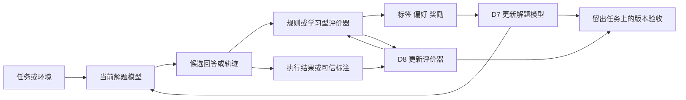

# D7 与 D8：RSI 的循环究竟怎样转动

调研日期：2026-10-28。核心方法论文限定为 2024 年及以后首次公开的工作。

本文承接[昨天的全景手册](../2026-10-27/01_RSI全景与方向判断.md)，聚焦 D7「基础模型参数自改进」与 D8「评价器、奖励与验证能力演进」。先独立检索综述，再回到原始论文核对方法；文献范围不限于昨天的手册。

本次材料分为三份：

- **本文件**：先理解流程、优化信号和跨论文共性，用于会议讨论。
- [02_代表论文的循环拆解.md](02_代表论文的循环拆解.md)：16 篇方法论文，逐篇解释每一轮到底发生什么、信号如何改变模型，以及证据边界。
- [03_综述入口与文献核查索引.md](03_综述入口与文献核查索引.md)：综述的分类贡献、原文版本、阅读位置和进一步阅读顺序。

文中「通用框架」「业务建议」是本次归纳；具体方法的原文依据见对应论文卡片。示例均为帮助理解而设计，不是论文实验。

## 1. 先回答你的核心问题

**不同论文的循环不完全一样，但可以用相同的问题去拆解。** 大部分方法反复完成「产生候选 → 获得反馈 → 转为学习或选择信号 → 更新某个对象 → 用新对象再产生候选」。差异主要在候选是什么、谁判断好坏、什么东西被更新，以及下一轮重新运行哪些环节。

**D7 改的是做题、回答、行动的模型；D8 改的是判断这些行为好坏的能力或机制。** 两者可以使用相同的神经网络训练方法，甚至共享一套参数，但其任务不同。D7 希望模型更会解决问题；D8 希望系统更会识别好答案、坏答案和错误步骤。

这里的“基础模型自改进”主要指在已有预训练模型上做后训练，不代表每一轮都重新预训练一个基础模型，也不默认修改网络结构。

**使用评价器不等于改进评价器。** DeepSeek-R1-Zero 使用固定规则奖励来训练模型，主要属于 D7；Self-Taught Evaluators 反复训练判断能力，才是直接的 D8 循环。GenRM 等论文提供了更好的 D8 组件，但论文中的一次组件训练本身不等于完整的递归自改进系统。

**本次最值得关注的共性，是持续生产“有区分力的反馈”，而不是让所有模块同时自我更新。** 模型如果生成的答案全部同样好或同样差，就很难学到新的区分；评价器如果已经分不清新错误，继续训练可能只会强化偏差。新一轮的数据、评价能力和模型更新必须相互匹配。

这里将“主流做法”理解为多篇公开论文及综述反复采用的技术家族，而不是对企业生产部署比例的统计。公开资料不足以证明某一完整 RSI 架构已经成为企业统一标准。

## 2. 先读综述，得到了哪些共同视角

本次重点核对了五篇综述的框架或相关章节。它们提供了互补的观察角度，并不都把相关方法称为 RSI。

| 综述 | 它怎样组织问题 | 对这次 D7 / D8 调研的作用 |
| --- | --- | --- |
| [Self-Improvement of Large Language Models: A Technical Overview and Future Outlook，2026](https://arxiv.org/html/2603.25681v1) | 数据获取、数据选择、模型优化、推理改进，以及贯穿这些环节的评价层 | 把“生成—反馈—更新”放回完整生命周期；模型优化章节用 Generation–Reward–Optimization 框架分析方法 |
| [Breaking the Reasoning Barrier，ACL Findings 2025](https://aclanthology.org/2025.findings-acl.386/) | 数据演进、模型演进、二者循环构成的自演进 | 解释为什么只讨论优化器不够：搜索和数据质量决定模型能学到什么 |
| [A Comprehensive Survey of Reward Models，2025](https://arxiv.org/html/2504.12328v1) | 偏好收集、奖励建模、奖励使用 | 强制分开“标签从哪里来”“怎样训练裁判”“裁判怎样指导模型” |
| [A Comprehensive Survey on Learning from Rewards，EMNLP Findings 2025](https://aclanthology.org/2025.findings-emnlp.970/) | 训练时、推理时、输出后使用奖励 | 同一个评分器可以训练模型，也可以只选答案；二者不是同一种能力更新 |
| [A Survey of Process Reward Models，2025，正文采用 2026 年 v3](https://arxiv.org/html/2510.08049v3) | 怎样产生过程数据、构建 PRM、使用 PRM | 区分步骤监督、生成式验证、搜索引导，以及它们各自的成本和评价方式 |

从这些分类出发，再核对方法论文，可以得到一个比“算法名字列表”更适合讨论的结构：

```text
共同问题：如何让下一轮比这一轮更有能力？
  ├─ 经验来源：固定题目、自出题、环境交互、搜索
  ├─ 反馈依据：执行结果、参考答案、人工偏好、模型判断、共识
  ├─ 反馈形态：正确样本、优劣对、数值奖励、步骤标签、文字诊断
  ├─ 更新对象：解题模型、判断模型、评价规则/程序、多个对象
  └─ 更新方式：模仿好样本、偏好优化、强化学习、监督训练、离散搜索
```

**这些轴是可以组合的。** 例如，“生成式评价器”和“过程评价器”不是互斥路线：前者讲评价器怎样输出判断，后者讲评价粒度。一个评价器可以先用文字分析每个步骤，再输出该步骤是否正确。

## 3. 附件中的五步图，应该怎样理解

### 3.1 它是一张系统更新图，不是所有论文的统一算法

附件的顺序是：

```text
提出更新 → 实施更新 → 方案评价 → 经验与版本存储 → 选择与采用
   ↑                                                  │
   └───────── 新版本参与下一轮改进 ─────────────────────┘
```

它表达的是“怎样产生并采用一个新系统版本”。论文常写得更窄：给定任务集与训练配方，采样、打分、训练，然后报告实验结果。论文未必实现了自动诊断瓶颈、设计训练方案、版本回滚和线上发布。因此，不能把这五个框自动当作每篇论文都具备的功能。

### 3.2 D7 和 D8 分别在五步中做什么

| 附件环节 | D7：改进解题模型 | D8：改进评价能力 |
| --- | --- | --- |
| 提出更新 | 识别模型在哪些任务上失败，决定采哪些问题、生成多少候选、采用何种学习目标 | 识别评价器在哪些错误上误判，决定增加哪类正反例、改评分标准还是训练判断能力 |
| 实施更新 | 当前模型生成回答/轨迹；获得反馈；构造训练信号；更新模型参数 | 收集待判断的答案/步骤；建立有依据的判断标签；训练评价器，或搜索新的评价规则/程序 |
| 方案评价 | 在未参与训练的任务上比较新旧模型的真实任务效果与成本 | 比较新旧评价器的判别能力，并检查它能否真正帮助解题模型选得更好、学得更好 |
| 经验与版本存储 | 保存采样模型版本、输入、轨迹、奖励来源、训练数据、模型检查点 | 保存被评对象、标签依据、裁判版本、误判类型、评价规则，以及与生成器的对应关系 |
| 选择与采用 | 采用通过评价的新解题模型，下一轮用它采样、交互或搜索 | 采用通过独立校验的新评价器，让它筛选后续数据、引导搜索或提供训练奖励 |

上表是**面向工程落地的统一映射**。具体论文哪些环节自动化、哪些仅由研究者设置，见第二份文件；不要把工程建议误记为论文原有设计。

### 3.3 最容易混淆：循环中有三种不同的“评价”

| 层次 | 评价谁 | 举例 | 评价结果用来做什么 |
| --- | --- | --- | --- |
| 样本反馈 | 一条答案、一个程序、一段轨迹 | 这个程序通过了哪些测试？ | 筛数据、构造偏好对、计算训练奖励 |
| 评价器监督 | 一次判断是否可靠 | 裁判说程序正确，但实际测试失败了 | 训练或选择更好的评价器 |
| 系统版本验收 | 更新后的整个模型/系统 | 新模型在留出任务上是否更好？成本增加多少？ | 决定是否采用新版本 |

**附件中的“方案评价器”主要对应第三层。D8 中训练的奖励模型，通常服务于第一层，它自身又需要第二层监督。** 三层可以使用部分相同的工具，但不应把同一套自评分数同时当作训练依据和成功证明。



这张图表达两个可能耦合的循环。只做 D7 时，D8 更新支路可以不存在；只训练评价器时，D7 更新支路也可以不存在。

### 3.4 “一轮”有四种意思

- **一次任务内的修正**：先回答，再修改。可能完全不更新模型。
- **一次采样与训练轮次**：用当前模型产生一批数据，再更新参数。D7 常见。
- **一次协同更新周期**：先训练评价器，再训练生成器，或者反过来。D7 + D8 常见。
- **一次系统版本迭代**：还包含验收、保存、采用等工程环节。

一轮中可能包含很多梯度更新；一个训练阶段也可能包含很多轮采样。DeepSeek-R1 的多阶段训练配方，不能直接画成“这几阶段永远循环”；SCoRe 的两轮作答，也不能直接理解为两个模型版本。

## 4. 你提出的三个技术问题，统一怎样回答

### 4.1 优化信号：谁提供依据，长什么样，作用到哪里

建议每读一篇论文，都写出下面这一行：

> **依据来源 → 信号形式 → 信号粒度 → 接收信号的对象 → 更新方式。**

例如：

```text
执行测试 → 通过/失败 → 整个程序 → 解题模型 → 强化学习
执行测试 → 裁判判断对/错 → 一次评价输出 → 评价器 → 强化学习
人工偏好 → A 优于 B → 整个回答 → 解题模型 → 偏好优化
已知标签 → 正确判断及其解释 → 评价输出文本 → 评价器 → 监督微调
对照样本 → 新规则比旧规则分得更准 → 评价程序 → 搜索与选择
```

同样一个“正确/错误”标签，可以训练两种不同能力。对于 D7，目标是下次**答对**；对于 D8，目标是下次**判对**。

### 4.2 优化对象与策略空间：不要把三个“空间”混为一谈

| 概念 | 通俗解释 | D7 例子 | D8 例子 |
| --- | --- | --- | --- |
| 候选空间 | 本次可以生成哪些东西 | 各种答案、推理步骤、工具操作 | 各种判断、批评、评分标准或验证程序 |
| 策略空间 | 系统可以采用哪些“根据输入产生输出”的行为方式 | 在问题和历史条件下怎样回答或行动 | 根据问题和候选答案怎样判断、评分、检查 |
| 参数或程序空间 | 实际允许修改哪些东西 | 模型权重或可训练适配模块 | 裁判权重、评分头，或提示/规则/程序 |

对于参数训练，“策略”可以理解为模型在各种输出之间分配概率的方式。一次训练主要改变这份概率分布；通常没有改变模型架构，也没有自动扩大所有可表达策略的范围。

对于 UCoE 这类无参数更新方法，允许变化的是评价程序与记忆。它搜索的是离散对象，不是通过梯度改变语言模型权重。

**所以，更准确的问题是“反馈怎样在给定策略空间内推动改进”，而不是笼统说“反馈优化了策略空间”。** 只有任务生成、工具扩展或结构修改等机制介入，候选内容、动作集合或表达范围才可能另外发生变化。

### 4.3 信号怎样真正造成更新：六种常见连接方式

| 连接方式 | 实际操作 | 学到了什么 | 代表工作 |
| --- | --- | --- | --- |
| 筛选后监督微调 | 留下通过检查的回答，训练模型更容易生成这些回答 | 模仿已经找到的成功解法 | V-STaR 的生成器、ReST-MCTS* 的策略模型 |
| 偏好优化 | 将同一问题的较好输出和较差输出配对 | 相对提高好输出的倾向，降低坏输出的相对倾向 | SPIN、ETO、Self-Rewarding、Meta-Rewarding |
| 强化学习 | 当前模型采样，反馈转为相对优势等权重，再更新生成概率 | 更常生成获得高奖励的行为 | R1、SCoRe、AZR、DeepSeek-GRM |
| 评价器监督学习 | 用已知对错、优劣或步骤标签训练评分/判断 | 从输入中预测质量或生成正确判断 | GenRM、Qwen PRM、Self-Taught Evaluators |
| 搜索引导再学习 | 评价器先决定哪些分支值得展开；搜索结果再用于训练 | 把较昂贵搜索发现的经验吸收到模型中 | ReST-MCTS* |
| 离散候选选择 | 生成若干评价程序，在对照数据上比较，采用较好的版本 | 改变评价逻辑而不改模型权重 | UCoE |

这里的“偏好优化”“监督学习”“强化学习”是机制层面的区分，不需要先掌握所有损失函数。

**特别注意：奖励本身不必可微。** 测试器只返回“通过/失败”也可以训练模型。优化算法利用模型对自己生成内容的概率，把奖励转成更新权重；不需要对测试执行过程求导。

**但一个终局奖励并不等于精确的步骤贡献。** 最终失败只能告诉你整条尝试不够好，不能自动说明第几步导致了失败。过程监督的价值正在这里，代价是更难得到可信的细粒度标签。

### 4.4 一个小例子：相同算法为什么能训练不同角色

以下是解释性例子，不是某篇论文的参数配置。

对同一道题生成四份答案，奖励为 `0、0、1、1`。简单减去组内均值后，得到 `-0.5、-0.5、+0.5、+0.5`：后两份相对较好，训练会倾向于提高这些生成行为的概率。实际 GRPO 还可能有归一化、裁剪、参考策略约束等操作；这些数字只解释“相对优势”的作用。

若改为让裁判对同一个候选答案生成四份评价，其中两份判断正确、两份错误，也能按同样思路构造相对更新权重。但此时被提高概率的是**正确的评价输出**，并不是原来的解题答案。这就是 D7 RL 与 D8 RL 可以形式相似、目的不同的原因。

如果四份都得 `0`，组内相对信号没有区分力。可能需要更合适的任务、更多探索或其他监督，而不是简单增加训练轮数。如果四份都得 `1`，也要检查它们是真的都很好，还是评价器没有辨别出差异。

## 5. D7 的五类循环：共同点与真正差异

### 5.1 类型一：产生候选，筛出好样本，再训练

```text
当前模型 → 多个解法 → 外部检查 → 保留好解法 → 监督微调 → 新模型
    ↑                                                        │
    └────────────────────────────────────────────────────────┘
```

这是最容易理解的路线：模型可能不是每次都能答对，但多试几次能找到一部分正确答案。把这些正确尝试作为下一轮学习材料。

V-STaR 还利用失败解法训练验证器；ReST-MCTS* 用搜索提高好解法的发现率。**这两篇的共同点是“生成器模仿成功”，差异是如何得到成功样本、如何使用失败样本。**

采用条件：可以检验答案，有一定成功率，有足够多未被当前模型稳定掌握的问题。暂缓条件：几乎找不到正确候选，或者所谓正确只是模型自己觉得正确。

### 5.2 类型二：产生优劣对，再做偏好优化

```text
同题多个输出 → 获得相对优劣 → 构造好/坏输出对 → 偏好训练 → 再采样
```

不一定需要一个连续分数，知道“A 比 B 好”就能学习。SPIN 的比较来自人工示范与当前模型输出；ETO 来自成功与失败轨迹；Self-Rewarding 来自模型自评；Meta-Rewarding 还把不同评价意见配成优劣对。

**相同优化器不能消除标签来源的差异。** “执行成功优于失败”和“模型觉得 A 比 B 好”不是同等强度的依据。SPIN 的“人工示范优于模型样本”也是训练假设，不能解释成逐条人工确认的偏好。

采用条件：可靠的相对优劣比精确数值奖励更容易获得。暂缓条件：优劣混杂多个业务目标，或者比较者偏爱长文本等表面特征。

### 5.3 类型三：边采样边用奖励做强化学习

```text
当前模型采样 → 规则/环境/裁判打分 → 计算相对优势 → 更新参数 → 重新采样
```

DeepSeek-R1-Zero 是清楚的代表。评价标准可以固定，而模型采样分布不断变化：旧模型常犯的错误逐渐减少，新一轮出现更难的候选。

同一问题采多个答案时，系统可以比较它们谁更好。若全部得同一个分数，组内相对反馈就很弱。由此自然连到 D5：需要什么难度的任务，才能持续获得有信息量的反馈？

采用条件：可自动获得大量反馈，允许在线生成和训练，任务具有足够探索空间。暂缓条件：环境调用昂贵、反馈延迟很长，或奖励与业务目标明显不一致。

### 5.4 类型四：学习“怎样改正自己的第一版答案”

```text
第一次回答 → 看到自己的回答后修正 → 比较前后成败 → 多轮行为训练
```

SCoRe 说明：只奖励最后答对，模型未必学会纠错，它可能学会第一遍直接作答、第二遍基本不改。作者通过初始化约束和纠错奖励，让“错→对”的行为获得更有针对性的信号，同时抑制“对→错”。

这仍是 D7：训练的是一个条件策略——**看见自己的前次尝试后，怎样作出更好的下一次尝试**。推理时可以不依赖外部纠错意见，但训练时仍有可验证奖励。

采用条件：业务允许多轮尝试，修正错误本身有价值。暂缓条件：第一次行动不可撤回，或者多轮开销超过收益。

### 5.5 类型五：连“出什么题”也一起更新

```text
出题模型/角色 → 候选任务 → 有效性与难度反馈 → 求解 → 更新出题与求解能力
```

AZR 和 R-Zero 都属于 D5 + D7 的交叉，但反馈基础不同。AZR 用程序执行建立验证依据；R-Zero 用求解器多次回答的共识产生伪标签，再交替训练出题器与求解器。

这两篇告诉我们：**循环可以在任务分布上递归，而评价规则本身仍然不学习。** 自动出题、自动训练，不等于 D8 已经实现了可靠的评价器演进。

采用条件：固定题库逐渐失去学习价值，可以验证新题的有效性及其与业务的相关性。暂缓条件：新题是否合理都难以确认，或多数投票错误会被当作真值继续强化。

## 6. D8 的五类机制：先讲“裁判怎样学会判断”

### 6.1 用有依据的标签训练评价器

输入是「问题 + 候选答案」，目标是预测对错或优劣。标签可以来自测试、参考答案、人工评价，而不是让裁判自己的分数成为唯一依据。

GenRM 的关键变化是把验证写成语言生成任务：输出 Yes/No，或者先解释再输出判断。Qwen PRM 则关注每一步是否正确，并研究步骤标签怎样可靠获得。

它们提供 D8 的基础能力，但如果只训练一次，就只是一个组件构建流程。要成为循环，还需要用新生成器产生的新错误继续训练，并验证新评价器仍然可靠。

### 6.2 评价器自己生成评价解释，筛选后再学

Self-Taught Evaluators 先构造预期有优劣差异的答案对，再让当前裁判多次判断。只有判断与构造标签一致的评价输出进入训练；新裁判下一轮重新标注。

这个循环的关键不是“我说自己对，所以我对”，而是**先有一个独立于当次判断的标签构造过程，再筛选模型生成的判断**。不过，构造标签本身仍可能出错，因此需要外部测试集检验。

### 6.3 把“评价任务”本身作为强化学习任务

DeepSeek-GRM 生成评价原则、分析和分数。训练时，数据中已有哪个答案更好等标签；如果生成的分数排序符合标签，就奖励这次评价过程。

与 D7 的 RL 形式相似，但输出对象从“答案”变成“评价”。它不是奖励裁判给更高分，而是奖励裁判**给出更正确的区分**。

### 6.4 再评价“评价意见”，或者让解题与验证共同学习

Meta-Rewarding 比较不同评价意见，用更高一层的模型判断构造裁判学习信号。CoVera 则用程序执行结果监督模型的验证行为，再让该验证能力辅助程序生成。

这两条路线都可能同时改善 D7 与 D8，但信号锚点完全不同：前者仍主要依赖模型判断，后者有执行标签。**增加一个 meta-judge，并不自动消除评价错误；使用执行标签，也不自动保证测试覆盖了所有真实错误。**

### 6.5 不改参数，改评分标准、组合方式与评价程序

UCoE 将评价器表示为可执行的评分程序。它构造“一处质量属性被破坏”的对照样本，比较候选评价程序能否把原回答与劣化回答分开，并关注最薄弱错误类别。

采用新程序后，它会影响回答修正与经验存储。随后根据任务诊断再提出新程序。所有基础模型权重保持固定。

这是 D8 范围比“训练奖励模型”更广的直接例子。该文发表于 2026 年 10 月，适合作为新增视角，不应据此宣称其已具备成熟的业务稳定性。

## 7. 16 篇论文放在一起：哪些循环相同，哪些不同

下表给的是最小机制，不替代原文方法。编号对应第二份文件的论文卡片。

| 编号 / 论文 | 被更新对象 | 主要依据 | 反馈转为更新的方式 | 下一轮真正变化什么 |
| --- | --- | --- | --- | --- |
| P01 SPIN，2024 | 解题模型 | 固定示范与当前模型样本的来源差异 | 对比式偏好目标 | 新模型成为下一轮生成样本的对手 |
| P02 ETO，2024 | Agent 模型 | 任务成功/失败、示范轨迹 | 轨迹偏好训练 | 新 Agent 产生新的探索轨迹 |
| P03 R1，2025 | 解题模型 | 可验证答案、测试；完整 R1 另有其他奖励 | RL，配合分阶段 SFT | 新策略产生新一批回答 |
| P04 SCoRe，2024 | 自纠错模型 | 前后回答的正确性及变化 | 多轮 RL 与奖励塑形 | 新模型改变初答和纠错行为 |
| P05 AZR，2025 | 出题与求解角色 | 执行验证、求解成功率 | 两个角色联合 RL | 题目难度与求解策略一起变化 |
| P06 R-Zero，2025 | 出题器与求解器 | 求解器共识产生的伪标签 | 两阶段交替 GRPO | 下一轮出题器追踪新求解器 |
| P07 Self-Taught Evaluators，2024 | 裁判模型 | 构造的答案优劣关系 | 筛选正确评价后 SFT | 新裁判能为更多案例产生可用判断 |
| P08 GenRM，2024 | 生成式验证模型 | 答案正确标签、训练用参考解等 | 验证与生成的联合监督训练 | 主要是组件能力改善，不自带完整外循环 |
| P09 Qwen PRM Lessons，2025 | 过程评价模型 | 步骤判断与完成采样的共识 | 步骤监督训练 | 主要是数据与 PRM 构建流程 |
| P10 DeepSeek-GRM，2025 | 通用奖励模型；另有 meta RM | 已标注的答案优劣/分数 | 筛选微调 + 评价任务 RL | 新裁判生成更可靠的原则与分析 |
| P11 Self-Rewarding，2024 | 共享回答/评价模型 | 模型按固定量表自评 | 回答偏好训练 | 新模型同时担任下一轮回答者和裁判 |
| P12 Meta-Rewarding，2024 | 共享回答/评价模型 | 自评 + 对评价意见的比较 | 回答对与评价对共同偏好训练 | 两种输出能力都得到显式训练 |
| P13 V-STaR，2024 | 生成器、验证器 | 参考答案或执行检查 | 成功样本 SFT；正负解训练验证器 | 新生成器提供新的正负解；验证器聚合经验 |
| P14 ReST-MCTS*，2024 | 策略模型、过程价值模型 | 搜索树及最终答案检查 | 好路径 SFT；节点价值训练 | 更好模型和价值模型共同改进下一轮搜索 |
| P15 CoVera，2026 | 共享生成/验证模型 | 执行结果与经校准的验证分数 | 两个角色的 RL | 生成器提供新案例，验证器反过来辅助生成 |
| P16 UCoE，2026 | 评价程序与外部记忆 | 受控质量对照、任务诊断 | 程序搜索、验证、采用 | 新评价规则改变后续修正与记忆积累 |

读这张表时，首先横向比较**依据来源**，其次比较**更新对象**，最后才比较算法名字。R-Zero 与 R1 都使用 GRPO，但前者与伪标签一致并不等于后者与可验证结果一致；GenRM 与 Self-Taught Evaluators 都使用 SFT，但后者明确有反复标注和再训练的循环。

## 8. 明天汇报的范围：前面已经回答了什么，还需要总结什么

**你提出的三个技术问题和附件循环，前面已经基本回答完了。接下来需要做的是把答案整理成 D7、D8 各自的子分支，以及这些分支之间的选择关系。** 这部分不再重新提炼整个 RSI 的共性，也不代替同事展开 D5、D6。

| 原始问题 | 前面的位置 | 明天要讲清的结论 |
| --- | --- | --- |
| 优化信号如何设计？ | 第 4.1 节，以及第 5、6 节的具体方法 | D7 的信号告诉模型“怎样做更好”；D8 的信号告诉评价器“怎样判断更准确” |
| 优化对象和策略空间是什么？ | 第 4.2 节、第 7 节 | D7 主要改解题/行动模型参数；D8 可以改评价模型参数，也可以改评价规则与程序 |
| 信号如何优化策略空间？ | 第 4.3—4.4 节 | 信号需转成训练目标或选择标准，才能改变行为概率或评价程序；不是有分数就会自动变好 |
| 附件循环中每一步做什么？ | 第 3 节 | 两者都能映射到五步，但更新对象和验收指标不同；论文未必实现完整的自动版本管理 |
| 不同论文是否使用相同循环？ | 第 5—7 节 | 框架相似，具体反馈箭头不同：可以只更新解题器、只更新裁判，或让两者协同更新 |

明天你的汇报可以围绕一句话组织：

> 我负责 D7 和 D8：先说明模型怎样利用反馈学习，再说明提供反馈的评价能力怎样改进，最后说明两者怎样接到共同的 RSI 循环中。

以下的子分支是**为了会议讨论而整理的分类**，不是重新规定前面论文的学术名称。尤其要区分两个层次：

- **改进对象或能力**：究竟想改好什么。
- **实现机制**：采用什么信号和更新方法来改好它。

例如，“过程评价器”描述评价什么，“生成式评价器”描述怎样输出判断，“强化学习”描述怎样训练。这三者可以出现在同一个系统中，不应当作为三条互斥路线投票。

## 9. D7 汇报总结：模型怎样把反馈变成自己的能力

### 9.1 D7 的一句话定义

**D7 是把经验和反馈转成模型参数的更新，使模型下一轮更会回答、推理或行动。**

它关注的是“拿到经验后怎样学”。题目如何产生、环境如何构建，可以由 D5、D6 提供；D7 不必把这些模块重新设计一遍。

这里的“策略”，可以通俗理解为：模型在给定问题和历史信息后，选择怎样回答或行动的习惯。参数训练改变的是这些行为的概率，而不是每轮都重新设计网络结构。

### 9.2 明天主讲三个基础子分支

这三个分支按**反馈怎样进入模型更新**划分。它们可以分阶段组合，例如先筛选微调，再做强化学习。

| D7 子分支 | 1）优化信号如何设计 | 2）优化对象与策略空间 | 3）信号如何推动更新 | 代表论文与循环特点 |
| --- | --- | --- | --- | --- |
| **A. 筛选成功样本，再监督微调** | 从候选中识别值得模仿的成功答案/轨迹；可以用测试、参考答案或可靠评价器筛选 | 解题模型参数；各种回答、推理路径或行动序列的生成策略 | 把选中的成功内容当训练目标，让模型更容易生成类似行为 | V-STaR、ReST-MCTS* 的策略训练；新模型再次生成或搜索，提供下一轮样本 |
| **B. 根据优劣比较做偏好训练** | 同一任务下构造“较好输出—较差输出”；依据可以是任务成败、人工示范或裁判评价 | 解题/Agent 模型参数；在相同输入下对不同输出的偏好 | 用成对目标提高好输出相对坏输出的生成倾向；不要求必须有精确数值奖励 | ETO、SPIN、Self-Rewarding；各轮重新生成负例或偏好数据 |
| **C. 根据奖励做强化学习** | 对当前尝试给出成功、质量、成本等反馈；奖励需要与真正目标一致 | 当前模型的回答或行动策略；也可包含多轮行为 | 将奖励转为相对优势等学习权重，更新产生这些行为的概率，再重新采样 | R1、SCoRe；采样—反馈—参数更新反复发生 |

**如何通俗讲三者：**

- A：挑出自己已经做对的例子，再学一遍。
- B：比较同一问题的两种做法，学会更偏向好的那种。
- C：不断尝试，根据结果调整以后怎样做。

三者不是从低级到高级的固定升级顺序。选择取决于能得到什么反馈、采样成本和训练条件，而不是“越像 RL 就越适合业务”。

### 9.3 三个分支分别在什么条件下值得讨论

| 分支 | 适合什么条件 | 主要投入 | 暂缓或进一步检查的条件 |
| --- | --- | --- | --- |
| A. 成功样本微调 | 已能产生一些正确答案，而且能可靠筛选 | 候选生成、验证、微调 | 几乎没有成功样本；或筛选依据无法确认正确性 |
| B. 偏好训练 | 比较两个方案谁更好，比给绝对分数容易 | 正负样本、比较标注、偏好训练 | 优劣标准不一致；比较只反映文风而非任务效果 |
| C. 强化学习 | 可以持续探索并自动获得反馈 | 在线采样、环境/裁判调用、训练工程 | 反馈太慢或太贵；奖励与真实目标偏离；探索空间不足 |

这里的投入是相对构成，不是固定成本排名。一次昂贵仿真就可能使候选生成成本超过模型训练成本。

### 9.4 前面讲的“纠错”和“自出题”放在哪里

第 5 节列出的五类循环，是按论文流程展开的。会议上可以收束为上述三种基础更新机制，再加两种可组合的扩展。

| 扩展 | 它额外改变什么 | 与三个基础分支的关系 | 你负责讲到哪里 |
| --- | --- | --- | --- |
| **多轮纠错** | 不只学习一次回答，还学习看见先前尝试后怎样修正 | 可以使用监督、偏好或 RL；SCoRe 是多轮 RL 的代表 | 讲清“错→对”“对→错”等反馈怎样训练修正行为 |
| **自适应任务/课程** | 下一轮练什么随模型能力变化 | 题目来源改变，模型仍需要上述学习机制；AZR、R-Zero 是交叉例子 | 讲清新任务怎样进入 D7，以及 D7 提供什么能力反馈；题目构造交给 D5 |

还可以采用搜索来提高候选质量，例如 ReST-MCTS*。搜索主要改变“先找到什么样的学习材料”，模型是否学会这些经验，还要看后续参数更新。

这样讲，可以保留前面的论文流程，又避免将“训练算法”“纠错能力”“题目生成”混成同一层子分支。

### 9.5 D7 的循环，明天可以这样画

```text
任务与已有经验
    ↓
当前模型产生答案 / 行动轨迹
    ↓
得到成功样本、优劣关系或奖励
    ↓
选一种或组合多种更新方式：
成功样本微调 / 偏好训练 / 强化学习
    ↓
得到候选新模型 → 在留出任务上检验
    ↓
采用有效版本、保留数据与记录
    ↓
新模型参与下一轮生成、探索或搜索
```

**D7 的递归点：新模型重新参与产生下一轮经验。** 如果只拿固定数据训练一次，那是参数更新组件；还不能仅凭这一点说已构成持续 RSI。

评价器可以保持固定。不要因为 D7 用了奖励，就认为 D8 也必然在同步改进。

### 9.6 D7 可以直接用于汇报的一段话

> D7 主要研究模型怎样把反馈学进参数。按学习机制，可以分为三类：筛选成功样本做微调、根据优劣对做偏好训练、根据奖励做强化学习。它们的更新对象都是解题或行动策略，区别在于需要什么监督，以及监督怎样改变模型的行为概率。多轮纠错是学习目标的扩展，自适应出题是与 D5 的衔接，不必作为另外两种互斥训练算法。循环成立的关键，是更新后的模型再次参与经验生成，并通过独立任务验证改进。

## 10. D8 汇报总结：提供反馈的能力本身怎样改进

### 10.1 D8 的一句话定义

**D8 是让系统更会判断什么是好结果、哪里出了问题、什么尝试值得继续，并把这种判断能力用于后续改进。**

D8 的训练信号不是“给被评答案更高分”，而是“让评价更准确、更有用”。它的被优化对象是评价能力或评价机制。

明天建议先按**改进哪种评价能力/对象**分三个主分支，再补充它们可以采用哪些训练方法。这样比直接把 PRM、生成式裁判、RL、自评放在一排更清楚。

### 10.2 三个主分支，分别回答三个问题

| D8 子分支 | 1）优化信号如何设计 | 2）优化对象与策略空间 | 3）信号如何推动更新 | 代表论文 |
| --- | --- | --- | --- | --- |
| **A. 完整答案与结果评价能力** | 为整个答案建立对错、优劣或质量依据；据此检查裁判判断是否正确 | 评价模型参数；面对问题与完整答案时如何打分、比较或给出判断 | 监督学习正确判断；用评价偏好训练；或用判断准确性奖励训练裁判 | Self-Taught Evaluators、GenRM、DeepSeek-GRM |
| **B. 过程与中间状态评价能力** | 针对某一步或某个前缀建立标签：步骤是否正确，或继续下去是否有希望；两者必须区分 | 过程评价/价值模型参数；怎样判断每一步或部分解 | 用步骤标签或搜索得到的价值目标训练，再用于定位错误、筛选或引导搜索 | Qwen PRM Lessons、ReST-MCTS* |
| **C. 评价规则与验证程序** | 判断一套评价标准或程序能否区分已知好坏案例，以及是否覆盖关键错误 | 评分标准、标准组合、聚合规则、评价程序等离散对象；可保持模型权重不变 | 提出候选规则/程序，在校验案例上比较，采用有效改动 | UCoE |

这三类按主要改进对象区分，仍可以组合。例如，用规则检查硬约束，再让学习型裁判评价难以形式化的内容。这里不是建议模型自行改写业务目标，而是在既定目标下改善判断方式。

对于 B 类，会议上只需要讲清两种目标，不必展开公式：

- **步骤正确性**：当前这一步有没有逻辑或约束错误。
- **状态价值/进展**：从这里继续，是否有希望完成任务、是否更接近成功。

它们都能指导后续行为，但不能把“以后仍可能成功”当作“当前每一步都没有错”。

### 10.3 “生成式裁判”“自训练”“元评价”应怎样放进分类

这些是实现 D8 的不同维度，**不与上面三个主分支一一对应，也不是互斥选项**。

| 维度 | 可选做法 | 通俗解释 | 与前文的对应 |
| --- | --- | --- | --- |
| 输出形式 | 直接给分；生成分析再判断 | 裁判只输出结果，还是先解释判断依据 | GenRM、DeepSeek-GRM 的生成式评价 |
| 数据获得方式 | 外部标签；构造对照；当前模型的新错误 | 用什么材料教裁判 | Self-Taught Evaluators、CoVera |
| 更新方式 | 监督训练；偏好训练；RL；规则搜索 | 评价反馈怎样改变裁判或程序 | 第 6 节的各类机制 |
| 循环组织 | 独立更新裁判；生成器与裁判共同更新 | 裁判改进以后是否与解题器形成反馈回路 | Meta-Rewarding、CoVera、ReST-MCTS* |

例如，可以有一个“**评价完整答案 + 生成分析后判断 + 用执行标签训练 + 与生成器共同更新**”的系统。这是一个组合方案，不是同时选择了四条相互冲突的路线。

第 6 节按方法流程讲了五种机制；这里把它们重新组织成会议需要的“评价对象—实现方式”两层，方便讨论资源应投向哪种能力。

### 10.4 D8 中，谁来判断裁判有没有进步

这是 D8 最需要补充说明的地方。若裁判自己认为自己更准确，并不足以完成验证。

| 评价器的学习依据 | 实际能提供什么 | 需要保留的限制 |
| --- | --- | --- |
| 执行、测试、参考答案 | 可复核的结果标签 | 测试可能不完备；最终答案对不等于过程无误 |
| 人工/专家偏好与标注 | 对专业质量和难以形式化目标的判断 | 标注成本、意见差异、覆盖范围 |
| 人为构造的质量对照 | 已知某个属性被改善或破坏的样本 | 构造差异未必覆盖自然发生的错误 |
| 模型或元裁判判断 | 可扩展的自动评价信号 | 仍可能共同犯错；增加一层裁判不等于获得真值 |

**D8 要有两类检查：裁判是否判得更准，以及它是否真的帮助后续系统做得更好。**

举例：裁判在回答比较数据上准确率提高，但用它筛出的训练数据反而使 D7 变差，就不能仅根据裁判分数宣布整个闭环成功。同样，若声称学会了步骤识错，就要测错误定位，不能只测最终答案挑选。

### 10.5 D8 各分支的采用条件

| 分支 | 什么需求下优先讨论 | 主要投入 | 什么时候暂缓 |
| --- | --- | --- | --- |
| A. 完整答案评价 | 需要挑选方案、筛训练数据或提供整体奖励 | 有依据的答案对错/优劣数据、裁判训练与调用 | 尚无可靠校验案例；固定规则已足够且学习型裁判无额外收益 |
| B. 过程评价 | 最终结果太稀疏；需要定位错误或指导中间搜索 | 分步数据、标签/完成采样、过程评价集 | 无法定义有意义的步骤；只有终局指标且无法检验中间标签 |
| C. 规则/程序演进 | 错误类型和任务需求变化，固定评分标准不足 | 对照案例、候选生成、程序校验、版本比较 | 无法判断新标准是否更可靠；少量对照不足以代表真实需求 |

生成式判断可以提高表达和分析灵活性，但会增加推理成本；过程评价粒度更细，但标签更难建立。明天不需要预先选“最先进”的组合，而要明确每种投入解决什么问题。

### 10.6 D8 的循环，明天可以这样画

```text
收集待评价的答案 / 步骤，以及当前评价器的误判
    ↓
建立对错、优劣、步骤标签或质量对照
    ↓
训练评价模型，或提出并比较新的评价规则/程序
    ↓
得到候选新评价器
    ↓
独立检查：
是否更会判断？是否帮助选答案、筛数据或指导学习？
    ↓
采用有效版本，保存判断依据与误判记录
    ↓
用新评价器处理新候选，并积累下一轮改进材料
```

**D8 的递归点：新评价能力用于后续判断，新的判断任务和误判又推动下一轮改进。** 一次训练好的奖励模型只是组件；反复调用一个固定奖励模型，也不等于它在自我改进。

### 10.7 D8 可以直接用于汇报的一段话

> D8 研究的是反馈本身怎样更可靠。按改进对象，我把它分为完整答案评价、过程与中间状态评价、评价规则或程序演进。每类都需要回答：用什么依据判断裁判对不对，实际修改裁判的什么部分，以及怎样验证它对后续任务有帮助。生成式判断、监督训练、强化学习和元评价是可以组合的实现方式。D8 不一定改模型参数，也不一定必须与 D7 同时更新，但只反复使用固定裁判还不能称为评价器自改进。

## 11. 把 D7、D8 放回附件：两个循环怎样对应、怎样相连

### 11.1 五步图的会议版对照

| 附件中的步骤 | D7 更新解题模型 | D8 更新评价能力 |
| --- | --- | --- |
| **提出更新** | 根据失败任务决定要学习哪些行为、采用哪类反馈 | 根据误判决定补哪些案例、改判断模型还是评价规则 |
| **实施更新** | 采样并获得反馈，做成功样本微调、偏好训练或 RL | 构建评价监督，训练裁判，或搜索新的评价程序 |
| **方案评价** | 在留出任务上检查新模型是否更会做事 | 在留出案例上检查新裁判是否更会判断，并检查下游收益 |
| **经验与版本存储** | 保存轨迹、信号来源、训练数据和模型版本 | 保存被评对象、标签依据、误判与评价器版本 |
| **选择与采用** | 有效新模型进入下一轮经验生成 | 有效新评价器进入下一轮数据筛选、搜索或奖励计算 |

这张表是面向会议的统一映射。具体论文可能只实现其中一部分，不能把完整工程验收和回滚都当作论文已有功能。

### 11.2 两个反馈方向，用一个例子说清楚

假设模型生成两个程序：A 执行成功，B 执行失败。

- **用于 D7**：学习更常生成成功程序 A，或者学习 A 优于 B。
- **用于 D8**：学习把 A 判断为通过、把 B 判断为失败；若裁判把 B 判为正确，就用这个错误改进裁判。

当两者连接时：

```text
D7 新模型 → 产生新的待评答案与错误案例 → 支持 D8 改进
D8 新评价器 → 筛数据、选路径或提供奖励 → 支持 D7 改进
```

但第二条箭头需要有具体实现：是裁判选了训练数据，还是提供 RL 奖励，还是引导搜索？只说“互相促进”还不够。

### 11.3 明天应该区分的三种系统安排

| 安排 | 适合讨论什么 | 代表例子或边界 |
| --- | --- | --- |
| **先固定评价，改 D7** | 已有可信验证方式，主要瓶颈是模型不会做 | R1-Zero 说明固定规则也能驱动模型更新 |
| **先固定生成器，改 D8** | 已能产生多种候选，但选不出好的、判不清错误 | GenRM 等组件研究有助于理解这条路线；仍需接上持续更新才成为循环 |
| **D7 与 D8 协同更新** | 生成器错误分布变化，评价能力需要跟进 | ReST-MCTS*、CoVera 等有具体的双向连接；V-STaR 不应被强行画成相同结构 |

不需要为了 RSI 的名义，一开始就让两边同时变化。先分别证明解题能力和评价能力的收益，再讨论耦合，通常更容易判断投入是否有效。这是本次面向业务的建议，不是论文证明的唯一实施顺序。

### 11.4 与同事负责的 D5、D6 怎样衔接

你只需留出接口，具体子分支由同事汇报。以下是分工讨论方式，不是断言所有论文都如此划界：

| 同事负责的方向 | 你需要向对方确认什么 | D7 / D8 能提供什么反馈 |
| --- | --- | --- |
| **D5：数据、任务与课程** | 会提供哪些任务、候选或标签？能否按模型能力调整难度？标签依据是什么？ | D7 提供成功率与薄弱能力；D8 提供误判类型、标签可靠性和需要补充的案例 |
| **D6：环境与反馈相关能力** | 哪些结果能执行或仿真验证？返回最终结果还是过程观察？成本多高？ | D7 提供需要探索的行为；D8 提出必须验证的错误类型与判断依据 |

可以这样交接：

> 我这边已经梳理了模型怎样学习，以及评价能力怎样更新。接下来需要和 D5 对齐学习材料及标签，与 D6 对齐可验证反馈和成本，再共同选出能闭合的方案。

这一页就足够连接四个方向，不需要你重新总结 D5、D6 的内部技术路线。

## 12. 明天会议的汇报提纲：约 8—10 分钟

建议用下面六页组织内容。重点是“子分支 + 三个问题 + 循环”，不逐篇念完 16 篇论文。

### 第 1 页：负责范围与两个问题，约 1 分钟

**页上写：**

- D7：怎样让模型更会做？
- D8：怎样让系统更会判断？
- 二者分别说明：信号、更新对象、更新机制、循环。

**可以这样讲：**

> 今天我负责 D7 和 D8。D5、D6 由同事展开。我先把“学习做事”和“学习判断”分开，再看两者如何接到共同流程中。

### 第 2 页：D7 三个基础子分支，约 2 分钟

直接使用第 9.2 节的表。选择两个例子即可：

- ETO：成功与失败轨迹形成偏好。
- R1：当前模型采样后，根据可验证奖励更新。

补一句：成功样本微调是另一种基础方式；多轮纠错与自适应任务可以叠加，不是互斥的训练算法。

**这一页要让听众知道：D7 的选择首先取决于能拿到哪种反馈。**

### 第 3 页：D8 三个主分支，约 2 分钟

使用第 10.2 节的表：

- 判断完整答案。
- 判断步骤或中间状态。
- 改进评价规则与程序。

用 GenRM 与 Qwen PRM 对照解释“完整答案”和“过程”即可；UCoE 用一句话说明评价机制也可以在不改权重时演进。

**这一页要让听众知道：先选需要哪种判断能力，再选生成式、监督训练、RL 等实现方式。**

### 第 4 页：同一个循环，两种更新对象，约 1—2 分钟

使用第 11.1 节的五步表，再讲 A 成功、B 失败的例子：

> 同一份执行结果，对 D7 是学习怎么做，对 D8 是学习怎么判。D7 新模型可以给 D8 提供新案例，D8 新评价器可以给 D7 提供更好的筛选或奖励，但必须把这两条箭头具体实现出来。

### 第 5 页：本轮建议优先讨论什么，约 1 分钟

此时业务细节尚未明确，不直接宣布最终选型。可以提出以下讨论顺序：

1. D7：现有反馈更适合成功样本学习、偏好训练还是 RL？
2. D8：当前更缺整体判断、过程判断，还是评价标准覆盖？
3. 哪些模块先固定，哪些模块真的需要循环更新？
4. 与 D5、D6 对齐后，哪一种组合能形成可验证、成本可承受的闭环？

### 第 6 页：希望会议形成的结果，约 1 分钟

会议产出可以是一张候选组合表，不必当场确定训练算法细节：

| 待讨论项 | 希望形成的结论 |
| --- | --- |
| D7 子分支 | 哪些保留为候选，哪些因反馈或资源条件暂缓 |
| D8 子分支 | 优先建设哪种评价能力，是否需要更新模型参数 |
| 反馈依据 | 来自执行、专家、参考答案还是模型判断，哪些仍不确定 |
| 循环安排 | 先只更新 D7、先只更新 D8，还是研究协同更新 |
| 与 D5、D6 的接口 | 下一步需要什么数据、任务、环境能力和成本信息 |

**你的汇报收尾可以是：**

> D7 和 D8 的流程与主要子分支已经梳理清楚。下一步不必直接进入某篇论文的细节，而是结合 D5 的数据与任务、D6 的环境与反馈，先确定我们有依据支持哪些学习和评价方式。这样就能把四个方向拼成几种可比较的方案，再逐个深入。
